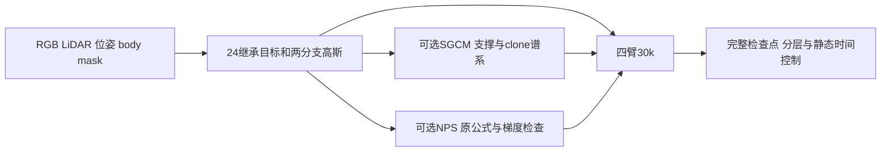

# 2024继承目标与30k消融

按用户最新规则保留2024活跃机制，原始动态alpha完整MSE、静态RGB、寿命/速度及深度衰减为共同基础；只切换corrected SGCM和原公式NPS。每臂从零30k，10k/20k/30k完整检查点；C00/G10/N01/GN11共120k步。



远端准备根目录为`/root/autodl-tmp/drivingeditor_repro/campaign/hybrid30k_20261012/`，不覆盖原S/V/作者代码。CPU准备不导入renderer、不加载模型；第三方完整源码留在该远端checkout，本Git目录只放工具、局部helper和策略。

默认只检查：

```bash
/root/autodl-tmp/envs/drivingeditor/bin/python -B tools/run_matrix.py
```

用户开GPU后由当前聊天执行：

```bash
/root/autodl-tmp/envs/drivingeditor/bin/python -u tools/run_matrix.py --run
```

实际可用`tools/start_matrix.py --run`启动独立会话，SSH断开后控制器继续运行；默认不带`--run`仍只检查。`tools/inspect_matrix.py`只读取进度/显存摘要，不导入torch或模型。用户授权每小时检查，控制器自行串行训练，不持续轮询。

`memory_monitor.py`记录初始化、training（含嵌套子阶段）、梯度诊断、checkpoint、photo_eval与static_time_eval。每秒nvidia-smi采样使用绝对路径和Linux posix_spawn，无fork回退；每100步保存allocated/reserved累计峰与阶段耗时。原后台fork版本的一次0步初始化停滞已保留，CPU7项与新版GPU首步通过。日志入口是各臂`memory_summary.json`、`memory_samples.jsonl`与`memory_phases.jsonl`；终态以`close()`写出的独立memory_summary为准。完整四臂30k覆盖前不认证24GiB3090可运行性。

GPU计算由同一`gpu_slot.lock`独占，四臂worker串行运行，失败不自动重跑/改配置/删旧资产。GPU环境沿用编译rasterizer对应的DrivingEditor Python3.9；CPU源码生成使用motionproj Python3.10。现有raw-body mask缺shadow，49帧属于开发重建视图；质量、完整GPUcheckpoint恢复及作者完整预处理仍未验收。

完整机制继承表、预算、输入角色、组件图、SGCM区域测量和证据见[实验协议](../../../../docs/v82/DRIVINGEDITOR_HYBRID30K_PLAN.md)。
