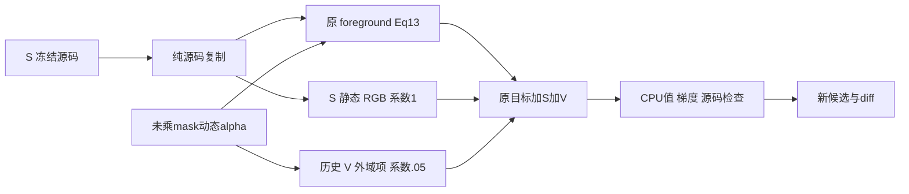

# S+V 2k 候选 CPU 准备

从实际 S frozen repository 新建 `/root/autodl-tmp/drivingeditor_repro/campaign/resume_sv_20261012/frozen_repository`，拒绝覆盖。只改 `train.py` 并新增 `utils/resume_sv_losses.py`；完整第三方源码留在远端，Git 只保留准备工具、计划与局部 diff。



两域监督明确为：保留原 foreground `-mean[Md*(1-a)*log(a)]`，其中 `a=clamp(raw_alpha,1e-4,1-1e-4)`、权重 `.05`；外域精确复用历史 V 的 `-mean[(1-Md)*a*log1p(-a/(1+1e-4))]`，其中 `a=clamp(raw_alpha,0,1)`、权重 `.05`。二者分母都为全 `H*W`，均读取 premask 前的渲染 alpha。mask 沿用现有 body-only 二值外观 mask，仍缺阴影；V 是工程诊断项，未认证为作者公式。

使用现有 motionproj Python 3.10，单线程 CPU 执行：

```bash
CUDA_VISIBLE_DEVICES= OMP_NUM_THREADS=1 /root/autodl-tmp/envs/motionproj/bin/python -B prepare_candidate_cpu.py
CUDA_VISIBLE_DEVICES= OMP_NUM_THREADS=1 /root/autodl-tmp/envs/motionproj/bin/python -B check_source_cpu.py --candidate-dir /root/autodl-tmp/drivingeditor_repro/campaign/resume_sv_20261012/frozen_repository --output /root/autodl-tmp/drivingeditor_repro/campaign/resume_sv_20261012/source_cpu_checks.json
```

计划从 saved30k 运行 30,001–32,000 共 2,000 步，`args.iterations` 和 LR horizon 保留 50k、seed0、FRONT raw0–48 的49帧，并对齐 B1 全2000步 camera/time_shift/LR 参考。CPU准备不加载四件共约2.78GB的 checkpoint；GPU restore、采样轨迹复核、评价与终态保存仍待新的 harness 接入。

候选两个训练入口都直接拒绝未绑定的 GPU 训练。没有 GPU launcher；旧 binding、旧审批或环境变量不能解除该状态。`candidate_plan.json` 只记录待执行设计，CPU测试通过不代表 GPU harness 已接入或训练已经完成。
