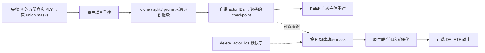
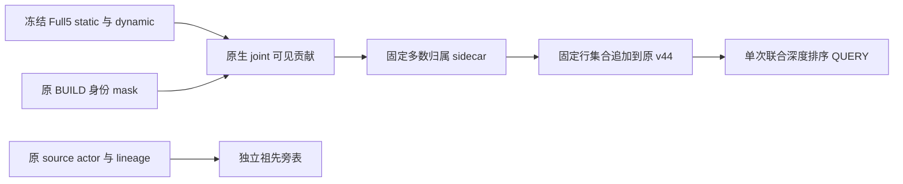
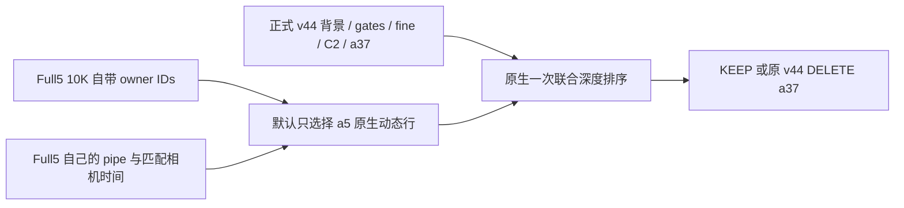

# 共享可编辑场景接口

新场景使用显式数据清单和 `v44_cli`。帧数、相机、原始轨迹、对象编号、表面及删除请求均从数据传入；公共代码不内置开发街段或逐帧例外。[完整组件图、输入边界与API说明](../../../docs/autoresearch/waymo_allframes_v44_20261109/V44_SHARED_PIPELINE_CN.md)。这表示代码入口可复用，不代表自动化或跨场景画质已经通过。

```bash
PYTHONPATH=scripts/worldsim_v82 python -m drivingeditor_dynamic_edit.v44_cli inspect --manifest scene.json
PYTHONPATH=scripts/worldsim_v82 python -m drivingeditor_dynamic_edit.v44_cli render --manifest scene.json --query query.json --diagnostic-branch-alpha --output new_output
```

`scene.json`使用`v44.scene.v1`，明确保存图像名、帧key、模型时间、真实采集时间、track与actor的双向登记、原生引擎与模型。`query.json`独立指定`delete_track_ids`，空删除集合为共享场景KEEP。V1对照另走原始渲染器直通，不能用编辑API的KEEP冒充。逐帧PNG、float NPZ与来源清单按真实帧key关联。

输入处理包括实测投影、多表面可见性、SAM图像遮挡物认证、时序断链与同帧回退；车辆前景与身份未知分别保存。无实测正点不等于背景；空三维框不作不透明遮挡。`v44_native_inputs`使用显式登记和原生像素深度比较初始化，保留完整动态alpha监督。标定、测距、轨迹、已接受mask与seed仍是输入依赖，不能声称从任意未标注录像全自动得到身份。

`v44_calibrate`冻结跨时刻可见质量归属；`v44_vehicle_prior`、`v44_vehicle_surface`与`v44_vehicle_material`恢复对象局部表面；`v44_road`与`v44_gate_fit`恢复世界道路并拟合固定静态交接。各模块接受显式路径/身份，依赖的引擎、预训练模型与原生稀疏算子须由清单固定。查询阶段不训练，不按请求改变表面交接，一次联合排序后渲染。

`v44_integration.py`、`v44_query.py`以及以下五身份/49帧内容是开发街段的历史回放，继续保留；不是新场景的通用默认入口。

# 历史原生来源身份接口

`dynamic_actor_ids` 声明完整五身份建模集合。全部真实 PLY 与原 union masks 进入原生联合重建，clone、split、prune 保持每个动态高斯的来源 actor 与谱系，checkpoint 自带完整恢复信息。来源记录可靠，并不保证训练后每个高斯只解释该语义车辆。主要输出是 KEEP 完整车体，车顶与挡风玻璃按真实重建图验收。`delete_actor_ids` 是独立的可选查询，默认空集合，不决定哪些车辆进入静态分支。



初始化后，按 loader 的实际 PLY 行顺序调用 `bind_initial_ownership`。例如原 Full5 的输入顺序为 `[5,26,18,6,37]`，与公开集合 `[5,6,18,26,37]` 的排序无关。原生 clone/split/prune 通过真实父索引维护谱系；checkpoint 同时保存来源 actor 表和当前逐行 actor ID，并交叉验证。

```python
install_identity_serialization()  # 在创建/恢复动态模型之前
# 仅 fresh 初始化时绑定，counts 来自实际输入 PLY 行数。
bind_initial_ownership(dynamic, [(5,21358),(26,15193),(18,2444),(6,11625),(37,98452)],
                       dynamic_actor_ids=[5,6,18,26,37])
keep = render_scene(camera, static, dynamic, args, background,
                    dynamic_actor_ids=[5,6,18,26,37], delete_actor_ids=[], env_map=env)
deleted = render_scene(camera, static, dynamic, args, background,
                       dynamic_actor_ids=[5,6,18,26,37], delete_actor_ids=[37], env_map=env)
```

原 Native API 按 checkpoint 的来源 actor 标签筛选，不能由来源标签推断当前语义纯度；v44 的当前语义接入使用下述显式 sidecar 入口。KEEP 直接调用原生函数。DELETE 只在每次调用私有的 `prepare_rasterization` 输出上相交动态 mask，随后使用原生 joint rasterizer。模型参数、opacity、优化器和共享模块 globals 均不改写，背景与保留车辆共同参与原深度排序。

没有身份/谱系的旧混合权重不能作为可逐 actor 编辑的 checkpoint 加载；仍可用原始 renderer 做整体 KEEP 参考。身份过滤通过、参数不变和图像质量分别验收：背景若学有车辆残影，不额外删除背景或绘制补洞来隐藏它。

新 Full5 checkpoint 必须使用本模块的 metadata-aware loader。旧 a6/a37 helper 将 lineage 区间硬编码为两辆车，不能解释新五身份的 source IDs，否则会错绑身份。推理身份来自 checkpoint 自带的来源表和当前行标识，无需原 PLY；公开集合顺序不改变已保存 ID 的含义。`render_scene` 会拒绝声明集合与已训练模型不一致的调用，缺失、未知或损坏的身份格式同样拒绝。

仓库提供直接可用的重建/身份 CLI。`dynamic_actor_ids` 从 checkpoint 只读加载；只设置删除集合，默认空集合为 KEEP。默认只渲染 97/105/109 三帧以检查 a5 重建，完整49帧必须显式选择。

```bash
python -m scripts.worldsim_v82.drivingeditor_dynamic_edit.query \
  --model /absolute/model --iteration 5000 --describe
python -m scripts.worldsim_v82.drivingeditor_dynamic_edit.query \
  --model /absolute/model --iteration 5000 --output /new/keep
python -m scripts.worldsim_v82.drivingeditor_dynamic_edit.query \
  --model /absolute/model --iteration 5000 --delete-actor-ids 37 --output /new/delete37
python -m scripts.worldsim_v82.drivingeditor_dynamic_edit.query \
  --model /absolute/model --iteration 5000 --delete-actor-ids 6 37 --scope all49 --output /new/delete6_37
```

也可使用 `--config query_example.json`，命令行参数覆盖配置值。CLI 不创建优化器、不训练、不读取原始点云或 mask；输出逐帧 PNG 和记录实际建模集合、删除集合、帧范围与参数只读验证的 `query.json`。KEEP 的车顶/挡风玻璃质量单独按实际重建图验收，不以总 alpha 或身份数代替。

可用 `export_inference` 导出只读推理包：Gaussian 保留18tuple全部参数、身份和谱系，仅去掉 Adam 的 `state`/`param_groups`；环境 checkpoint 原样保留。包内配置和 manifest 明确标记 `inference_only`，不支持训练恢复。完整 Adam/RNG 训练现场保留在原目录。

```bash
CUDA_VISIBLE_DEVICES='' python -m scripts.worldsim_v82.drivingeditor_dynamic_edit.export_inference \
  --model /absolute/full-training-model --iteration 10000 --output /new/inference-package
python -m scripts.worldsim_v82.drivingeditor_dynamic_edit.compare_inference \
  --original /absolute/full-training-model --inference-package /new/inference-package \
  --iteration 10000 --output /new/equivalence.json
```

导出先逐字段 CPU 验证，再以97/105/109原生 KEEP RGB、alpha、可见身份贡献以及逐点 actor IDs 精确比较。推理包无需原 PLY、mask 或观测 RGB；仍需要兼容的原生 CUDA 引擎与本 metadata-aware loader。

## 推荐 v44 入口：显式语义身份 QUERY

来源 actor/lineage 是祖先记录，不能保证当前高斯只解释同一语义车辆。`SemanticActor5V44Integration` 使用独立 sidecar：在冻结 Full5 static+dynamic 的原生联合排序中，用原 BUILD a5 mask 与补集的可见 alpha*T 质量估计归属；固定 `inside/total > 0.5` 且 `total > 0`，保留未观测项，不猜填。只接受明确登记的四帧 `[94,105,130,137]` 或完整49帧 BUILD 统计，不将其当作独立验证集。



新模式显式构造，不改变旧模式默认。它可同时选择 Full5 static/dynamic 行并统一标为估计语义5；即使一行原来源是37，其原 ancestry 仍原样保存，不能把语义5贡献说成“全部来源37已消失”。原 v44 static、road/gates、fine、C2 和原 a37 路径保持，不启用静态来源退役。`retire_legacy_static_actor5` 是另一个默认关闭的来源诊断选项；来源后代不等于语义真值，不能由此推断可安全删除背景。

sidecar 必须保留完整 inside/total 质量 NPZ，loader 重算固定判据并核对两份权重 SHA、行序和数量。原 actor/lineage 旁表与语义 row IDs 分开。身份包带坐标变换副本和代码快照，但仍需要原 v44 冻结依赖、Full5 inference10k 权重与兼容 CUDA 环境。新增 a5 行选择和当前估计语义只用固定 sidecar，不使用当帧 a5 掩码或 GT 决定行、裁剪输出；原 v44 输入读取依赖保持，其 obs 档案仍可能包含并读取 RGB、actor_labels 等字段。QUERY 不训练、不校准、不创建优化器。sidecar 绑定固定 checkpoint；父 checkpoint、拓扑或权重变化时拒绝加载，需要重新校准。它不会自动随未来增密或裁剪更新。

推荐 API 同样要求显式模式；先按原合同创建唯一的 `base_v44`：

```python
from scripts.worldsim_v82.drivingeditor_dynamic_edit.v44_integration import SemanticActor5V44Integration
runtime = SemanticActor5V44Integration(
    base_v44,
    semantic_sidecar_path=run / 'semantic_actor5_calibration49/semantic_actor5_manifest.json',
    full5_model=inference10k,
    full5_transform_path=run / 'contract/full5_transform_matrix.txt',
)
keep = runtime.render_scene(105, delete=False)
delete_a37 = runtime.render_scene(105, delete=True)
```

公用入口 `v44_query` 默认四帧 `[94,105,130,137]`、两状态，要求新输出目录。原通用 Full5 `query` 入口仍保留，两者用途独立。

```bash
SCENE008_RUN=/root/autodl-tmp/drivingeditor_repro/campaign/scene008_v44_full5_integration_20261107_r1
python -m scripts.worldsim_v82.drivingeditor_dynamic_edit.v44_query \
  --semantic-sidecar "$SCENE008_RUN/semantic_actor5_calibration49/semantic_actor5_manifest.json" \
  --transform "$SCENE008_RUN/contract/full5_transform_matrix.txt" \
  --scope pilot --state both --output /new/semantic_pilot
python -m scripts.worldsim_v82.drivingeditor_dynamic_edit.v44_query \
  --semantic-sidecar "$SCENE008_RUN/semantic_actor5_calibration49/semantic_actor5_manifest.json" \
  --transform "$SCENE008_RUN/contract/full5_transform_matrix.txt" \
  --scope all49 --state delete --output /new/semantic_delete49
CUDA_VISIBLE_DEVICES='' python -m scripts.worldsim_v82.drivingeditor_dynamic_edit.v44_query \
  --semantic-sidecar "$SCENE008_RUN/semantic_actor5_calibration49/semantic_actor5_manifest.json" --describe
```

可显式传 `--model` 指向同 SHA 的 Full5 inference10k 副本，`--save-float` 保存原生 float。raw105 DELETE 的实际公用 CLI 已与配对渲染 PNG 逐字节复核；该工程等价不代替所有帧的画质验收或隐藏真值验证。

## 历史来源加法与退役诊断（非推荐路径）

本节保留已测失败的来源 actor 加法与静态来源退役路径，便于精确复放。默认不开启退役不表示此路径被推荐；当前 v44 接入应显式使用上方语义 sidecar 类或公用 CLI。

`v44_integration.Full5V44Integration` 保留正式 `scene008_v44_rgb_asset_20261107_r1` 的 static、environment、road1K/gates、fine11×9、C2/SurfaceLOD 和原 a37 路径，默认只追加 Full5 checkpoint 自带身份所选的 a5 动态高斯。a18/a26 保持原 v44 表示；Full5 a6 不叠加（继续由 C2 代表），Full5 a37 不叠加（继续沿用 v44 的 KEEP/DELETE）。较新的 R0 道路候选未采用，不作为本接口底座。



先按原方法创建一个 v44 runtime，再包装。每个独立 worker 只创建一套底座；适配器只加载 Full5 dynamic，用私有模型子类恢复身份，避免覆盖旧 v44 共用类的 lineage hooks。Full5 相机、时间、锚点和 world-to-model 与 v44 精确核对，原 static gate 索引始终只应用于原 static。

```python
from pathlib import Path
import sys
campaign = Path('/root/autodl-tmp/drivingeditor_repro/campaign')
v44 = campaign / 'scene008_v44_rgb_asset_20261107_r1'
sys.path.insert(0, str(v44 / 'source'))
from v44_runtime import V44Runtime
from scripts.worldsim_v82.drivingeditor_dynamic_edit.v44_integration import Full5V44Integration

base = V44Runtime(v44 / 'contract/input_contract.json')
runtime = Full5V44Integration(
    base,
    full5_model=campaign / 'scene008_full_dynamic_edit_20261107_r1/inference10k',
    iteration=10000,
    added_actor_ids=(5,),
)
keep = runtime.render_scene(105, delete=False)
delete_a37 = runtime.render_scene(105, delete=True)
receipt = runtime.receipt()  # 只读模型/资产/输入检查；0 optimizer、0 updates。
```

必需输入为原 v44 合同的全部冻结依赖，以及 Full5 的动态 checkpoint、effective_config、cameras、actual_scene_binding 和已保存的 `transform_matrix.txt` 坐标元数据。变换元数据默认从 Full5 config 的 source_path 读取，也可用 `full5_transform_path` 指向其独立副本。actor 身份只来自 checkpoint，不依赖原 a5 PLY、actor mask 或 GT 来选择行。原 v44 仍按原合同读取其已有相机、姿态和资产依赖。

`scene(raw, delete=...)` 后可将同一对象传入 `render(raw, scene)`，保证审计的 rows 正是实际光栅化输入。24 个 feature 保持原 ABI，输出七个固定 joint alpha*T 槽（asset、a37、road、native_static、a5、a18、a26），及 `added_owner_rgb_T` 中按 `[5,18,26]` 排列的三个 RGB*T 槽；未选的 actor 槽为零，meta/receipt 的 added_actor_ids/rows 只列实际追加者。不提供或伪造原四组 RGB 分解。不做前景优先、屏幕拼图、像素 mask 剪裁或新颜色拟合。

最初 `(5,18,26)` 三车混合的四帧候选已保留，保护域回退且视觉未通过；不能作为已接受输出。需要复现该失败时显式传 `added_actor_ids=(5,18,26)`。默认收紧为 `(5,)`，其余车辆维持正式 v44，仍须单独完成同四帧验收。

这仍是显式混合表示：旧 static 可能已学到保留车辆内容，追加动态行后的遮挡冲突需由 105/113/130/137 四帧真实 pilot 检查，再决定完整49帧。此接口不会按几何邻域或预测 mask 猜测并删除旧 static，也不以身份贡献代替车体与道路图像验收。
