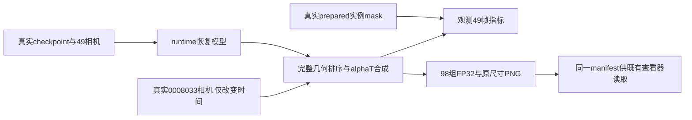

# 恢复后场景评估契约

`evaluate_scene.py`默认只读校验真实scene spec、49帧身份和全部49×K已知mask，不导入Torch、不查询GPU、不创建输出。CPU预检只确认checkpoint文件存在；内容、step和模型恢复在取得共享GPU锁后验证。实际执行与质量只由对应运行凭据认证。



```bash
python evaluate_scene.py --spec ACTUAL_SPEC --checkpoint ACTUAL_30K_CHECKPOINT
python evaluate_scene.py --spec ACTUAL_SPEC --checkpoint ACTUAL_30K_CHECKPOINT \
  --output NEW_DIRECTORY --run
```

默认要求step为30000、原尺寸480×320、固定相机frame ID为`0008033`，模型单位保持prepared归一化。新目录才可执行，运行期间每帧检查StreetCrafter及其他GPU任务优先级，`MemoryMonitor.start()`记录恢复、渲染与只读核验阶段。失败保留部分资产，重新执行必须使用新目录；旧300输出及历史receipt不改写。

完成后`scene_evaluation_manifest.json`记录真实checkpoint、身份、相机pose/投影/intrinsics、模型和物理时间、归一化、相对资产路径与完整98帧契约。`observed/`和`fixed_camera/`各49个NPZ；FP32原值不clamp，PNG仅显示0..1，不缩放或拉伸对比度。逐ID的`visible_rgb`与`visible_alpha`由稳定raw track映射到`instance00/01`文件名。

- `composite`：完整场景RGB，保留原环境填充；`gt`只属于真实观测视角，仍是训练重建视角，并非held-out。
- `static_rgb`：独立静态分支含环境；`static_raw_rgb`不补环境。固定相机的时间变化诊断不等于绝对静态保证。
- `instance_visible_contribution`：完整场景遮挡下逐ID的alpha×transmittance。`instance_visible_rgb`是同样权重乘物体局部SH RGB的可见贡献，黑色画布、已乘alpha、不补环境。每ID颜色pass仍提交静态和所有车辆；7个feature通道即可，安全默认MAX10。该RGB不是孤立完整车体外观。
- `all_vehicles_raw_rgb`与`all_vehicles_isolated_raw_alpha`：独立渲染所有实例、无静态遮挡的RGB/raw union alpha；它们不能冒充单ID或用于可见mask指标。

观测RGB报告raw/clipped MSE、clipped PSNR及继承SSIM；完整mask MSE和outside均按49帧均权，body指标只按真实非空帧计分，零分母为null。实际GMC两个ID的body分母由真实prepared计算，预期7/39，不能凭valid轨迹替代可见mask。固定相机由`copy.copy`实际相机且只修改timestamp，保留pose/projection/intrinsics/grid及方向计算；49时间是反事实诊断，没有GT、PSNR或body mask监督。不给出人工质量结论，不增加哈希或HTML入口。

CPU契约检查仅4项：`python -m pytest scripts/worldsim_v82/drivingeditor_instances/tests/test_evaluate_scene.py -q`。包含新进程无Torch预检、优先级/旧目录保护、真实renderer的深度合成数学参考及固定相机/FP32导出边界；不代表真实GPU评价已执行。
