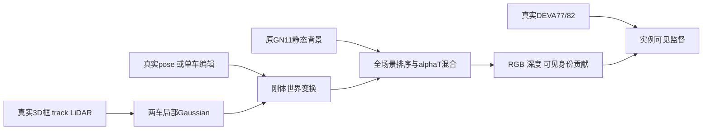

# DrivingEditor v82 刚体实例基础设施

当前只验证 GMC 两个已审查动态实例；真实GT 3D框/track作为先验，局部Gaussians由整体pose移动，没有动态PVG重复运动。初始背景冻结，完整场景alpha*T可见贡献监督。入口默认validate，不占GPU；StreetCrafter及其他GPU任务优先。

完整协议、组件图和证据边界见 [实验报告](../../../docs/v82/DRIVINGEDITOR_INSTANCE_EDITOR_20261013.md)。准备、训练和编辑入口分别是 prepare_instances.py、train.py、render_edits.py；queue_gmc.py/start_queue.py只管理当前GMC300步短测，不能重复启动。

CPU测试：`python -m pytest scripts/worldsim_v82/drivingeditor_instances/tests -q -k 'not actual_49_frame_bundles'`。真实GMC输入检查：`python check_gmc_prepared.py --prepared ACTUAL_GMC_TWO_ACTOR --output NEW_RECEIPT --cpu-threads 4`，它不验证GPU照片质量。新scene/完整mask未知时拒绝联合背景，不把缺注释当空mask。
