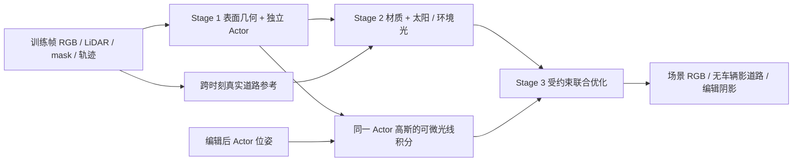

# 从零重建实例场景与车辆关联阴影

任务 `WS-V82-DRIVINGEDITOR-SHADOW-REBUILD-20261017 / v3`。此目录是新训练分支，初始化仅来自真实 LiDAR/RGB/轨迹和 reviewed body masks。不读取 GN11 checkpoint、旧道路替换层、原渲染图或五盒体代理。

运行顺序由只读数据预检、实际CUDA ABI检查、分阶段测速与训练入口约束；CPU合成夹具不能替代驾驶场景实验。当前执行状态统一见仓库 `docs/RESEARCH_STATUS.md`。



## 表示和训练

| 阶段 | 更新 | 固定/限制 | 监督 |
|---|---|---|---|
| 几何，拟定30k步 | 逐高斯位置/尺度/旋转/opacity、canonical颜色与 Actor 小幅视角项、天空 | 静态层无 time/velocity/lifetime；真实轨迹固定；几何锚在测量点附近；只在此阶段增密 | 非道路重建、车身 RGB、完整 mask 内/外、全场景可见实例、稀疏 LiDAR 逆深度、跨时刻干净道路颜色、局部法线 |
| 材质/阴影，拟定10k步 | 道路逐高斯 albedo、太阳方向/角半径/强度、环境光比例、Actor/canonical外观 | 默认几何和opacity固定；阴影只读同一 Actor 几何 | 整图均匀像素 RGB、随机patch SSIM、车身分层 RGB、canonical重建与教师、同一组深度/实例/道路约束 |
| 联合，拟定5k步 | 材质、canonical外观、光照及受约束几何/opacity | 几何相对上一阶段最多2cm，尺度log±.12、opacity logit±.3；学习率×.1；不增密 | 持续保留上述重建/车身/实例/深度/跨时刻约束 |

这些步数是初始预算，不是承诺的收敛步数；实测吞吐和执行状态另见 `docs/RESEARCH_STATUS.md` 与对应实验记录。

道路为局部 PCA 定向的薄各向异性3D高斯，具有独立颜色和opacity，不是固定平面。第一阶段把道路的跨时刻稳定颜色作为 canonical 外观目标；带车影的道路像素不直接推动几何/本色。第二、三阶段主RGB覆盖整幅图的均匀像素，patch用于SSIM；不使用历史人工修复ROI。视角残差仅给Actor，幅度±0.08线性RGB且无时间输入。

`tracing.py` 沿太阳射线解析积分 Actor 3D高斯密度；同一 `field.evaluate()` 同时给主相机渲染和遮挡计算提供编辑后的几何/opacity。投影接收位置来自主渲染的三维 G-buffer。太阳盘采样产生软边，ambient/sun共享场景参数。3DGS opacity 转密度使用最薄轴穿心光学厚度匹配；6σ聚合AABB粗剔除省算，积分块反传重算省显存。这些是明确的近似，GPU成本与阴影轮廓仍须实测。本实现没有迁入IRGS的OptiX、间接反射、多光源或完整车身BRDF；太阳/材质分解也不保证从单段视频唯一识别。

本轮材质分解专注道路，Actor正常暗面、自阴影和反射由**新训练**的canonical radiance及小幅视角项解释，Actor外观在后两阶段仍可优化，不强制整车变成Lambert材质。道路颜色/位置/法线的条件G-buffer全部共享全场景alpha*T；重着色只替换新场景自身的可见道路贡献，保留车身贡献。这里没有使用旧场景或观测RGB作图像补丁。

## 损失约定

完整不透明度监督使用**未预乘GT mask**的逐Actor独立渲染alpha：mask内 `(alpha-1)^2`，mask外 `alpha^2`，分别按各域实际元素数归一化，默认权重各0.05。全场景alpha*T实例贡献另外监督可见身份，默认0.1。未知mask不参与两域；默认正式训练直接拒绝未齐全mask。已知不存在的Actor有明确零目标。`--allow-partial-masks`仅用于显式登记的数据缺口运行，不能冒充完整监督实验。

RGB=1，SSIM=.2，LiDAR逆深度=.1，跨时刻道路=1，canonical重建=.3，车身RGB=1，Stage1教师=.1，几何/法线各.02，视角项=.01。权重集中于`config.py`，下文单列分层修复配置，未声称最优。教师保留新分支Stage1的车身重建，不加载旧GN11。

`configs/scene0008.json` 保留R3全局域均值定义，供历史重放。`configs/scene0008_balanced.json` 是显式登记的分层修复配置：逐实例先计算域内MSE；inside在有正标签的已知实例间取均值，权重.05；outside对各已知实例完整外部域均值求和，权重.5，避免34–37个空/远处实例稀释某辆车的车外梯度。没有缩小外部监督域或预乘GT alpha。可见身份项仍为原定义/权重.1。车身RGB和教师先逐车域内均值，再在可见实例间等权；材质阶段每辆最多128个RGB像素，避免小车被大车像素数淹没。

修复通过 `--fork-supervision-from /path/to/parent/latest.pt` 写入新目录，原始模型、Adam、RNG与已使用global_step均保留；只允许几何阶段将该开关false→true和outside权重改为.5，其他配置/数据契约必须一致。后续仍用严格`--resume`。这是监督修复的持续训练，不能冒称同一步数的单因素因果消融；代码记录父checkpoint和变更，不能加载GN11或旧18k场景。是否改善分层须同时检查动态RGB/raw alpha、车身和背景。

## CPU准备与审计

在本目录执行；远端仍使用已保存的DrivingEditor环境，不安装或覆盖旧内核。

```bash
python run.py prepare \
  --scene /path/to/original/inputs/scene0008_089_137 \
  --annotations /path/to/complete/real/laser_labels_audit \
  --reviewed-instances /path/to/real/reviewed/rigid_prepared \
  --output /path/to/new/v3_data

python run.py preflight --data /path/to/new/v3_data \
  --config configs/scene0008.json --output /path/to/new/full_run
```

`annotations`必须来自真实完整laser_labels，不能由渲染或框推断造标签；`reviewed-instances`只读`instances.npz`中的frame/track/mask_known和`instance_masks/*.png`。导出器为原始车辆轨迹建立Actor，训练帧LiDAR源点按当帧真实框分离；重叠歧义点与其他类别动态点不进入静态层。Actor缺少训练帧真实LiDAR默认停止；显式 `--allow-unseeded-input-gaps` 可登记并排除该轨迹，不用OBB补成车辆或宣称已重建。`--associate-cached-segments` 只把已存在的真实缓存分割与三维实例对应，记录包含率/IoU/可见LiDAR证据；未对应且无法认证在视锥外的标签仍未知，不由投影框造body mask。所有坐标以第一帧原始ego位置重置原点，单位保持米；不使用旧模型归一化。

点的初始颜色来自同帧深度可见RGB；没有可见颜色的点仅用0.5作为初始化先验，不把该值作为训练标签。单相机未见的车辆背面/道路不能由代码验证自动认证为真实恢复。

初始 ground 是LiDAR局部低表面/法线候选，**不是人工语义道路真值**，仍需实际覆盖审计。只对真实深度一致、车体保护外、训练帧可见的同一道路点收集RGB；要求亮簇多次重复，拒绝一次亮异常；完全未见或支持不足的点没有伪参考。始终在阴影里的道路仍有不可辨识性。缺少GT时不声称恢复了真实干净颜色。原始raw101/113/125只用于新分支测试，种子/参考不读其RGB或LiDAR；这些时刻过去被旧实验用过，不能称整个研究过程未见过的最终测试集。

## GPU执行顺序

```bash
# 先实际ABI/梯度与各阶段测速，不直接排45k长作业
python run.py benchmark --data /path/to/new/v3_data \
  --config configs/scene0008.json --output /path/to/new/benchmark --steps 20 --execute

python run.py train --data /path/to/new/v3_data \
  --config configs/scene0008.json --output /path/to/new/full_run --execute

python run.py progress /path/to/new/full_run

# 中断恢复要求相同配置、数据契约和ablation
python run.py train --data /path/to/new/v3_data \
  --config configs/scene0008.json --output /path/to/new/full_run \
  --resume /path/to/new/full_run/latest.pt --execute

python run.py evaluate --data /path/to/new/v3_data \
  --checkpoint /path/to/new/full_run/joint_final.pt \
  --actor-evidence /path/to/reviewed/actor_evidence.json \
  --comparison-protocol /path/to/reviewed/comparison_protocol.json \
  --output /path/to/new/eval49 --execute
```

评价必须提供相机与LiDAR联合证据准入表，默认只编辑 `eligible_track_ids`；可重复 `--track-id` 或用 `--target` 指定其中的子集，不能沿用旧actor0假定，更不能把所有有LiDAR的轨迹都作为delete对象。缺监督时训练/评价的 `--allow-partial-masks` 必须显式指定，输入缺口保留在记录中。正式场景主渲染只接受已审计DrivingEditor四输出feature rasterizer；GPU probe验证13个含负值通道跨批共享合成、CPU参考投影与反传。不兼容即停止，无隐式内核替换或CPU大场景fallback。

Stage1增密及结束时，会按新点位置重新投影真实训练RGB/深度，刷新道路参考；不把父点颜色作为子点永久纹理。Stage1→Stage2→Stage3保存独立final、latest、Adam、RNG、教师、增密后点表与输入契约。每50步更新progress/metrics，原子保存。`progress.py`只读、不会开机或启动worker；进度文件不等于进程存活证明。测速只反映初始点数，还需给增密、教师、I/O和完整视频留预算。

评价导出原位/关影/准入车辆一起删除、静态背景、覆盖率、阴影差异、固定相机静态分支，以及全动态独立RGB/raw alpha、全场景动态可见RGB/alpha与彩色实例贡献。每个准入Actor有逐车delete、删除后剩余动态分支、独立RGB/raw alpha、可见alpha；协议指定的旧三Actor另有连续±1m、±15°/±30°旋转和对应动态RGB。7个准入目标、其中3个连续运动目标共65流×49帧。背景单独渲染是分支诊断，不算其他Actor的delete编辑。分层不乘GT mask。没有反事实GT就不伪造编辑质量指标，人工verdict始终由用户填写；无真实可见证据的帧不能算编辑成功。

遮挡加速按当前帧Actor聚合AABB先筛射线，复用精度矩阵，随后进行同一解析积分；缓存只存在于当前 `evaluate()` 结果，checkpoint不保存。`tracer_probe.py` 可在真实种子上比较密集版/加速版遮挡值与几何、opacity、光照梯度，不能把一致性通过当作画质通过。

## 消融

`--ablation full|no_shadow|no_clean_road|no_body_teacher|frozen_joint_geometry|hard_sun|opacity_stage2`。每臂独立新输出、同seed/数据划分/初始点；记录resolved_config、输入角色与缺口。`no_clean_road`同时禁用参考初始化、参考损失和参考刷新，恢复保存的原始测量颜色，避免消融仍偷用亮道路先验。消融不自动排队，逐臂显式运行。旧五盒体/固定平面结果作为历史对照保留，不接回新模型。用同样49帧指标、原始及编辑视频核对①道路细节、②阴影轮廓、④车身质量，特别单列raw106–108与±30°。

## CPU验证

```bash
CUDA_VISIBLE_DEVICES= OMP_NUM_THREADS=2 python -m unittest discover -s tests -p 'test_*.py' -v
```

包括独立SciPy数值积分、解析梯度、共享几何编辑、mask外梯度、几何冻结、非平面原始导出、测试帧RGB隔离、真实三阶段小场景更新、增密后逐位恢复、连续编辑与空分母。详细结果见随交付保存的CPU检查记录。测试不调用CUDA或远端主机。

## 外部依据

`instance_balanced_visible_identity=false`保留原可见身份损失重放。R10显式设true时，已知车体内的`(visible_alpha-1)^2`先按每个有正像素的Actor域内均值、再平均Actor，防止小车体和大量空实例稀释；权重仍0.1。原身份外部项仍为`sum(visible_alpha^2 * known * ~body) / sum(known)`，完整known-HWK域与归一化逐式保持。raw内部0.05和完整可见外部0.5是另外两项，不变。未知mask不新增车体标签。显式fork必须保持模型、Adam、RNG、数据契约和已用步数，保存变更谱系；缺省配置可读取旧checkpoint。

道路证据需区分LiDAR视角和相机视角。R9数据从R8证据中以实际训练车体LiDAR及轨迹投影进行相机深度遮挡拒绝，不用没有车体点来证明无遮挡，不生成新body mask。旧道路投影域包含潜在车体遮挡，跨版本收益须在相同认证道路域重新只读度量。证据筛选本身不算训练收益。

R8另外支持 `Frame.road_certified`（默认全零）和 `weights.road_identity`（默认0，历史重放不变）。启用臂显式设0.5：在独立、真实训练LiDAR道路正证据像素上，对所有Actor的全场景可见alpha之和做域内均值MSE→0。它不使用未知实例mask的补集；非认证未知像素没有新增标签，原完整已知mask内外损失保持。证据须有多时刻世界道路支持、实际点邻域平面法线、车体3D接触保护和真实深度，不能与已有body标签重叠。缺正证据却启用会预检失败。数据新版本保留原RGB/masks/known/road/depth/seed/trajectory，只增加认证字段并显式记录谱系。道路静态覆盖先只读检查，再受界优化，逐帧核对轮胎／车身与孔洞。

归属修复另提供 `shadow_rebuild.ownership` 与 `shadow_rebuild.boundary`：以全场景alpha*T特征反传累计逐高斯body/真实LiDAR道路正证据，遮挡与未知不自动判背景。跨边界主轴由实际多视角mask交点确定，至少3帧一致才分解；两侧用截断高斯矩保留，复审后才可将道路候选锚定到实际测量世界点。未认证混合点不整点转归属。此过程不是车底高度裁剪，也不是普通梯度增密。

`outside_fullscene_visibility=false`保留旧raw-alpha外部监督重放；显式R6修复为true时，外部域仍是每个已知实例完整图像的mask外部，监督值改为全场景可见alpha*T贡献。mask内仍用未乘GT的独立raw alpha，未知mask无梯度；raw alpha也继续完整输出。此变化避免强迫被其他物体遮住的真实车体变背景，必须与归属/拆分干预一起登记，不能称单因素因果消融。边界split与道路reanchor分开接口，训练与几何阶段诊断独立。

- [Gaussian Grouping论文](https://arxiv.org/html/2312.00732v2)及[官方身份特征实现](https://github.com/lkeab/gaussian-grouping/blob/main/scene/gaussian_model.py)：借鉴逐高斯身份和多视图一致性；这里使用贡献证据，不声称复现其16维身份分类网络。
- [SAGD论文](https://arxiv.org/html/2401.17857v4)：借鉴投影轮廓交点定位跨边界高斯。本实现保留两子点并重新优化，区别于丢弃外侧部分的原分解策略。
- [UnIRe论文](https://arxiv.org/html/2504.00763v2)：借鉴跨时刻LiDAR关联；复用实际轨迹与道路表面证据，未移植其场景流网络或按高度移除地面步骤。

- [LumiMotion论文](https://arxiv.org/html/2604.10994v1)与[官方训练脚本](https://github.com/joaxkal/LumiMotion/blob/main/bash_scripts/enerf-actor1.sh)：借鉴几何先行、后续材质光照及持续重建约束；不复制其动态形变系统。
- [IRGS官方代码](https://github.com/fudan-zvg/IRGS)与[几何学习率默认值](https://github.com/fudan-zvg/IRGS/blob/main/arguments/__init__.py)：借鉴适于光照的表面与第二阶段冻结；没有声称复现其完整光线传输。
- [Gaussian Shadow Casting论文](https://arxiv.org/html/2401.06116v1)：借鉴各向异性密度射线解析积分；这里直接绑定同一Actor高斯，不另设随RGB任意变形的遮挡代理。
- [RNG论文](https://arxiv.org/html/2409.19702v3)：作为后续深度/边缘修正参考；本轮没有加入该网络。
