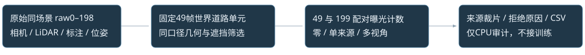
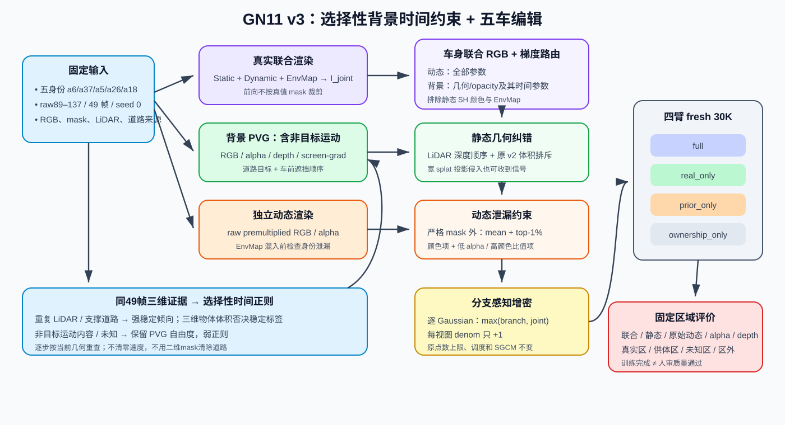
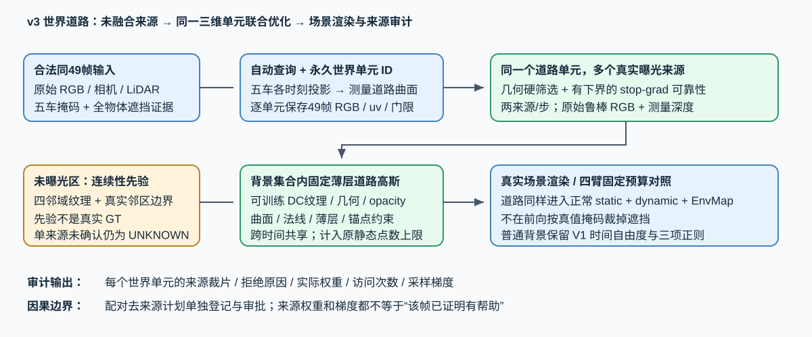
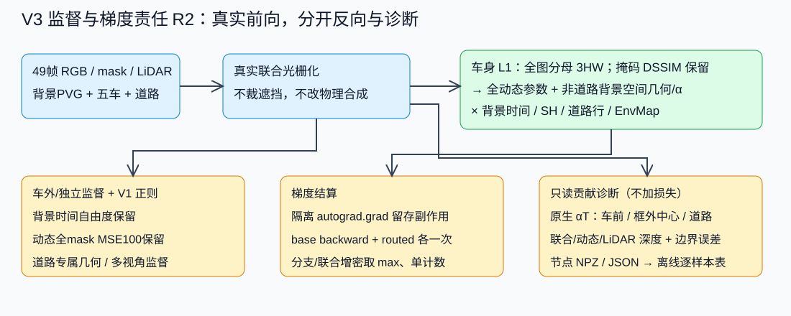
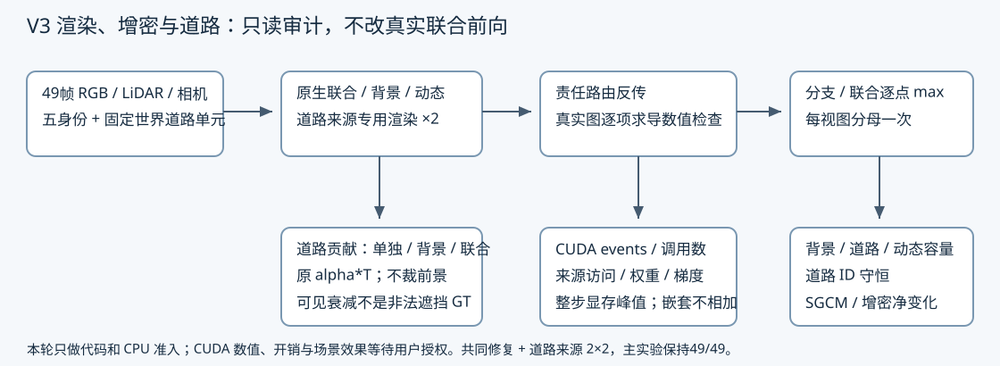
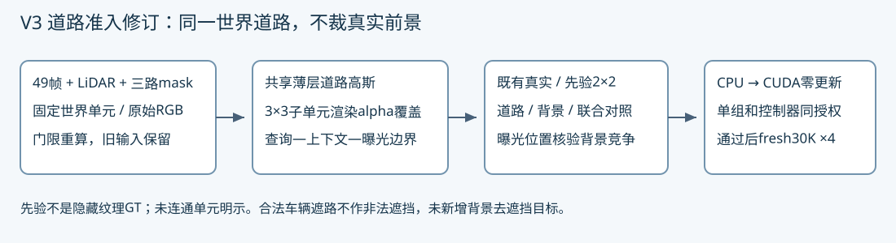
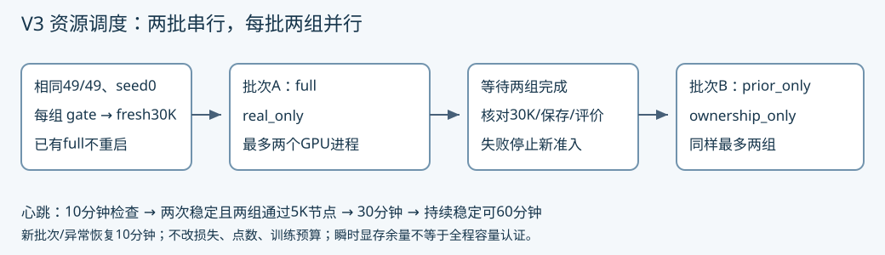

# 五身份 GN11 Stage-1 30K v3

该版本以五身份 GN11 30K v1 的真实输入/原生初始化协议及 v2 的归属修复为基础，道路输入独立重建。背景表示“不需要独立编辑的内容”，包含非目标运动物体，不继承 v2 的统一时间冻结；五辆目标车仍由共享动态分支承担。方法与四臂协议见下；当前执行状态统一见仓库 `docs/RESEARCH_STATUS.md`。

[检查点发布合同修复、0步真实49帧准入与授权fresh重跑](publication_fix_r1/README.md)：旧5K资产保持不变；四臂方法与2+2预算不变。

[后期并行OOM的单槽资源恢复与完成后关机授权](resource_recovery_r1/README.md)：逻辑分组不变、物理并发改为1，科研配置和30K预算不降级；旧资产全部保留。最新执行范围与状态以仓库状态快照为准。

道路输入已替换为从原始同49帧重新构建的 `road_multiview_001`；不加载 V2 `input_bundle_002`，不融合固定目标颜色。原生五车和普通背景的原始初始化仍保留；新增固定道路单元占用原静态点数预算。

## 49帧主实验与199帧曝光审计的范围隔离



| 实验 | GN11训练帧 | 额外道路参考帧 | 执行范围 |
|---|---:|---:|---|
| V1基线 | 49 | 无 | 保留已有基线 |
| V3主实验四臂 | 49 | 49 | 原计划、原输入不变；仍需用户审核与GPU授权 |
| 199帧道路曝光审计 | 不训练 | 199 | 仅CPU、只读原始测量；不生成可训练bundle |
| V3扩展 | 49 | 199 | 用户要求暂缓，没有可执行队列 |
| 完整199帧训练 | 199 | 199 | 用户要求暂缓，没有可执行队列 |

范围登记见[experiment_scope.json](experiment_scope.json)。199是同一真实TFRecord的raw0–198，不是从别的场景凑帧；原49为raw89–137，新增150为raw0–88与138–198。`tools/audit_199_road_exposure.py`沿用主实验的世界ID、曲面、法线、支撑和查询分母，仅扩展候选来源；清晰度归一化基准仍为原49中位数，不在199上重新估计。原49原图、位姿、标定、LiDAR、时间戳必须与原始数据核对通过。

窗外没有原V3的准备分割mask，因此独立审计采用全类别原始FRONT相机框、投影LiDAR标签框与三维框的投影外包络；三维框跨近面时先裁剪12条边再投影，不把侧后方物体误判为全图遮挡。其余门限沿用道路输入策略。缺FRONT标注时遮挡门限关闭，缺测量深度不算清除。配对49/199都重算相同包络口径；原V3/SAM49结果仅单列参考，不能把不同筛选口径的变化解释为新增曝光。

确认需至少2个通过来源；单来源仍未确认，无曲面支持不因加入帧数而变成可用道路。分别报告原零来源→确认、原单来源→确认、原已确认→更多支持。确认只表示当前标注/稀疏测量下的几何证据，不等于密集语义GT、隐藏纹理唯一恢复或训练质量通过。始终缺少观测的a6单元仍应标为先验候选或未知，不能无条件改成真实监督。

`tools/report_199_road_exposure.py`导出固定单元CSV、逐帧拒绝原因与raw89/a6/a37的逐单元原图裁片。RGB不融合；CPU候选权重不是实际训练权重，没有训练可靠性、访问、梯度或因果帮助结果。主入口增加49来源合同检查，拒绝199来源或审计文件直接晋升；没有修改主`plan.json`、道路bundle或四臂训练预算。[审计结果与复现命令](exposure199/README.md)。



## 世界道路多视角优化与正式审计工具



自动查询使用五辆待编辑车辆在全部49帧中的原始掩码射线与实测道路曲面相交，按锚坐标中0.2m网格建立永久世界单元ID，再扩展1.2m上下文邻域。没有人工 raw89/a6/a37 查询限定、late-frame优先或供体多边形。道路走廊之外、交点不收敛与缺乏测量支撑均保留 UNKNOWN，不靠车身掩码清空道路。

每个来源分别保留原始 sRGB、raw图像uv、测量深度与9项硬门限：图内、曲面支持、掩码清除、测量道路支持、深度匹配、三维框射线清除、角度、面积、画面质量。49帧等权候选，没有颜色融合或把跨帧颜色差当成几何拒绝。至少2帧通过才是确认观测；单来源候选仍未知；零有效来源但有曲面支持才进入先验。颜色空间沿用原生重建的 sRGB，不误称已线性化反射率。

每个有曲面支持的单元向原背景集合加入一个薄层3D Gaussian。DC颜色、位置、旋转、尺度和opacity可训练，高阶SH对道路置零；道路位置/显隐跨时间共享，普通背景PVG不冻结。道路ID写入原18字段checkpoint的附加optimizer元数据，在普通背景append/prune后保持；道路固定容量，不参与通用clone/split/prune或SGCM替换。道路不被周期opacity reset清成透明（该步道路Adam动量仍按原replace路径重置）；其他背景与目标动态仍走原机制。新增行在同一静态Adam中更新，不增加优化步或点数上限。

正常联合前向包含这些道路高斯，没有按真值掩码裁掉错误静态层。额外的道路专属光栅化使用完全相同的参数，不含EnvMap，以alpha归一化的道路颜色监督原始来源RGB，并另加coverage约束；不是优化一张最终二维补图。预测采样坐标由实际Camera的full projection和原生NDC-to-pixel约定计算，原图RGB采样仍使用原始标定uv；实际相机内参必须与来源表一致，避免混淆半像素中心约定。

每步按确定性循环取2个来源（不消耗原采样器RNG），所有来源共同优化同一世界参数。RGB采用Charbonnier鲁棒误差，可靠性由当前颜色/道路深度残差计算、stop-gradient并限制在[0.1,1]；它只能减权，不能提升硬拒绝。分母使用全49帧最近可靠性快照，batch乘F/B，不逐帧单独归一；这是等频在线近似，不声称每步已计算完整49帧目标。额外来源光栅化开销须另记，不把相同30K步数当成相同计算量。

道路几何直接受曲面距离、法线、法向薄层和单位锚点约束，四臂共同启用，权重分别0.1/0.01/0.01/0.01；超出0.15m的单元漂移为软惩罚，不冒称硬保证。未曝光查询区只使用四邻域颜色连续性、道路coverage及曲面深度先验；非查询的真实曝光上下文作为边界条件，明确是其他位置证据，不是真实查询纹理。未知单元不作为先验传播边界。没有周期纹理采样、生成器或大型编码网络。

四臂原道路权重键保留，但新含义显式改变：`observed_rgb/depth`控制查询单元逐来源RGB/测量深度；`prior_rgb`控制未曝光区连续性、coverage和真实邻区边界RGB；`prior_depth`控制未曝光单元的曲面锚定。四臂均有相同14,034个固定道路种子和共同几何项，因此`ownership_only`现在意为“共同v3道路表示/几何、两类新增外观来源关闭”，不是与旧V2同名组严格等价。所有结论限于这一共同条件下的2×2对照。

真实CPU覆盖：26,088个世界单元、14,034个有曲面支持、22,173个硬通过来源-单元对。raw89/a37为1,170单元：351确认观测、528先验、291未知（含93个单来源候选）；raw89/a6为493单元：0确认观测、314先验、179未知。该0.2m世界单元统计与V2像素统计分母不同，不作成功率比较；a6未曝光纹理不能宣称真实恢复。

正式工具：

- `tools/prepare_multiview_road.py`：只在新目录建立原始来源与世界ID表，不覆盖旧包。
- `tools/road_source_audit.py`：按任意查询帧/actor输出逐单元离线HTML，含世界位置、曲面支持距离、逐来源原图裁片/uv/RGB/拒绝原因。未加载优化记录时可靠性、有效监督权重和梯度显示“尚未执行”，不填示意值。
- 每5K从真实优化导出`road_audit/iteration_*/optimization.npz`：实际域/arm归一化权重、RGB损失访问计数及每100步采样的独立道路RGB梯度L2。梯度可能经邻近splat重叠影响未直接选中单元；它不是Adam更新分解，更不是因果帮助。
- 在线可靠性/访问/采样梯度计数也进入完整`training_state.pth`，不只存在审计副本；恢复函数检查来源合同并恢复它们。主v3入口仍只授权fresh30K，不自动续训。道路永久ID在静态`.pth`中保存；原生裸PLY不含完整世界单元协议，不作为独立v3重放入口。
- `tools/road_source_counterfactual.py --plan ...`：登记相同初始化/seed/49帧/30K预算的reference与去来源计划，移除指定世界查询单元的额外道路来源，不移除原生整帧重建。不会执行GPU；若两组均新跑需额外60K，精确同合同full臂可审核后复用。比较入口要求两个真实30K终态，只报告资产变化，仍需完整49帧质量与固定区残差检查才能判断帮助。

CPU验证在部署campaign目录执行：`CUDA_VISIBLE_DEVICES='' /root/autodl-tmp/envs/drivingeditor/bin/python -m unittest discover -s tests -v`。2026-10-21用户授权后首组真实CUDA零更新已通过；额外开销开始记录，训练质量未验收。

设计参考：[3DGS原始表示/优化](https://repo-sam.inria.fr/fungraph/3d-gaussian-splatting/)、[2DGS的曲面与法线动机](https://surfsplatting.github.io/)、[PyTorch grid_sample约定](https://docs.pytorch.org/docs/stable/generated/torch.nn.functional.grid_sample.html)。本实现为本项目内的薄层3DGS设计，不宣称复现2DGS光栅器或已证明优于基线。

## 背景时间自由度与 V1 原生正则

普通背景行继续继承 `NativeGaussianModel` 的 `_t/_scaling_t/_velocity` 参数、学习率、SHM 和时间显隐，原生时间梯度、时间 split 调度及 checkpoint/Adam 路径保留。训练不调用 `enforce_static()`；仅新增、有明确曲面身份的道路行使用上节的共享薄层表示，不把所有背景强制静止。

本轮按用户要求把静态时间／寿命、速度正则和 NPS 的公式、输入域、归一化、权重与启用状态原样恢复到五身份 GN11 V1。不是只恢复配置中的名字；训练直接调用原生 `compose_hybrid_loss(hybrid_state, args, nps_fn=nps_loss)`，不再在调用前清零权重或关闭 NPS。

| 项目 | V1 计算与监督域 | 权重／开关 |
|---|---|---|
| 时间／寿命正则 | 背景寿命特征除以联合 alpha；`1 / mean(abs(map))`，均值下界 `1e-8` | `lambda_t_reg=0.1` |
| 速度正则 | 背景速度特征除以联合 alpha；全图 `mean(abs(map))` | `lambda_v_reg=0.01` |
| NPS | 背景速度特征除以独立背景 alpha；原五身份掩码、到掩码外的距离、四轴邻居、双棋盘奇偶、求和不取均值 | `paper_lambda_nps=0.01`，`hybrid_nps_enabled=true` |

两种 alpha 的下界均沿用 `EPS=1e-5`；背景寿命特征沿用 `get_scaling_t.clamp_max(2)`，速度特征沿用原生 `get_inst_velocity`。NPS 距离仍按相机缓存；不重新划分身份掩码，不改成只在稳定体素上计算，也不改成前景平均。

上一轮新增的“稳定区／上下文 raw 位移与窗口显隐选择性正则”已从训练目标移除，不与 V1 三项叠加。`v3_temporal.py`、证据构建工具及[已生成的 CPU 覆盖记录](temporal_evidence_summary.json)保留为历史离线材料；当前 runtime 不导入、不加载证据，campaign 构建也不要求生成它们。四组共同使用完全相同的 V1 正则合同，准入拒绝任何不同权重或关闭 NPS 的配置。

这并不恢复 V2 的统一时间冻结。背景仍可通过原生 PVG 表示非编辑车辆等运动内容，只受到 V1 的软正则；五车归属仍使用本次实际渲染三维位置、有效 opacity、车辆体积、道路薄层保护和车身测量深度，不用二维车身掩码清掉车后道路。

CPU 配对测试读取实际 V1 与 v3 的 `train.py` 特征映射和原生损失源码，比较三项 raw／weighted 标量及其对特征、联合 alpha、独立背景 alpha 的梯度；另外检查 NPS 求和域和权重闸门。这里只证明实现对齐，不证明恢复正则后的画质或非目标运动保真。

## 监督责任



| 目标 | 前向 | 参数责任 | 明确不做 |
|---|---|---|---|
| 车身最终合成 RGB | 真实 `I_joint`，不按真值掩码裁掉静态贡献 | 全部动态参数；仅非道路背景 `xyz/opacity/scaling/rotation` | 不给背景 `t/scaling_t/velocity`、SH、明确道路行或 EnvMap 车身 RGB 梯度 |
| 非法静态前遮挡 | 独立静态深度和 alpha，对比车身有效 LiDAR 深度 | 静态几何与不透明度 | 不用动态分支独自补偿静态挡车 |
| 动态身份泄漏 | 加入 EnvMap 之前的独立动态预乘颜色 | 动态参数 | 不把环境背景算作动态泄漏；不靠最终图像截断掩盖资产 |
| 道路恢复 | 世界单元的未融合真实来源 RGB/测量深度 + 连续先验/邻区边界 | 同一静态集合内的道路参数 | 不直接更新动态或环境参数；不加载 V2 固定颜色包 |
| 拓扑细化 | 联合与独立分支各自屏幕梯度 | 对应静态/动态 Gaussian | 不把两套统计相加造成重复计数 |

车身联合项在真实联合图上计算：

\[
L_{body}=(1-\lambda)\frac{\sum M|I_{joint}-I_{GT}|}{3HW}
+\lambda\left(1-SSIM(MI_{joint},MI_{GT})\right).
\]

反向路由仅改变车身联合损失的梯度，不冻结参数、不修改真实前向。普通背景时间参数仍可从车外联合RGB、独立背景RGB、V1正则等原有效路径学习；动态参数全部保留。对四类背景空间梯度，明确道路行归零；道路可继续通过道路专属监督、正常非车身监督和几何项优化。车身RGB不再直接驱动道路空间参数，但不宣称道路已与所有其他目标完全隔离。

主实验只把车身 **L1** 恢复到V1整图L1的等效分母 `3HW`。掩码外与车内L1相加在权重1时等于原整图L1；两项掩码SSIM相加不等于原整图SSIM，不声称严格恢复V1整个RGB目标。旧车身面积分母保留为显式 `body_area` 备选函数参数，主plan拒绝该替换；暂不混入四臂。

静态前遮挡项仍使用 `static_depth_sum/static_alpha` 与有效测量深度的相对顺序，并按静态alpha加权；它仍可能被前后层的平均抵消，不宣称是逐splat的精确front-alpha。本轮不调高其权重，也不增加可微分前缀损失。真实LiDAR提供的几何约束仍可更新背景时间参数；禁止的是目标车身**RGB**时间路由，不是禁止所有车身几何证据。

动态泄漏使用固定语义字段 `dynamic_premultiplied_rgb`：它来自独立动态光栅化，且位于 EnvMap 混入之前。在车身掩码膨胀 2 px 之外，损失同时包含区域均值与 top-1%，另处罚当前低动态范围约定下的

\[
\max(0,\lVert C_D\rVert_{\infty}-4A_D-1/255).
\]

原有完整动态掩码 alpha MSE、权重 100 保留，并在 v3 hybrid 路径中不再借用通用 opacity-entropy 开关作为是否启用的条件；没有增加显示阶段颜色截断。该字段只在固定黑色光栅背景下定义为预乘颜色，CPU/GPU 准入都会拒绝白背景配置。

## 分支增密

渲染器显式返回联合、静态、动态三套屏幕代理、可见性与投影半径。独立背景重建进入静态代理，车身联合项进入联合代理；每个 Gaussian、每个采样视图只记一次：

\[
g_i=\max(g_i^{branch},g_i^{joint}),\qquad denom_i\mathrel{+}=1.
\]

投影半径也逐点取最大值。原 30K 调度、静态/动态点数上限、SGCM 和完整动态 alpha 监督均不变。

屏幕梯度的确定性修复：每次路由 `autograd.grad` 前保存三套代理的既有 `.grad`，调用后在 `finally` 中恢复；然后执行正常 `base_loss.backward()`，只把返回的指定联合/静态梯度补一次。即使代理仍是原生 `zeros_like(..., requires_grad=True)+0` 的非叶子并启用 `retain_grad()`，也不会把自动留存和手动补入重复计数。叶子代理、已有梯度、两个路由项与base叠加均回归。道路独立光栅代理是额外来源自己的图；其固定容量道路行不进入通用增密，不能再声称道路RGB全部进入当前训练视图的静态代理。

## 深度、体积与泄漏的只读诊断

每100步记录车内联合/独立动态RGB、动态alpha、严格掩码外颜色均值/top1%以及内外边界带误差；记录联合、独立动态、独立静态的有效车身LiDAR覆盖和深度MAE。无有效像素时误差为 `null`，不是零误差。动态RGB一律取EnvMap混入之前的预乘颜色，不把背景颜色当作动态泄漏；阈值、比值约束和MSE100均未改。

准入、第一步及每5K步更新**之前**保存 `supervision_audit/iteration_*_<frame>/maps.npz` 与 `metadata.json`。更新计数为当前iteration−1，不冒称保存后的终态；后续完整49帧终态评价仍须独立执行。保存同一帧联合/动态/静态/LiDAR浮点深度图、mask、RGB与alpha；深度图为相机z米数、未混入天空深度，sample数组保留模型单位并记录换算比例。

对最多14个按像素序均匀抽取的有效车身LiDAR像素，复用当次真实光栅参数，以每个车辆深度阈值作为独立feature通道输出 `sum T_i alpha_i 1[z_i<d_vehicle*(1-.01)]`。保持所有高斯/掩码/深度排序/opacity，**不是只渲染前方子集**；独立静态T与真实联合T分别报告。额外区分框内中心、框外中心的前方贡献及明确道路行贡献，和三维框内中心数量对照。每7个样本使用两次额外光栅、最多4次/节点；输出alpha必须和原静态/联合图在样本处一致，否则准入失败。

这是原生3DGS中心z排序约定下的贡献，不是椭球连续表面first-return；最多14条射线不是全图front-alpha。CPU测试中的5m/20m平均抵消构造仅证明诊断能识别这种情况，不是V3场景已测出大量漏检。首组已实际输出CUDA贡献和alpha重放核验，不据初始样本宣称整个场景漏检率或修复成功。

`tools/report_supervision_audit.py --run <run> --output <new_dir>` 在CPU汇总实际记录与逐样本CSV；没有文件就标记 `NOT_EXECUTED_NO_DIAGNOSTIC_FILES`，拒绝覆盖。背景时间路由1000+1000步短程配对仅在[独立登记](supervision_short_controls.json)中提出，需单独审核runner和GPU授权，没有新增执行队列；面积归一化留作后续单独对照，不混进这对控制。

实现依据为当前原生 `forward.cu` 的 feature `alpha*T` 累积与中心相机z；没有修改CUDA内核。PyTorch的[autograd.grad](https://docs.pytorch.org/docs/stable/generated/torch.autograd.grad.html)与[retain_grad](https://docs.pytorch.org/docs/stable/generated/torch.Tensor.retain_grad.html)合同分别说明返回梯度和非叶子留存行为；本工程重复计数判断以实际部署版本的数值回归为准，不仅依据文档措辞。

## 渲染、增密与道路审计



合同 `V3_RENDER_DENSIFY_ROAD_R1_20261020` 保留原生联合/背景/动态三次光栅化、环境混入前的动态预乘颜色、逐点max融合、原增密调度和SGCM。道路永久行现在也明确排除在通用增密统计的分子/分母之外；其独立来源代理不与当前训练视图代理相加。道路仍通过专属几何和多来源目标更新，固定容量不因此获得新的增密配额。

零更新CUDA gate新增两个数值比较器（本轮只CPU回归，未执行真实CUDA）：在真实场景图中分别对base/body/road求导，保存/恢复非叶子retain_grad缓冲，构造应得的三套屏幕梯度，再与实际责任路由后的`.grad`比较，包含道路行屏蔽。用真实梯度/可见性/半径在临时缓冲执行当前融合函数，独立核对逐点max、并集可见性、分母恰好一次和道路排除，不污染训练缓冲/拓扑。比较容差atol=2e-5、rtol=2e-4。它验证路由与统计的数值一致性，不是CUDA导数的有限差分认证；额外反传计入gate开销，不冒充30K训练性能。

开销日志 `v3_render_cost.jsonl` 在gate、第一步、每100步及SGCM实际due步用CUDA events记录各类原生/道路/贡献光栅、道路目标、路由反传、DC梯度诊断、Adam、通用拓扑和SGCM的当前流时间，同时记录主机dispatch wall和整步峰值allocated/reserved显存。SGCM原生offset50与整100步错开，due步单独采样，非due空调用另命名，不用空调用估算真实细化成本。每次训练迭代的光栅调用数累计到采样记录中；计时范围从迭代开始到optimizer/SGCM结束，不含随后可视化、评价、checkpoint。同步仅在采样边界做，峰值在该步开始重置；显存是整步峰值，不声称已分离某模块的增量。嵌套span不相加，CUDA当前流时间可包含主机等待，不称kernel-exclusive。

四臂均保留每步2次来源道路光栅，即使来源权重关闭；关闭组记录有效RGB访问0，不把“调用过”写成“受到该类监督”。每臂30K有60K次额外来源前向；四臂合计240K次，另加gate、贡献诊断及原生评价，反向开销需真实计量，不能从步数推断。没有同状态V1性能采样时不报告V3相对V1的加速比或显存增量。

容量账 `v3_capacity.jsonl` 在初始化、通用拓扑事件、SGCM事件、每100步及gate保存普通背景/固定道路/动态点数、道路占比、各事件间净变化；校验14,034个原世界道路ID守恒。记录是净变化，不伪装成精确birth/prune总次数。原生cap是增密前触发门槛，可能在单事件后超额，日志显式报告overshoot；未改成新的硬截断或静态/动态重分配策略。

gate、第一步和每5K更新前增加3次只读光栅：道路独立alpha、保留全部背景高斯的道路标记alpha*T、保留全部静动态高斯的道路标记alpha*T。保存永久单元anchor投影处三者浮点贡献和衰减、支撑/来源类型/查询域，在 `road_visibility/iteration_*/` 逐单元输出。贡献是**全部道路高斯在单元anchor处的贡献**，不冒称该单元孤立splat贡献；节点不是终点更新后的完整49帧评价。重放alpha必须与原静态/联合alpha一致，否则失败，不裁掉前方几何。

背景渲染不含五辆可编辑车，仍保留非编辑运动内容；联合图则包含五车。车遮住道路或非编辑前景遮住道路都可能合法，衰减本身不是非法遮挡GT。这一诊断用于区分“道路自身没学好”和“放回场景后看不见”，不新增去遮挡损失，也不宣称薄层道路已解决遮挡。

来源记录新增逐采样帧硬通过数、实际有效RGB访问、可靠性、alpha、RGB/米制深度残差、加权目标及被采样DC梯度触达的道路行数。梯度可经splat重叠到邻行，选中观测、梯度触达与因果改善仍分开；原始来源/门限/连续先验不变。

`tools/report_render_audit.py --run <run> --output <new_dir>` 只读汇总实际日志，gate与训练分开，计时样本中位数不冒充总运行时间；无数据标记 `NOT_EXECUTED_NO_RENDER_AUDIT`。`tools/validate_render_audit_cpu.py` 执行CPU准入并保存完整日志，真实CUDA数值、开销、道路遮挡与最终质量均待用户授权。新gate和GPU审批必须匹配本轮render版本；旧gate或只有版本字段而无数值/可见性/计时证据的receipt均拒绝。

计时接口依据[PyTorch CUDA Event](https://docs.pytorch.org/docs/stable/generated/torch.cuda.Event.html)和实际安装Torch 2.2.2的本地接口；本轮CPU不创建CUDA event，实际性能字段未填测量值。

## 2026-10-21 道路准入修订



当前道路合同为 `V3_WORLD_ROAD_MULTIVIEW_R2_20261021`，输入为 `road_multiview_002`。`001`和199审计均保留，不改历史结果。查明新准备器遗漏V2的native proposal mask，并非有意修改；恢复five-ID、all-vehicle、native proposal三路并集，缺任一路立即拒绝。固定世界单元/曲面/原始RGB完全保留，只收紧mask门限：有效来源22,173→22,164。新包逐帧保存三路路径、像素数、native额外像素和通过数；49帧native额外掩码10,227像素，不等于10,227个有效道路观测。

先验覆盖不再用单高斯opacity代替。使用两次既有来源道路光栅结果，在固定世界0.2m单元的局部切平面3×3子位置（两轴偏移−0.08/0/0.08m）采样实际道路alpha；仅支持/入视野/角度/分辨率门限合格的查询先验子单元，损失`relu(0.95-alpha)^2`。49帧全局有效子单元分母、周期batch的F/B修正，权重仍为`prior_rgb*coverage_weight`，不新增第三个开关或额外光栅。真实车遮挡位置只用于道路独立alpha先验，不引入该位置车身RGB。有限子采样不是连续全表面无孔证明，远距离抗锯齿也可能遮掩亚像素孔；实际CUDA结果仍需核验。

先验颜色图现在包含支持的上下文先验边，允许“查询先验→上下文先验→真实曝光上下文”；UNKNOWN/无支撑不能成为桥。记录每单元component/context_hops、边界锚点及孤立分量；关闭先验组不会把图连通冒称为实际边界监督。raw89/a6的314先验单元均连到曝光上下文；a37为514/528，14个仍未连通，保持弱先验不宣称恢复真实纹理。a26另有8个未连通。颜色邻接约束不等于渲染表面连续，因此另报实际子单元alpha和缺口比例。CPU高opacity/小尺度/同色反例验证旧项为0而渲染子单元缺口项为正、对尺度有梯度；它是CPU解析测试，不是假称已观察真实V3孔洞。

节点诊断额外选择硬通过查询曝光权重最多的一个真实来源视角，并保存道路独立RGB/alpha、完整背景RGB（删除全部五辆可编辑车、保留非编辑运动）、实际联合RGB、三种T下的道路贡献及先验子单元alpha。只在当前来源真正硬通过且确认曝光的世界单元上比较RGB残差；其余遮挡不当负例。PNG仅浏览，未截断浮点保留。每节点最多额外一次原生三分支和三次贡献/道路光栅；开销另计。当前没有新增深度门控背景去遮挡目标；只有实测道路改善而背景/删除不改善后，才据此决定下一轮是否需要。

控制器与单组gate/train共用 `V3_GPU_ENTRY_R2_20261021` 授权校验，在任何GPU查询/导入/输出创建之前要求显式开关和精确匹配的审批。绑定主plan、当前输入、方法/道路/监督/渲染版本、四臂顺序，并核对实际CLI中的engine/bundle/config/readiness/binding/lock、固定run目录与gate凭据路径；正确plan不能搭配别的CLI输入或额外run。拒绝备用plan、旧包、来源反事实和未登记模式。反事实另有历史登记，但此入口目前fail-closed，不在本次GPU范围。CPU63/63通过；本次用户明确允许修完后启动GPU，只授权主49/49四臂，49/199与199/199继续暂缓，无关机授权。

首组实际CUDA gate在RTX 4080 SUPER通过，Adam更新0；非叶子三套屏幕缓冲最大绝对差joint=6.7521e-9、static=9.0804e-9、dynamic=6.5193e-9，增密scratch最大梯度差均0、分母精确，14,034道路行排除。原背景/联合alpha重放通过。实际道路子单元alpha检查已执行；初始常色造成边界DC差0不等于学到了纹理。主控制器PID2167、首组训练PID2254已从fresh seed0运行，超过500步；首次550步SGCM后14,034道路ID全部保留。其余三组尚排队，各自仍先过gate。完整30K和49帧质量待完成，不依据初始道路贡献下降给合法车辆遮挡定罪。见[实际零更新凭据](road_review_r2/gpu_full_gate_001/gpu_gate_receipt.json)与[训练启动快照](road_review_r2/training_launch_snapshot.json)。

## 四组固定对照

四组均为同一五身份 `a6/a37/a5/a26/a18`、raw89–137 共 49 帧、seed 0、fresh 第一阶段 30K、第二阶段 0；每 5K 保存。唯一变化是道路来源权重。

| 组 | 查询区真实多视角 RGB/depth | 连续先验/邻区RGB 与曲面锚定 |
|---|---:|---:|
| `full` | 1.0 / 0.1 | 0.1 / 0.01 |
| `real_only` | 1.0 / 0.1 | 0 / 0 |
| `prior_only` | 0 / 0 | 0.1 / 0.01 |
| `ownership_only` | 0 / 0 | 0 / 0 |

用户2026-10-21追加资源授权后，改为两批串行、批内两组并行：`[full, real_only] → [prior_only, ownership_only]`，最大并发2，不是四组同时启动。每组先过实际CUDA零更新gate，仍相同fresh seed/30K，不改变损失/点数/调度。失败停止新准入，已有健康同伴继续保存完成，保留失败、不自动重试。



新入口`tools/run_v3_pairs.py`采用live full，核对PID/start-ticks/命令行、原控制器父子关系、gate和实际Adam计数；只终止旧队列控制器，不对进程组或full发停止信号。实际交接在full 3800步，PID2254不变、无重启。新worker必须由活的pair coordinator直接创建，核对lease中的批次/槽位、已批准同伴PID和真实GPU应用，拒绝外部进程共跑及第三槽。full仍持有原全局GPU锁；内核等待者在full完成释放后由新控制器接管同一锁文件，不删锁、不把共享锁当独占锁。并发准入/锁接管CPU回归通过，原训练/数值检查继续保留。

每次启动要求设备当前空闲显存至少8GiB；运行期4GiB余量作为监控告警，不自动降配置。该门限不是最大容量证明，也不预留独占的8GiB；后期增密、5K保存/评价、真实设备峰值继续监控。full前3800步为串行，之后共享GPU；两组wall/吞吐不能据此作公平方法速度比较。全局锁/控制器异常不授权杀健康训练或新增重跑。

本聊天心跳`v3-gpu`初始每10分钟。连续两次检查两组推进、无错误、道路ID守恒，且两组各至少完成一个5K四件保存/49帧评价后改同一心跳为30分钟；再持续稳定可60分钟。新批次/异常恢复10分钟，全部完成后暂停；无需另建定时任务。状态、实际PID与进度见RESEARCH_STATUS，CPU和调度快照见`pair_schedule_r1/`。未使用subagent。

## GPU 与存储闸门

用户2026-10-21明确授权修复通过后安排主四臂GPU实验。执行前独立保存 `GPU_APPROVAL.json`，与当前道路输入/版本、监督R2、渲染R1、单组入口R2和四臂范围匹配，并显式传入 `--execute-after-user-gpu-approval`。模板本身永不构成授权；旧gate不能授权修订后的训练。每组仍在任何Adam前先做实际CUDA gate，失败保留现场停止。

参考 v2 四组实际产物约 48.25 GB，v3 在启动控制器前要求 campaign 所在盘至少 70,000,000,000 字节可用；不足时状态写为 `WAITING_STORAGE_BEFORE_GPU_EXECUTION`，不会占用 GPU。单臂内部还会在启动和每个节点保存前重新做空间准入。

## 评价边界

最终必须按 `evaluation_contract.json` 的固定世界区域分别报告车身联合合成、车前静态遮挡、严格掩码外动态颜色、真实多视角道路区、连续先验区、未知区和查询区外损伤。完整重建、静态、原始动态、道路独立RGB/alpha/深度均覆盖49帧，保存未截断float道路图；先验区没有隐藏道路RGB真值，不报告虚构PSNR。训练完成不等于质量通过，`human_verdict` 在人审前保持 `null`。

## 正式 49 帧删除评价入口

`tools/evaluate_v3_final49.py` 只在当前单槽四组训练全部返回真实30K、每组六个四件/49帧节点发布历史齐全后准入。用户精确授权清理的full/real_only旧5K–25K四件按下述完成凭据核对，四组30K与全部评价文件仍必须在盘。显式执行开关、原GPU独占锁和“无现存GPU进程”检查同时通过才渲染；不会插队训练，不会创建优化器、调用Adam、安装道路行、SGCM细化或关机。它逐帧重新加载原生相机/三份模型，保留背景PVG时间自由度，并验证原生loader重算的PCA变换与已有输入一致而不重写共享输入。

```text
[30K三份模型 + 原49帧相机/道路世界单元 + 发布/授权清理凭据]
                   ↓
[零更新原生渲染：联合 / 移除五车共享动态分支 / 道路单独]
                   ↓
[核对30K浮点重放 + 独立删除前向等价 + 原透射率道路贡献]
                   ↓
[49帧PNG与未截断浮点 / 世界单元来源域误差 / 动态泄漏与深度诊断]
                   ↓
[四组对照汇总与资产复核；human_verdict仍待人审]
```

每帧独立移除动态分支重渲染，并检查与原生完整背景`render_s`一致；还要与正式30K保存的联合/背景/动态原始RGB、alpha、深度、道路RGB/alpha浮点逐项比较。道路在背景/联合中的alpha和预乘RGB贡献通过原透射率feature pass计算，不裁合法前景；仅在同位置已验证真实曝光单元比较道路/删除背景/联合RGB误差，先验区只报告连续覆盖诊断，未知隐藏纹理不制造GT。PNG只作浏览，不把clamp作为资产修复。原训练文件size/mtime在评价前后必须一致。

R2补齐固定合同中的显式终态输出：每帧用同一冻结定义记录车身掩码结构损失、前遮挡硬比例/alpha质量、动态颜色/alpha比例退化；保存完整静态/联合alpha、三分支深度、道路alpha归一化颜色。逐帧抽最多14个有效车身LiDAR像素，用保留全部几何与透射率的原生feature pass记录静态/联合车前贡献、框外中心质量与平均深度漏检；这不是全图front-alpha或连续椭球first-return。另报告真实曝光道路深度、硬通过查询区外背景/联合残差、终态道路几何能量和不经UNKNOWN桥接的先验边界连续性，固定raw89/a6、a37查询映射完整保留。无训练、optimizer或额外Adam步。首个full_r1实际49帧零更新重放通过，但补齐诊断后使用新目录full_r2作为最终完整入口，保留r1不覆盖；不是额外训练或为质量重调参数。

CPU新增8项通过：拒绝未完成/0步gate/错误调用计数、缺帧/越界checkpoint、loader写入或变换变化、显示裁剪冒充浮点重放，并验证原生半像素投影及dry-run不创建GPU任务/成功凭据。首次在不完整`engine_overlay`上运行全套测试因缺少原生`hybrid30k_runtime`导入失败，保留该日志；随后在隔离CPU测试目录绑定当前冻结完整engine，87/87通过，无skip。日志位于当前campaign的`monitor/final49_cpu_native_RZEQ1S44/unittest.log`。这些是CPU准入，不是实际49帧CUDA重放通过；实际执行和四组结果汇总仍待训练结束。

执行时使用当前分支工具，`--campaign <当前单槽campaign> --arm <固定四组之一> --output <campaign>/final49/<arm>_r1 --execute-final-evaluation-after-user-approval`。输出目录必须全新，失败保留现场；不自动重复评价、不修改训练终态或伪造质量接受。

### 用户授权的旧 checkpoint 清理

2026-10-21 10:01 SGT，仅当前serial_r1中已完成的full/real_only各5K、10K、15K、20K、25K四件checkpoint共40文件已删除，释放23,317,435,622字节（21.716GiB），盘余约41.13→62.84GiB。两组30K四件共8文件在清理前后SHA-256一致；7,948个其他文件的size/mtime/inode未变，包括全部原始发布事件和各49帧评价。prior_only、ownership_only、全部旧失败campaign均不在清理范围。旧步数没有另做checkpoint字节备份，不能再从这些已删节点恢复。

一次性工具`tools/prune_v3_completed_checkpoints.py`只允许该campaign/两组/五步数/四固定文件名，拒绝活跃目标worker、被打开的目标文件、软链接、目标变化或重复尝试；不递归删除。完整意图及完成凭据保存在campaign根目录`checkpoint_retention.intent.json`/`checkpoint_retention.json`；[版本化索引](resource_recovery_r1/checkpoint_retention_20261021.json)记录原事件摘要、删除字节和保留30K校验和。最终评价只接受status=complete且40路径/原事件SHA-256/bytes完全匹配的豁免；缺其他checkpoint、30K或评价仍失败，不能据此降低预算或冒称从未保存。完整冻结engine上的CPU回归94/94通过，包括7项清理/保护/最终评价兼容测试；同一心跳已同步此例外，不新建任务、不给另外两组自动清理授权。

## 已知限制

- 固定0.2m薄层单元是受控容量起点，未证明足以恢复细道路纹理；不做自适应道路增密。可靠性更新是残差代理，不是已学习完整可见性或物理曝光/阴影模型。
- 静态前遮挡是 opacity 加权平均深度代理；若一条射线上前后多层静态贡献互相抵消，仍可能低估问题。零更新 CUDA gate 会先检查其梯度与数值稳定性，30K 后需用固定区域诊断确认。
- 颜色/alpha 比值上限只针对当前归一化低动态范围表示，不外推到 HDR。
- v3 同时修复多条共同机制，因此四臂只回答两类道路来源在同一 v3 条件下的覆盖作用，不能用于拆分每个 v3 修复项的独立因果贡献。
- V1 的全图寿命／速度先验和 NPS 可能抑制背景中的非目标运动；本轮按要求完整恢复，不宣称它们已经选择性地区分稳定表面与非编辑车辆。原生 feature velocity 随寿命衰减，未改成 raw velocity；这个继承边界不能称为已修复。
- 固定相机改变时间时，背景 RGB 允许变化；原来要求整幅背景时间差为0的 CUDA gate 已替换为原生 PVG 前向等价和时间梯度检查。固定表面的稳定性与非目标运动内容的保真度分别评价。
