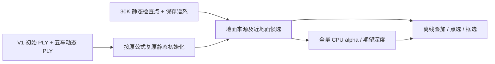

# V1 地面静态可视化诊断

本次只读补齐 V1 原生静态初始化、保存谱系和训练后地面候选对照。V1 没有独立道路分支；候选只改变诊断分组，不注入或修改任何模型高斯。

初始静态585,943与实际启动绑定一致；其中走廊内、实测拟合平面±0.15m的地面输入71,120。候选1,278,443：全部初始地面来源后代 ∪ 49帧任一中心在相同走廊和平面±0.30m的其他静态点；局部x3..90m、y±8m。包含可能的残留与近地物，不是道路语义真值。

点选使用原 `optimizer.sgcm_lineage_v1`，不是最近邻猜测；clone/split继承来源，所以一对多。距初始来源不等于同一高斯连续位移。初始位置、时间、原行号由真实PLY与五车0.1m动态邻居排除复原；尺度为原生3NN均方公式CPU复原，opacity0.01。不冒充保存的CUDA step0。V3固定道路的opacity0.5不套给V1。

实际输入层全量；初始/训练后标记默认各显示10%，可调至100%，独立于普通背景2%。二维候选/其余静态独立alpha与期望深度、框选始终全量。V1候选有效opacity=基础opacity×当前时间权重；统一不透明只改变标记alpha。

`export_offline.py` 的常规导出自动调用 `export_v1_ground.py` 并携带 `v1_ground.js`；原有 `export_offline.ps1` 直接更新现有离线目录。V1专用道路颜色/原生贡献通道仍不适用；新增四个显式 V1 候选/其余静态alpha、深度通道。原生图片、checkpoint、训练代码不改。

验证：真实数据的18项JS/Canvas交互检查覆盖V1及V3回归；标记投影回同一像素，显示率改变不影响框选，保留原生静态行ID，零存活后代不伪造位置。CPU投影新行索引保持旧C ABI和顺序，独立Python射线对照每帧两个分组。浏览器UI未实际验收，Canvas预览不是浏览器截图。

数据：`/root/autodl-tmp/gsdiag_v1_ground_20261022_r1`。仅CPU派生、optimizer_updates=0；初次导出曾因一次性邻居列表超过2GiB内存限额失败，已改成邻居计数查询后完成；失败不改模型或训练输入。

failure_ledger_refs=[V82-F01,V82-F06]；failure_ledger_delta=none；quality_accepted=false；human_verdict=null。
