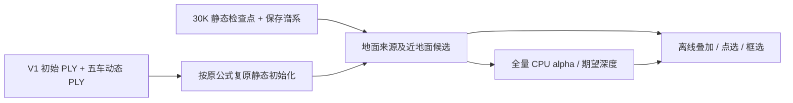

# V1 地面静态可视化诊断

本次只读补齐 V1 原生静态初始化、保存谱系和训练后地面候选对照。V1 没有独立道路分支；候选只改变诊断分组，不注入或修改任何模型高斯。

初始静态585,943与实际启动绑定一致；其中走廊内、实测拟合平面±0.15m的地面输入71,120。候选1,278,443：全部初始地面来源后代 ∪ 49帧任一中心在相同走廊和平面±0.30m的其他静态点；局部x3..90m、y±8m。包含可能的残留与近地物，不是道路语义真值。

点选使用原 `optimizer.sgcm_lineage_v1`，不是最近邻猜测；clone/split继承来源，所以一对多。距初始来源不等于同一高斯连续位移。初始位置、时间、原行号由真实PLY与五车0.1m动态邻居排除复原；尺度为原生3NN均方公式CPU复原，opacity0.01。不冒充保存的CUDA step0。V3固定道路的opacity0.5不套给V1。

实际输入层全量；初始/训练后标记默认各显示10%，可调至100%，独立于普通背景2%。二维候选/其余静态独立alpha与期望深度、框选始终全量。V1候选有效opacity=基础opacity×当前时间权重；统一不透明只改变标记alpha。

`export_offline.py` 的常规导出自动调用 `export_v1_ground.py` 并携带 `v1_ground.js`；原有 `export_offline.ps1` 直接更新现有离线目录。V1专用道路颜色/原生贡献通道仍不适用；新增四个显式 V1 候选/其余静态alpha、深度通道。原生图片、checkpoint、训练代码不改。

验证：真实数据的18项JS/Canvas交互检查覆盖V1及V3回归；标记投影回同一像素，显示率改变不影响框选，保留原生静态行ID，零存活后代不伪造位置。CPU投影新行索引保持旧C ABI和顺序，独立Python射线对照每帧两个分组。浏览器UI未实际验收，Canvas预览不是浏览器截图。

数据：`/root/autodl-tmp/gsdiag_v1_ground_20261022_r1`。仅CPU派生、optimizer_updates=0；初次导出曾因一次性邻居列表超过2GiB内存限额失败，已改成邻居计数查询后完成；失败不改模型或训练输入。

failure_ledger_refs=[V82-F01,V82-F06]；failure_ledger_delta=none；quality_accepted=false；human_verdict=null。

## V1配色分组与交互性能修订（2026-10-22）

task/run=WS-V82-GSDIAG-V1-VIEW-PERF-20261022/r1；只读诊断显示，不修改模型、训练、固定候选集合或独立alpha/深度。

DC为原0阶SH基础RGB，不是地面类别。进入V1默认配色改为来源/离地：初始地面来源贴地=绿、已离地=橙；其他来源本帧贴地=蓝、不贴地=灰。贴地定义延续实测拟合平面±0.30m和纵向3..90m/横向±8m走廊；该几何谓词不是道路语义真值。可筛选全部、当前贴地、初始地面后代、离地后代。初始地面后代允许保留离地点，其他初始来源指初始中心不在±0.15m地面带。选择筛选时仅改变3D标记；二维固定全集与屏幕框选全量统计不变。

raw102锚定纵向11..15m、横向-1..0m的4平方米局部，共约79.2万个时间有效候选中心，来源169个；其中约八成候选的来源为初始非地面。这是冻结检查点中的同源后代聚集，不是重复绘制同一行，不能把整团称为正常道路，也不据中心数量宣称原生像素贡献或删除残影因果。raw100/102与五车框只读统计见v1_view_cluster_analysis.json。

性能：去除每次接受帧的百万行Set/Map；位图判断重复静态行、双精度按帧位置/时间权重缓存、确定性显示子集和配色缓存、标量投影、紧凑可点选数组。pointermove按requestAnimationFrame合并，拖动/缩放时每层最多约12000标记，明确标注预览减点，松开恢复设定显示率（默认10%，可调100%）；初始输入同样仅交互时减点。大型base64每1MiB解码后让出事件循环，类型对齐时共享解压Buffer。无最低opacity抬升，无点密度增亮或数据合并。

同数据、10%显示率、1200x700 Node Canvas测得旧完整重绘中位约1.6s，新缓存后完整重绘约0.28s，拖动预览约0.05s；实际数字见v1_view_performance.json。首次帧/配色准备仍有单独成本；这些是本地Node测试，不能当浏览器FPS。原功能+分组/缓存/选择/预览/解压回归24项通过（修订后最终凭据为准）。浏览器file协议UI没有实际操作验收。

CPU测试沿用原只读实现，GPU使用0、optimizer_updates=0；failure_ledger_refs=[V82-F01,V82-F06]；failure_ledger_delta=none；quality_accepted=false；human_verdict=null。
