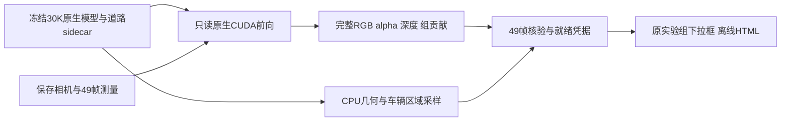

# V4 30K 结果接入

V4 R/RP作为原诊断首页“实验组”选项，与原四组V3及历史V1共用49帧时间轴。只有完整导出并通过验证的组才显示30K结果；其他组保留可选择的占位，数值保持未知。

`src/export_v4_results.py`读取已完成运行的原生静态、动态、环境和道路30K检查点，不恢复训练或创建优化器，不调用会写transform的场景加载器。相机来自该运行保存的`cameras.json`，与原诊断世界坐标核对。原V1输出逐帧对照训练保存的图像；道路和原V1在同一次原生光栅化中按真实深度排序，通过追加one-hot feature取得道路在背景/联合图的实际贡献。独立道路、普通背景、动态各自重新光栅化。

固定道路的xyz/尺度/四元数逐张量核对初始化。初始化创建的全14034点保留在sidecar信息中，三维“训练后道路”显示实际参与输出的点；未输出点可点紫色初始化点查看，不宣称被训练移动或删除。R本次输出1919个。普通背景和动态默认各2%，可调及单车加密，所有输出道路保留。

交付245张480×320图像、49帧alpha/深度/组贡献、49帧独立深度标记、全量离线采样分块及车辆投影区域。源于同49帧冻结输入的初始化证据仍可叠加。未知优化来源访问历史不使用V3替代；V4逐Gaussian trace/干预尚未接入，旧GPU入口禁用；全幅原生结果正常可看。

一键`export_offline.ps1`默认包含已完成的V4组；也可`-Arms v4_R`仅增量更新R。导出受每进程8GiB显存上限及至少12GiB空闲准入限制，不改其他训练。工程导出不等于科学质量验收：quality_accepted=false，human_verdict=null；failure_ledger_delta=none。

检查：`validate_v4_results.py 导出目录`；实际app/inspection/sampling使用Node Canvas及离线数据核对，不冒称浏览器UI验收。
