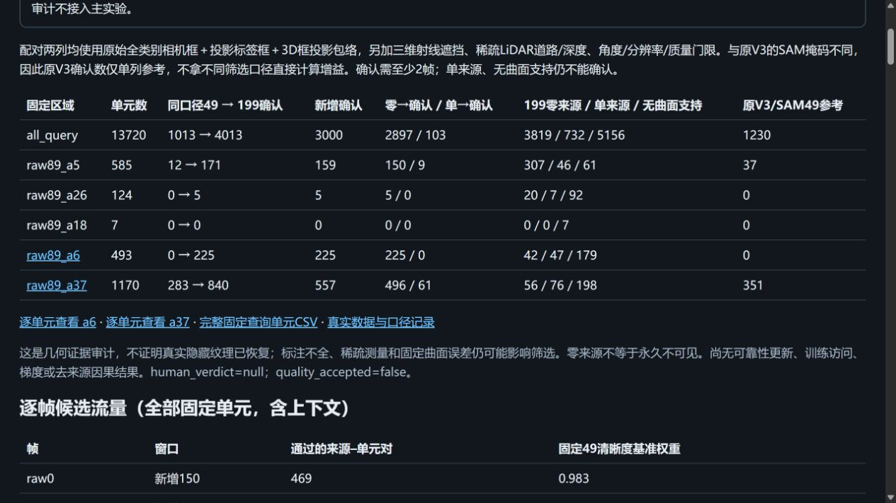

# 同一场景199帧道路曝光审计

task：`WS-V82-GN11-ROAD-EXPOSURE199-20261020`。仅CPU审计，不优化高斯、不训练网络、不晋升道路输入。当前执行状态只见仓库 `docs/RESEARCH_STATUS.md`；实验范围见[独立登记](../experiment_scope.json)。


## 配对设计与证据边界

实际TFRecord为`segment-10094743350625019937_3420_000_3440_000_with_camera_labels.tfrecord`，从文件边界核实199帧、raw0–198；原49窗口为raw89–137，新增150为raw0–88和138–198。没有跨场景取图或根据显示颜色选择来源。

固定原V3的26,088个世界单元、13,720个查询单元、曲面、法线、支撑标记与全部查询映射，不重建199帧初始化。原49清晰度中位数也固定。每个来源保留原RGB、投影uv、测量深度、9项门限与CPU几何权重；不提前融合颜色。

窗外缺少原准备SAM掩码，因此本次采用独立的全类别标注包络口径：真实FRONT相机框、投影LiDAR标签框、全部有效三维框的投影外包络；三维框先按近面裁剪12条边。再用三维射线、稀疏LiDAR道路支持/深度、法线角度、投影面积与画面质量硬筛选。缺FRONT标注则mask门限关闭；缺测量深度不当作无遮挡。道路支持仍是平面附近且不在标注物体内的实测点，不是密集道路语义GT。

配对49与199均用同一包络口径重算。原V3/SAM49的a37=351、a6=0只是独立参考，不能直接与199列相减。确认需要至少2个不同来源帧；一个来源仍未知，邻近两帧也不等于大基线的独立验证。固定49曲面无支撑的单元不因帧数增加自动确认，不能据此断言这些位置在完整199中永久不可见。

## 实际输出与复现

同口径配对结果（单位为固定世界单元，不是像素）：

| 固定查询区域 | 分母 | 49确认 | 199确认 | 新增确认 | 199零来源／单来源／无曲面支持 |
|---|---:|---:|---:|---:|---|
| raw89/a6 | 493 | 0 | 225 | 225 | 42 / 47 / 179 |
| raw89/a37 | 1170 | 283 | 840 | 557 | 56 / 76 / 198 |
| 全49帧查询并集 | 13720 | 1013 | 4013 | 3000 | 3819 / 732 / 5156 |

全部查询区新增确认中，2,897个原为零来源、103个原为单来源；a37新增确认中496个原为零来源、61个原为单来源。原V3/SAM49的a37=351不同于本表283，差异来自标注包络筛选，不是数据丢失或训练退化。a6在原49仍无确认曝光，但199中已有225个同位置几何确认单元，因此不能再笼统宣称完整199内a6全部只能用先验；也不能把剩余268个单元补写成真实纹理。主实验仍只使用49参考，199候选未晋升。

a6的通过来源位于raw149–198。实际浏览器已验证X5202→X5203切换、199行来源和raw89的掩码/道路/深度/三维遮挡拒绝，以及包络显示；a37/X665由原raw132的单来源加上raw138成为双来源，原图裁片均可查看。页面仍明确没有优化贡献与质量验收。



完整证据目录：`/root/autodl-tmp/drivingeditor_repro/campaign/r15_gn11_stage1_v3_20261020/road_exposure199_005`。`exposure.npz`含199×世界单元的逐来源RGB/uv/测量深度/权重/门限位，另保留原49权重作参考；没有模型参数、优化器或训练权重。

报告目录：同campaign下的`road_exposure199_report_001`。`index.html`提供固定区域配对表，`raw89_a6.html`与`raw89_a37.html`可按新增确认/零来源/单来源筛选世界单元、逐来源查看原图裁片和遮挡包络，`fixed_query_units.csv`保留全部查询单元分母。页面明确显示尚无训练可靠性、访问、梯度或因果帮助结果。

本目录中的`summary.json`与`fixed_query_units.csv`为真实审计的轻量Git交付；完整NPZ、199原图缩略图和逐单元HTML保留在campaign与本地报告中，不把它们写入主训练bundle。

在远端仓库根目录复现（输出必须使用新目录）：

```bash
TASK=scripts/worldsim_v82/drivingeditor_shadow_rebuild_20261017/r15/gn11_stage1_v3_20261020
CAMP=/root/autodl-tmp/drivingeditor_repro/campaign/r15_gn11_stage1_v3_20261020
export CUDA_VISIBLE_DEVICES='' PYTHONDONTWRITEBYTECODE=1 OMP_NUM_THREADS=1 OPENBLAS_NUM_THREADS=1 MKL_NUM_THREADS=1 NUMEXPR_NUM_THREADS=1
/root/autodl-tmp/envs/drivingeditor/bin/python "$TASK/tools/audit_199_road_exposure.py" \
  --bundle "$CAMP/road_multiview_001/bundle.json" --output "$CAMP/road_exposure199_NEW" \
  --engine "$CAMP/engine" \
  --raw-reader scripts/worldsim_v82/drivingeditor_debug/followup_20261013/red_preparation/waymo_numpy_cpu.py
/root/autodl-tmp/envs/drivingeditor/bin/python "$TASK/tools/report_199_road_exposure.py" \
  --audit "$CAMP/road_exposure199_NEW" --output "$CAMP/road_exposure199_report_NEW"
```

数据解码复用既有NumPy转换规则、双回波、NLZ和TOP像素运动补偿；只把已知MatrixFloat的packed float32字段解码改为NumPy读取，形状仍用原protobuf。小矩阵与原protobuf数值逐项一致，原49完整LiDAR/原图/pose/标定/时间戳另做真实配对检查。CPU只有0.5核配额，线程均设1；这不是GPU吞吐基准。

早期`001`–`004`是不完整工程运行，保留现场，不计入曝光结果：包括原解码速度探索、近面框过度拒绝诊断及等价的道路候选预筛优化；没有任何训练更新。源码覆盖层不含完整原生引擎，不能在该目录运行完整回归；正式测试在campaign完整部署目录执行。

V3主四臂仍为49训练/49道路参考、每组fresh第一阶段30K、第二阶段0；本次只增加来源数/帧序检查，拒绝199审计结果直接接入。V3扩展49/199、完整199/199均按用户要求暂缓，未创建可执行队列。几何审计通过不能证明该来源提升训练质量；需要用户另行授权的配对实验才能评价收益。

failure_ledger_refs=[V82-F01,V82-F06]；failure_ledger_delta=none。human_verdict=null，quality_accepted=false。
