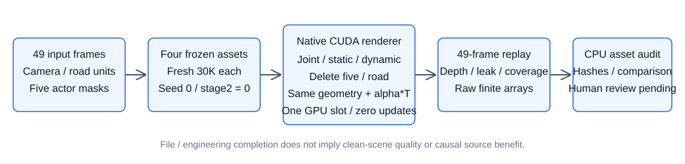
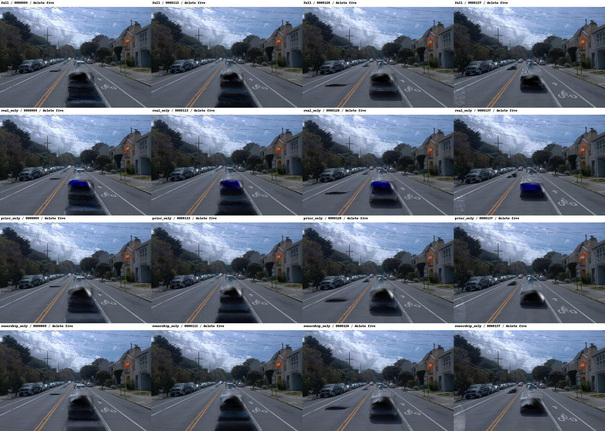

# V3 四组：最终49帧评价与资产核验

工程收尾已完成，科学质量未通过验收。四组均完成fresh第一阶段30K，第二阶段0；最终实际CUDA重建、删除五车、道路与联合贡献评价覆盖49帧，未创建optimizer、未增加Adam更新。代理目视抽查四个完整锚帧时，四组删除图仍有明显车形/黑白残留，real_only另有蓝色残影。不能将工程通过、重建分数或低动态泄漏当作干净街景通过。`quality_accepted=false`，`human_verdict=null`；不追加训练、调参或额外方法实验。

## 固定合同与证据

同49训练/49道路参考帧（raw89–137）、五身份[6,37,5,26,18]、seed0，共同世界道路表示/几何、原生点数/分辨率/调度/损失/SGCM/NPS不变。物理单槽按full→real_only→prior_only→ownership_only执行，四组累计120,000次实际优化更新；每组三个optimizer.step调用均各30,000。每组六个正式节点的原始发布事件及49帧七通道/道路浮点已核验。内部每参数Adam时钟29856/29989/30000与原生拓扑换Parameter后grad=None相符，不等同step调用计数，不宣称实际非零中断精确续训。

四组真实零更新CUDA准入通过；0步不是正式5K。历史失败训练更新另记26,152=10,000+8,400+7,752，未用real_only的旧7700状态冒充实际7752。原始发布失败、publish_r1零步失败、publish_r2并发OOM等现场均保留。

最终R2入口补齐了原R1缺少的显式终态诊断。full_r1已实际49帧重放通过，保留为初轮结果；完整索引采用四个全新`*_r2`目录，不覆盖r1。额外R1评价也是零优化，不计训练步数。绑定冻结完整engine的CPU回归98/98通过，无skip。一次误用不含torch的数据环境导致的CPU导入失败日志保留，随后用正确训练环境完整重跑；没有因此改动训练或方法。

实际CPU全套日志：campaign内`monitor/final49_audit_cpu_Od8ndziS/unittest.log`（98项）及`monitor/final49_r2_cpu_native_wqnRcDpi/unittest.log`（96项）；错误环境现场在`monitor/final49_r2_cpu_ygDQ2R0t/unittest.log`。四组实际CUDA零更新准入凭据保留在`arms/<arm>/gate_001/gpu_gate_receipt.json`，不能用CPU测试替代这些真实CUDA检查。

## 结果与边界

下表前三个重建指标来自30K正式49训练视角；道路/删除误差来自最终实际重渲染，仅在同位置硬通过、至少两来源确认的查询世界单元上报告，并按有效单元-视角数加权。不是隐藏道路GT、独立测试集或唯一纹理恢复率。

| 组 | 重建PSNR | SSIM | LPIPS | 道路RGB L1 | 删除背景RGB L1 | 道路深度MAE(m) |
| --- | ---: | ---: | ---: | ---: | ---: | ---: |
| full | 34.6138 | 0.96554 | 0.03892 | 0.007617 | 0.012784 | 0.05346 |
| real_only | 34.5323 | 0.96525 | 0.03886 | 0.007399 | 0.012995 | 0.05268 |
| prior_only | 34.3566 | 0.96526 | 0.03865 | 0.128356 | 0.013175 | 1.86314 |
| ownership_only | 34.0012 | 0.96464 | 0.03775 | 0.153868 | 0.013091 | 2.63380 |

开启真实道路来源的两组在该确认曝光域内，道路独立RGB/深度残差明显较低；完整删除背景的差别小得多，四组仍有车形残留。这不支持“独立道路改善已经解决静态车形残留”的结论。该单seed四组对照不是逐来源因果归因；未执行199扩展或另需批准的来源排除反事实。

| 组 | 严格掩码外动态颜色均值 | 逐帧top1%加权均值 | 静态平均深度前遮挡alpha质量 | 抽样实际静态车前alpha | 抽样平均深度漏检质量 |
| --- | ---: | ---: | ---: | ---: | ---: |
| full | 0.00004415 | 0.00441480 | 0.023565 | 0.081129 | 0.043375 |
| real_only | 0.00003657 | 0.00365686 | 0.024477 | 0.075866 | 0.035447 |
| prior_only | 0.00008975 | 0.00841623 | 0.028613 | 0.141614 | 0.098503 |
| ownership_only | 0.00008782 | 0.00857391 | 0.023831 | 0.150221 | 0.111989 |

前遮挡硬比例/质量是沿用原训练定义的平均深度代理。实际贡献每帧最多抽14个有效车身LiDAR像素，保留全部几何与原alpha*T，另报联合T、框外中心前方贡献及中心框内计数；不冒称全图front-alpha或连续椭球first-return。表中漏检质量是抽样诊断，不是全场景漏检率。严格外域排除2px膨胀边界；top1%是逐帧尾部量的加权汇总，不是全49帧像素重新排序的全局top1%。

四组先验边界DC RGB RMSE依次为0.05310/0.21026/0.03776/0.25378；几何能量和连续性详见comparison.json。共同23,597条有效连续边、150个先验组件、361个查询先验单元没有确认上下文路径，UNKNOWN不作桥。先验没有隐藏道路RGB真值，不能据平滑或alpha高声称纹理正确。

固定raw89/a6为493单元：0确认曝光、314先验、179未知；raw89/a37为1170单元：351确认曝光、528先验、291未知。映射和全49帧可见anchor/3×3子单元统计已保留。重复可见样本不是唯一像素面积。a6在本49帧无确认曝光，不能报告其唯一真实隐藏纹理；高覆盖也不能证明新增先验产生因果收益。

查询区外硬通过世界上下文的删除RGB L1依次为0.009887/0.010231/0.009986/0.011085；这不是全画面无车GT，也不证明所有非编辑车辆运动已保真。原生背景时间自由度保留；全49帧静态、联合、原始动态、alpha及相机z深度均供人审，非目标运动/稳定建筑几何尚无人审通过。来源访问、梯度触达和V1 duration/velocity/NPS原始/加权/梯度记录均引用真实训练日志，不伪造评价期梯度。

## 真实删除与负结果

每帧实际把共享五车动态分支移除并重渲染，与原生完整背景`render_s`浮点一致；与原30K的联合/静态/动态RGB、alpha、深度及道路浮点逐项重放通过。因此预览中的残留确由当前完整背景路径呈现，并非没有执行删除。尚未对每个残留Gaussian作因果归因。

预览按行full/real_only/prior_only/ownership_only，按列raw89/113/128/137。这里只是代理对锚帧的目视抽查；不冒充用户人审或完整49帧视觉验收。

## 开销、保留与文件核验

四组整步profile的最大allocated/reserved约19.24/25.55、18.50/24.54、19.10/24.25、18.09/23.57GiB；范围从迭代开始至optimizer/SGCM结束，不含后续评价/保存，不是设备级峰值或容量保证。每组实际训练累计road_only调用60,014次（其中额外来源前向60,000次，其余为节点诊断），四组合计240,056次。没有匹配状态V1性能基准，不报相对加速或零额外计算。

四组R2评价分别96.91/101.00/98.06/97.99秒，PyTorch reserved峰值17.23/14.90/18.78/18.40GiB；范围仅各评价进程，不是训练/设备峰值，不能作公平方法速度排名。初轮full_r1额外86.20秒另记，仍0优化。

仅按用户最新授权删除full/real_only旧5K–25K的40件checkpoint，释放23,317,435,622字节。最新30K共8件SHA256与清理前相同，其余7,948保护文件的size/mtime/inode未变；40个原事件SHA256/路径/bytes逐项匹配完成凭据。未向prior_only/ownership_only扩大清理，当前正式checkpoint实际56件。所有24个正式发布事件、每节点343PNG+49道路NPZ均仍在盘并复核。12,297项原始/最终资产的SHA256清单已保存；模型/sidecar的有限值在各正式节点发布时和终态分别CPU加载核验，最终CUDA渲染另复核。

## 索引与关机边界

- [四组比较与真实训练诊断](comparison.json)
- [12,297项资产SHA256清单](asset_manifest.json)，SHA256=`eb926ef96b21f5b7382bc7e9eff7f4424cb13fc914246482d90ad179f6b72465`
- [full逐帧终态](evaluation_full.json) · [real_only](evaluation_real_only.json) · [prior_only](evaluation_prior_only.json) · [ownership_only](evaluation_ownership_only.json)
- 原始资产根：`/root/autodl-tmp/drivingeditor_repro/campaign/r15_gn11_stage1_v3_serial_r1_20261021/final49/`，完整结果在各`<arm>_r2/`，CPU核验在`summary_r2/`。

四个train的原控制器状态保留为`FOUR_ARMS_TRAINING_COMPLETE_EVALUATION_PENDING`这一历史返回；最终工程完成凭据以`summary_r2/comparison.json`的`FOUR_ARM_FORMAL49_AND_ASSET_AUDIT_COMPLETE`为准。关机须在本报告/索引代码推送、全机无未完成或待启动作业后，按既有授权正常执行；关机意图及后续可用SSH观察另行记录，不能把SSH断开写成平台计费确认。
