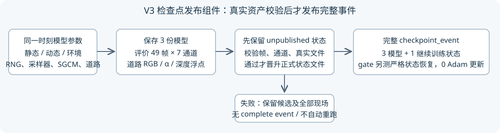

# V3 发布合同修复与授权重跑

task：WS-V82-GN11-V3-PUBLICATION-R1-20261021；主方法仍为 GN11_STAGE1_V3_20261020。
这是保存／准入工程修复，不改变已审核的表示、损失、点数、训练调度或道路输入。当前执行状态只见仓库 `docs/RESEARCH_STATUS.md`。



## 真实失败与授权

原 campaign：`/root/autodl-tmp/drivingeditor_repro/campaign/r15_gn11_stage1_v3_20261020`。
full、real_only 各完成5000次静态／动态／环境 Adam 更新后，在49帧评估发布处退出。新增道路三通道使每帧共7通道，旧发布器要求严格等于4通道；不是 OOM，也不是方法的科学否定。
三模型 `.pth`、7×49 PNG、49道路浮点 NPZ 均保留；完整 `training_state5000.pth` 和 `checkpoint_event` 缺失，不声称能精确续训。
用户明确授权：“不能保证从checkpoints精确续训的话，可以从头开始”。失败10K逻辑更新单列，不抵扣新的四组各30K。

最终重跑目录：`/root/autodl-tmp/drivingeditor_repro/campaign/r15_gn11_stage1_v3_publish_r2_20261021`。
中间 `r15_gn11_stage1_v3_publish_r1_20261021` 保留一次0步 gate 工程失败：评估包装器试图导出还未执行 objective 的道路权重。新增0步旁路后重做CPU准入；该目录没有训练更新、没有覆写，也不参与稳定性判断。

## 修复边界

- 旧非V3训练保持严格4通道；V3要求原4通道加道路预乘RGB、表面颜色、alpha，不能静默丢弃道路图来规避校验。
- 校验49个唯一训练相机、模型文件字节数、非空PNG，以及每帧道路浮点 `rgb_sum/alpha/depth_sum` 的尺寸、类型、有限值与alpha物理范围。
- 先原子写入 `training_stateN.unpublished.pth`；资产验证成功后晋升正式状态，最后写完整事件。失败留下未发布候选，不伪称完整checkpoint、不自动续训，也拒绝覆盖已有状态。
- 严格恢复schema纳入已由capture写出的 `v3_world_road_runtime`。道路来源可靠性、访问/梯度计数、RNG、49帧采样器和SGCM仍保留；不绕过 `_validate_continuation`。
- 每个实际CUDA gate在首个采样/Adam之前，真实保存三个模型、渲染49帧七通道和道路NPZ、发布0步诊断事件，再严格恢复状态。产物单独放在 `gate_001/publication_smoke`，带 `diagnostic_only_zero_update_snapshot=true`；三个Adam和采样器计数均为0。不能把它当作正式5K节点或训练稳定性证据。
- 单组train入口要求新版实际发布/恢复gate凭据。控制器新增显式 `--fresh-start`，只接受另获重跑授权的新目录，持全局锁且初始GPU无其他计算进程。原live-full采用模式保留；不杀旧PID、不自动重试。

## 准入证据

[CPU验证](validation.json)、[完整测试日志](unittest.log)：76项通过，0失败/错误/跳过；包括真实publisher的49帧夹具、严格V3状态往返、旧4通道兼容、缺帧/重复帧/缺通道/缺道路浮点/非有限值/截断文件拒绝、失败保留未发布候选、新目录与显式重跑授权检查。
CPU测试只在硬件接口边界mock CUDA，不mock严格schema校验。CPU夹具不是实际训练checkpoint。实际CUDA gate凭据与0步发布事件索引另存于同目录相应arm子目录；实际训练5K/30K和49帧删除质量尚须节点证据，不能由单元测试推断。

[full实际CUDA凭据](full_gate_001/gpu_gate_receipt.json)与[real_only实际CUDA凭据](real_only_gate_001/gpu_gate_receipt.json)均通过完整前向/反向数值检查及真实0步发布/严格状态恢复。对应目录保留原始 `publication_event0.json` 与四件文件绝对路径；不是旧5K资产的补造event。[重跑后只读快照](restart_snapshot.json)仅作工程/资源证据，不作质量验收。

## 四组与资源

| 批次 | 两组并行 | 真实来源 | 连续先验 |
|---|---|---|---|
| A | full / real_only | 两组启用 | 仅full启用 |
| B，等待A两组完成 | prior_only / ownership_only | 两组关闭 | 仅prior_only启用 |

仍为 raw89–137、49训练/49道路参考、五身份、seed0、每组fresh stage1 30K、stage2 0、每5K六节点。原 `road_multiview_002` 为本轮V3多视角包，不是V2的旧 `input_bundle_002`；只读复用它避免重建输入。新增gate的渲染/I/O开销另计，不声称计算量等于旧gate。没有启动199扩展、反事实或短程方法对照。

```bash
python prepare_publication_restart.py --previous <failed-campaign> \
  --campaign <distinct-new-campaign> --reviewed-source <repo-v3-task> \
  --user-authorized-fresh-restart
CUDA_VISIBLE_DEVICES= PYTHONDONTWRITEBYTECODE=1 python validate_render_audit_cpu.py \
  --campaign <new-campaign> --output <new-cpu-receipt-dir> --allow-approved-campaign
python run_v3_pairs.py --campaign <new-campaign> --fresh-start --execute-after-user-gpu-approval
```

重跑计划见 [restart_plan.json](restart_plan.json)，授权作用域见 [GPU_APPROVAL.json](GPU_APPROVAL.json)。正式训练无自动重跑；失败保留现场并请求方向。心跳10分钟，只有两组实际5K四件+49帧节点及连续稳定检查满足后才降频。瞬时空闲显存不证明后期容量安全。

`human_verdict=null`；`quality_accepted=false`；`failure_ledger_refs=[V82-F01,V82-F06]`；`failure_ledger_delta=none`。本修复不作CUDA逐位等价、精确旧5K续训或道路方法有效性的声明。
