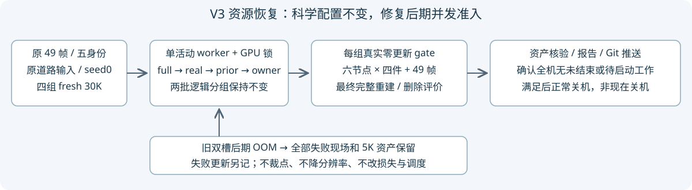

# V3 后期显存准入恢复与完成后关机授权

task：WS-V82-GN11-V3-RESOURCE-RECOVERY-R1-20261021。当前执行状态只更新仓库 `docs/RESEARCH_STATUS.md`。

## 已确认的资源失败

原 `r15_gn11_stage1_v3_publish_r2_20261021` 两组在同一张实测32GiB GPU上后期同时反传耗尽显存。错误显示两个进程占约15.39/15.90GiB，设备只余约168–176MiB，分别申请384/404MiB失败；不是七通道发布合同再次失效，也不是科学方法被否定。

实际三Adam计数：full8400、real_only7752。real_only的`status.iteration=7700`仅为上一个100步快照，不可用它代替已执行7752次更新。旧2×5K发布失败共10,000另记，因此累计失败训练更新为26,152；0步gate及CPU测试不计训练更新。没有删除、覆写任何旧资产。两组完整5K四件及49帧评价仍保留，未声称已验收实际5K中断续训路径。

先前启动时余量和5K保存成功不足以保证后期两组同时运行，这是资源准入缺口。修复后物理槽固定为1，逻辑批次仍`[full,real_only]`后`[prior_only,ownership_only]`；实际依序运行。它不是逐车资产、第三分支、裁点或方法消融。

用户随后明确确认：“嗯，要是没法2+2，就只能1+1+1+1了”。当前full继续运行，不因这次确认再次重启。

## 科学协议与工程改动

- 新目录 `r15_gn11_stage1_v3_serial_r1_20261021`；原49训练/49道路参考、seed0、五身份、每组fresh stage1 30K/stage2 0、六个5K保存节点不变；同一V3道路包只读复用。
- 表示、时间自由度、全部已审核损失及归一化、原生点数/增密/SGCM/NPS/分辨率不变。没有为通过资源门限降低训练配置。
- `v3_resource_recovery.py`统一校验计划与授权的单槽政策，拒绝混用旧物理双槽政策；单组入口同样检查，不能绕过控制器。
- 复用单进程队列`run_v3_four_arms.py`，每次同步等待唯一子进程结束，再进下一gate/train。所有输出/日志要求fresh；完成检查同时要求三个Adam各30000，不仅检查逻辑步数。
- `check_v3_progress.py`支持单槽注册表、逻辑批次和实际活动arm；待启动peer不误判为故障，PID需匹配真实runner/plan/arm/mode/output。10分钟起步，资源/新arm风险重新从10分钟检查。
- [CPU凭据](validation.json)及[完整日志](unittest.log)：79项通过、0失败/错误/跳过。新增单槽授权、拒绝陈旧双槽、实际失败计数/30K终态、待启动peer监控回归。最初新测试误用了`/tmp`所在文件系统的实际余量，已明确mock资源接口后全量重跑；失败CPU凭据仍在campaign中，不是GPU试跑。

新full的[实际CUDA准入](full_gpu_gate_receipt.json)和[0步发布／严格状态恢复](full_publication_smoke_receipt.json)已通过；[重跑后快照](restart_snapshot.json)仅说明工程执行与资源状态，不等于30K完成或质量验收。

## 新的人类授权与关机条件

用户已明确授权“所有bug自己修好并完整跑好四实验；四实验全部顺利完成后关闭远端AutoDL，不需再次审批”。[原始授权与机器可读条件](OPERATOR_AUTHORIZATION.json)记录于当前campaign及仓库；这改变此前仅监控、失败后不得修复/重跑、无关机授权的范围，不代表现在可以关机。

工程错误需诊断、局部修复和验证，失败现场保留，修复/必要重放另记。不得通过改科研条件、无限重调超参或代填`human_verdict`来制造成功。控制器本身仍不盲目重试；已授权的代理可在确认问题并修复后重新准入。

关机前必须完成四组真实30K、每组六个四件+49帧节点、正式49帧完整重建与删除五车/道路/联合评价及资产核验，保存报告/代码/结果索引并Git推送；再检查全机没有未结束训练、评价、数据处理、渲染或会启动作业的控制器/队列。GPU空闲、异常退出、仅train返回、只有gate或缺最终删除评价都不算完成。不得强杀不相关工作，不释放/销毁实例或删数据。当前`/usr/bin/shutdown`仅确认存在，未执行任何关机动作。

计划见[recovery_plan.json](recovery_plan.json)；[旧full OOM状态](oom_full_status.json)、[旧real_only OOM状态](oom_real_only_status.json)。图中最终评价/关机是执行条件，不是已经完成的结果。当前原始控制器仍会返回`FOUR_ARMS_TRAINING_COMPLETE_EVALUATION_PENDING`，最终删除评价脚本缺口必须由收尾过程实现/验证，不能跳过。

`human_verdict=null`、`quality_accepted=false`；`failure_ledger_refs=[V82-F01,V82-F06]`、`failure_ledger_delta=none`。资源恢复没有证明视觉质量或后期单组最大容量，仍需实际节点/峰值监控。
