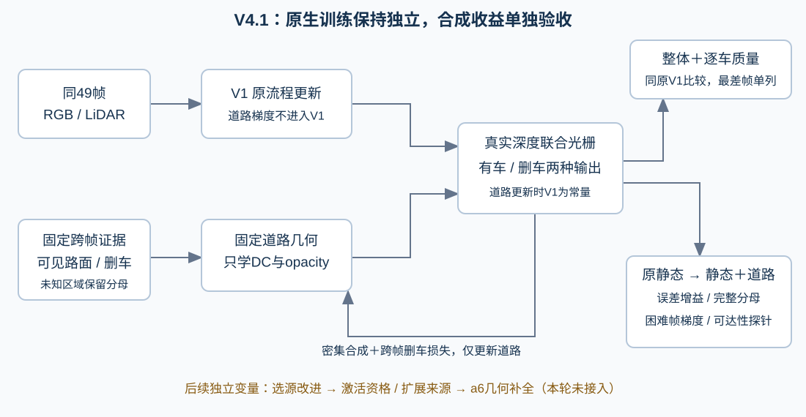

# V4.1：把补全收益、证据缺口和遮挡上限分开验收

2026-10-24。本轮修复评价与诊断，完成49帧只读CPU审计。**没有更改训练损失、采样、学习率、道路几何、活跃容量或监督数据；没有启动GPU。** 当前仍是固定几何R的阶段性方案，a6和a37完整目标均未通过。

## 已补齐的评价缺项

同checkpoint、同一车辆原轮廓、同固定双源监督域、同跨帧参考，比较原静态删车图与静态＋道路图的MAE/MSE及差值。差值定义为加入道路后减去加入前，负值表示误差改善。主口径将浮点RGB限到[0,1]，同时保存未限制的误差；该跨帧参考不是隐藏路面GT，也不是独立测试集。

逐像素以RGB通道平均绝对误差比较，容差1e-6，分别记录改善、退化、不变。49帧汇总按像素帧加权，逐车报告最差MAE/MSE差值帧、最少标签覆盖帧及所有零标签帧。没有标签时误差为null，不能用0表示成功。

贡献、连通性和颜色一致性同时报告“双源域分母”和“完整原车辆轮廓分母”。全轮廓包括未知区域；其中没有标签的像素只报告贡献，不判颜色正确。已验证颜色且有贡献的面积/全轮廓，只是已验证比例，不是完整补全率。轮廓也不保证下面全部是道路；所有统计为49帧累计像素，不是世界面积。

评价新增`crossview_deleted_comparison`，各帧保留`crossview_deleted`。这证明的是“静态＋道路”的输出是否改善，不改变原静态参数及内部残影。

## 49帧证据缺口的实际分解

各列互斥且合计等于完整车辆轮廓分母。

| 对象 | 完整轮廓 | 未通过固定参考面检查 | 有参考面但非R单元 | R单元不足双源 | 首两源颜色不一致 | 当前双源标签 |
|---|---:|---:|---:|---:|---:|---:|
| a37 | 555,950 | 94,672 | 222,874 | 3,709 | 102,875 | 131,820（23.71%） |
| a6 | 45,418 | 27,610 | 17,808 | 0 | 0 | 0 |

“未通过固定参考面”包含射线范围、四角支撑、法线或交点收敛失败，不能直接解释为原始LiDAR完全没有点。“有参考面但非R”也不等于没有高斯；当前R活跃规则只允许已有可靠观测单元。

对a37/a6所有已有支撑的轮廓像素，重新检查其余48帧，保持框外、车辆保护、实测小三角形和深度门限。用全部合格颜色的逐通道中位数作为共识中心，候选要求颜色MAE≤0.05、至少3个来源、且占合格来源至少60%。不挑任意一对碰巧一致的颜色，也不读取目标帧车辆RGB。**这是机会审计，未生成新训练标签。**

| a37原拒绝原因 | 原像素帧 | 多源共识候选 | 改法的变量成本 |
|---|---:|---:|---|
| 首两源颜色不一致 | 102,875 | 84,248 | 可在原R活跃单元内改进选源，几何与容量不动 |
| 有参考面但非R | 222,874 | 20,506 | 需要复核单元资格，激活会改变有效容量，必须单独对照 |

raw102对应两类新增候选为2,504与703；raw129为70与38；raw137均为0。a6的17,808个已有参考面、非R候选在当前门限下连一个合格源都没有。其原因可能包括未曝光或保守门限，不能由此断言物理不可见。

上述候选还没有经过独立留出来源、空间连通性及颜色偏差验收。相邻视频帧高度相关；中位数也可能模糊车道线、混合阴影。不能把候选数量直接算成最终标签增长，更不能算成重建收益。

## 借鉴哪些已有方法，具体取哪一部分

1. **多视图逐像素选源 → a37先修证据利用。** COLMAP对应的ECCV 2016论文把视图选择与光度、几何可靠性结合。本项目可借鉴其“按像素验证多个来源”的思想，替换按帧序遇到前两个就停止的规则；不整体替换重建管线。先只在原R活跃单元做来源改进，将其他来源留作验证，保存全部来源与拒绝原因，避免用同一颜色簇既造标签又宣称泛化。[原论文](https://demuc.de/papers/schoenberger2016mvs.pdf)

2. **道路结构化曲面 → a6独立补几何。** RoGS使用道路表面高斯及轨迹辅助初始化。可借鉴“道路是有边界的连续薄面”这一表达：先回查原始LiDAR，修复有证据却被筛掉的单元；仍缺实测支撑时，才在相连可靠道路之间尝试受限曲面延拓。新增单元、延拓距离、拟合残差与法线必须独立记录；有几何不等于有真实颜色。第一步仍沿用现有真实深度光栅器，不同时更换V1或整套2DGS渲染。[原论文](https://arxiv.org/html/2405.14342v1)

3. **多目标梯度诊断 → 先查冲突，不盲目加覆盖权重。** PCGrad研究目标梯度冲突及投影处理；这里只借鉴分开测量梯度的思路。当前不导入梯度投影，因为它改变优化方法，而且不保证车身质量。若质量保护与补路梯度长期反向，应先确认冻结背景遮挡及道路表达是否使目标不可兼容，再单独研究优化修改。[原论文](https://arxiv.org/abs/2001.06782)

以上是针对本项目的迁移建议，论文没有证明这些修改一定能修复当前场景。

## a37：先辨别“能收到更新”还是“固定模型根本露不出来”

真实smoke已新增raw102、raw129、raw137的逐车只读诊断入口：分别求删车颜色损失对DC/opacity的梯度、实际道路贡献及贡献损失对opacity的梯度，同时记录完整轮廓与有标签域。a5/a26的非零梯度不能代替a37；raw137没有标签，颜色诊断明确标为NO_REFERENCE。非零梯度只能证明路径存在，不能证明困难区域已改善。

同一诊断还暂时将道路opacity推到接近1、保持几何和原静态不动，测量道路实际可见贡献，随后恢复原参数；不更新优化器。这是当前光栅器下的可达性探针，不是严格物理上界证明。若独立道路覆盖高而探针在困难区仍低，说明固定布局/前方原静态遮挡限制了补层。提高覆盖权重或继续长跑未必有用。

单层的直观关系是道路贡献约等于“道路之前的透射率×道路alpha”；前方透射率接近0时，提高道路alpha没有足够空间。此时应如实判当前固定补层方案在该域受限。不能偷偷把道路拉到车前，也不能自动裁掉原静态高斯来维持本对照。

## a6：先用已有证据区分颜色缺口与几何缺口

仓库已有199帧只读审计，在独立的同口径49/199比较中，raw89/a6的493个固定世界单元从0个确认增加到225个，来源位于raw149–198；其中179个仍无固定曲面支撑，另42个零来源、47个单来源。这与本轮像素分母、掩码口径不同，不能混算。

因此应优先登记两项独立后续：①原V1仍只训练49帧，道路单独增加199帧真实来源，保持已有几何；②单独补足缺失几何，分清实测恢复和曲面先验。前者不能填不存在的道路单元，后者不能凭空产生真实纹理。当前49帧合同不接入199候选，也不启动这两项新实验。

## 推进顺序与停止条件

先完成同域增益评价与困难帧可达性诊断；再做原R单元内的选源改进对照；之后单独研究非R单元资格、扩展真实来源和a6几何补全，避免把多个机制一次性混入。

每一阶段都要同时守住：同checkpoint原V1的49帧浮点PSNR/SSIM/LPIPS、每辆车内部/边缘与最差帧、正常背景；以及原静态→静态＋道路的同域增益、完整轮廓贡献/已验证颜色/连通性。质量约束目前仍是软损失，不能保证零退化；整体指标回升但道路变透明，或局部补路伴随车身下降，都不能通过。

当前交付：评价缺项、逐车梯度及不透明探针代码已准备，CPU证据审计完成，真实GPU效果未测。长跑前仍必须完成真实约10分钟smoke、checkpoint保存/评价/精确恢复/下一阶段入口。旧R、RP现场及所有输入保留，RP仍暂停；没有电源操作。质量最终由用户评审。
