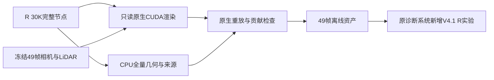

# V4.1-R 30K 接入原离线诊断系统

本次零更新恢复正式 R 的同一 30K checkpoint，保留原 V4/V3/V1 实验，新增 `v4_1_R`。同批 raw89–137 共49帧、480×320；原路径相机、RGB/LiDAR、时间戳与固定道路绑定经检查。只读恢复不创建 optimizer；单帧真实 CUDA 接线验证后导出完整49帧，未停止或重启 B。

界面新增“同checkpoint · 原V1完整重建”“同checkpoint · 原静态删车”两个图像通道，与最终完整合成/静态＋道路删车、动态、独立道路、道路颜色共343张无损WEBP。所有图为显示用量化图，不代替正式浮点PSNR/SSIM/LPIPS。49帧深度/alpha/同次排序道路贡献、独立道路/普通背景深度、固定道路状态和普通高斯采样分块同时打包。初始化14034、输出资格1919；未输出单元sidecar保留。既有普通背景/动态2%默认采样和单车增采样可用，道路全量。

原V1完整图逐帧重放训练保存PNG，最大绝对误差0.00196081，处于半灰度量化范围；道路贡献通过同一次真实光栅的one-hot feature累计，并与原合成器比较。所有检查点只读；对全部图像、地图、分块和道路身份运行独立验证。`ready.json` 绑定输入、逐帧检查与各文件；只有全49帧验证通过才登记为可用。新增通道在未导出的历史组显示不适用，不请求不存在的资产。

原入口 `export_offline.ps1 -Arms v4_1_R` 可重导出；正式训练由现有控制器独立执行。导出进程PyTorch分配器预算取8GiB与总显存25%的较小值（不等同整个CUDA进程显存硬限额），推理前至少12GiB空闲；进程CUDA峰值记入render_receipt，B期间设备NVML可能包含此辅助推理，不能误当B单进程训练峰值。探针和正式导出均为0训练更新。

当前工程可用不等于质量通过。a37跨帧参考仅覆盖131820/555950像素帧（23.71%），a6无标签且固定几何不补缺失单元；不能以高alpha或局部改善宣称道路已完整恢复。原生逐Gaussian训练trace/干预未导出，不套用历史V3轨迹。`quality_accepted=false`，`human_verdict=null`；failure_ledger_refs=[V82-F01,V82-F06]，failure_ledger_delta=none。

派生资产：`/root/autodl-tmp/gsdiag_v41_R_30k_20261024_r1`；源代码位于诊断系统原src。用户交付目录仍为原 `GS_Reconstruction_Diagnostics_20261021_Evidence_r1`。浏览器工具拒绝file协议，未绕过；Node对实际app函数/资产及Python完整性验证单列，不冒称浏览器交互验收。
