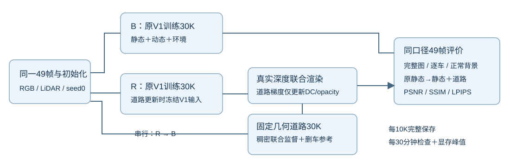

# V4.1 与原 V1 的两组30K对照

Task：`WS-V82-R15-GN11-V41-PAIRED30K-20261024`。用户在阅读真实smoke报告后，明确要求直接完成30K再看指标；随后指定暂时串行、每30分钟检查进度、全程监控显存峰值。当前执行状态以仓库 `docs/RESEARCH_STATUS.md` 和 campaign 的 `formal_serial_status.json` 为准。

|训练组|训练路径|正式更新预算|完整节点|
|---|---|---|---|
|R：当前V4.1|原V1每步原样更新；固定几何道路另做稠密联合/删车监督，仅更新道路DC和opacity|V1 30000，道路30000|10K/20K/30K：静态、动态、环境、训练状态、道路五件及manifest|
|B：原V1|直接运行原V1源码，不安装道路hook，不传道路训练字段|V1 30000，道路0|10K/20K/30K：静态、动态、环境、训练状态四件|

R先启动，正常返回并确认三个完整节点后，唯一控制器自动接B；两组均fresh，不从1000步smoke继续，不追加正式步数。共同49帧raw89–137、480×320、seed0，原V1初始化、损失/采样/学习率/SGCM/NPS/增密裁剪预算均沿用基线。R道路14034点、活跃资格1919，位置/尺度/朝向/数量固定；道路独立RNG并保护V1 RNG。属于等步数、有额外道路容量与计算的对照。

原V1原生保存/评价路径已在约18分钟真实smoke中执行，500步的CUDA恢复后状态逐项精确一致并成功续训到1000。工程V1/道路各2000更新单列。两次fresh轨迹在恢复之前已非逐位一致，严格轨迹门禁仍失败，1000步车身/感知质量仍有退化；原报告、receipt、checkpoint和日志保留。此次正式执行依据最新用户授权 `formal_authorization.json`，没有把旧smoke改判为全通过，也没有修改方法来绕过科学问题。

原V1对照启动前，先用既有smoke的原生四件、零优化更新验证新增B评价入口。fixture明确标记为工程评价输入，不是B训练；验证49帧指标与既有同checkpoint原生结果一致后，才从共同初始化启动B。此只读检查与正式训练保持串行，耗时另外记录。

两组30K正常返回后自动分别做49帧浮点评价，主指标按V1先clamp到[0,1]，计算逐帧PSNR/SSIM/LPIPS后平均，原始未clamp误差另保留。比较独立B、R同checkpoint原V1输出和R最终合成，完整图、逐车内部/边缘、正常背景分别报告。删车用同固定跨帧参考域比较原静态→静态+道路，保留改善/退化比例、逐车最差帧、完整目标分母与未知区域。CPU另核对两组原V1模型/Adam/RNG/采样状态，差异原样报告，不宣称CUDA逐位确定。

a37仍只有131820/555950像素帧带跨帧颜色参考，约23.71%；R7新增接纳标签为0。a6仍无标签，本轮固定几何没有其补全机制。30K结果能检验当前受控方法的最终表现，不能预先认定a6/a37解决。旧V4-R30K仅作历史参考，不恢复旧RP或再训练旧V4；口径不同指标不混比。质量由用户评审，`quality_accepted=false`、`human_verdict=null`。

显存通过驱动NVML每秒采样，按整个队列和阶段保存驻留峰值；R同时逐100步记录从启动累计的CUDA allocated/reserved峰值，B在整个原生training()返回后记录CUDA峰值。NVML采样可能漏掉亚秒峰值，两种口径分别报告。监控器不用CUDA前向，不影响优化器或随机状态；监控故障恢复保留已有峰值和时间缺口。

活动目录：`/root/autodl-tmp/drivingeditor_repro/campaign/r15_gn11_stage1_v41_20261023`。Python：`/root/autodl-tmp/envs/drivingeditor/bin/python`；SSH：`wm-vgpu-1011`。唯一控制器 `tools/run_v41_formal_serial.py`；单次只读检查 `tools/check_v41_formal_progress.py --campaign <目录>`。控制器不会提前关机。训练结束后完成CPU验收、报告/可视化、提交推送与必要结果取回并验证，最后才按资源规则处理电源。

`failure_ledger_refs=[V82-F01,V82-F06]`；`failure_ledger_delta=none`。本登记没有增加新失败结论；所有数据、模型、日志留远端，不进入Git。
