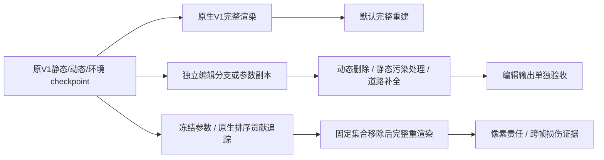

# V4.1-R 中心残影归因与完整重建分路

2026-10-24；R checkpoint 30K，raw102。只读诊断、零更新。B正式训练继续；未修改训练合同。quality_accepted=false，human_verdict=null。

编辑分支中的静态污染处理是后续研究建议，尚未实现。本次落实的是诊断及查看器默认通道，不改正在执行的R/B方法，不把V1通道切换当作道路联合质量改善。

## 分支责任

用户图一对应原静态＋道路＋环境，动态分支完全不参与。去掉道路的同checkpoint原静态图中，中心车形及拖影已存在。

| raw102像素 | 删车参与数 | 普通静态Tα | 道路Tα | 道路独立alpha |
|---|---:|---:|---:|---:|
| 中心黑部 (255,240) | 327 | 0.999899 | 0 | 0 |
| 彩色上缘 (255,214) | 1038 | 0.999900 | 0 | 0 |
| 近处拖影 (255,290) | 309 | 0.988255 | 0.011623 | 0.043672 |
| 左侧黑影 (90,255) | 见离线完整trace | 0.975267 | 0.024631 | 0.352721 |

所有删车trace动态贡献0。中心黑部在完整联合图中动态贡献0.99742，普通静态0.00248；动态车掩盖了其后的静态污染。中心两个像素道路本身无覆盖，不能仅凭道路联合贡献0诊断遮挡；拖影与左侧黑影还存在静态对已有道路的透射抑制。

历史V3 full同一像素(255,240)旧原生trace为普通静态0.48548、道路0.51442、动态0。V3蓝黑色残影有道路层参与，与V4.1当前责任分布不同。历史指标不与本轮正式浮点指标混比。

## 初始化污染与谱系传播

中心黑部最高Tα行static:1890789、彩色上缘最高Tα行static:1957322，均记录根谱系448440。根来自input.ply第459203行，时间对应raw109，投影(249.61,202.20)，在目标车mask中；源点相机z=16.07105m，同像素LiDAR=16.07064m，离拟合地面约0.752m。距原动态点云最近点0.100078m，略大于原生静态排除阈值0.1m，因而进入静态初始化。共同支持车辆表面几何混入静态的诊断；初始RGB实际为原生零色初始化，不能称初始车身RGB直接复制。

核对了原生Open3D点顺序、input.ply与source points3d点值、全部动态PLY、KD-tree排除mask逐项一致。过滤后585943静态点与训练初始日志一致；保存谱系有效且与clone/split父索引继承代码一致。

| 节点 | 静态总数 | 根448440后代数 | 根420021后代数 |
|---|---:|---:|---:|
| 10K | 1449412 | 543783 | 1445 |
| 20K | 1974298 | 926556 | 1724 |
| 30K | 1974298 | 926556 | 1724 |

根谱系不是唯一高斯身份，也不证明全部后代均错误。没有逐事件记录，不能把全部增长归因于SGCM；原生普通clone/split也继承此字段。不要整根删除926556后代。

拖影重要根420021来自raw111的近地面暗色输入，离拟合平面约0.156m，不可直接当作车辆表面污染。当前“静态”仍使用时间参数与运动函数，速度/寿命正则不是严格零运动约束。原静态RGB监督排除车辆mask，完整图颜色损失不保证分支语义唯一；这解释了为何完整图可由动态遮盖污染，而删车暴露它。不能仅凭本次终态数据确定每个后代的全部优化历史。

## 因果干预和操作

新增raw102五点×四模式(ordinary/deleted_five/joint/road_only)20条原生缓冲区trace，RGB/alpha/depth/T重放最大误差0、每查询Top20 ID独立one-hot权重误差0。模式的原生整图与既有复合渲染回放核对。

每点按Tα选择20个普通静态行，只在渲染输入mask排除，原checkpoint参数未改；对同一集合在raw102/89/113/137重渲染。中心黑部移除后仍有0.99989 alpha且道路贡献0；拖影移除后显著变亮并出现亮斑，目标车mask外有观测损伤。排序不是错误标签。mask外MAE是观测区损伤筛查，不等于可靠路面语义或隐藏道路GT。

原诊断包新增`V41_GHOST_DIAGNOSIS.html`。选择V4.1 R→raw102→“前车黑色残影”(255,240)，对比原静态删车和删除五车；射线模式“删除五车”、排序Tα，可以查看原生贡献、椭球和自动载入的固定Top20移除。新增上缘(255,214)和拖影(255,290)预设。任意像素/任意集合实时V4.1接口尚未开放，未覆盖点保持未知。

默认二维通道改为native_v1：同R checkpoint原静态＋原动态＋环境，完全不加入道路。仍保留joint为道路联合诊断、deleted_five为编辑候选；下方数值明确标注固定绑定道路联合/删车对照，不冒充原V1 RGB通道指标。R内部原V1通路不等于独立fresh B逐位一致，B完成后按合同评估。

合理的后续架构是完整输出固定原V1基线，编辑副本中处理经跨帧证据确认的污染/补全，检查正常区和剩余车辆；原模型不被编辑损失覆写。无编辑输出必须与所选原V1基线一致。单靠改显示路径不会解决编辑质量或a6缺几何，不自动启动新实验。

## 执行与验证

GPU只读推理时间2026-10-24T09:37:34Z—09:38:13Z；CUDA allocated峰值4942179328B、reserved6132072448B，CPU谱系检查额外运行。设备NVML该时段含B与推理，不能当B独立峰值。后续修正了摘要road_only RGB不应加环境的显示字段；原生trace/reference和干预数据不变，没有额外训练。

49帧原有R通道/历史实验回归、20条实际缓存加载路径、固定干预加载、未覆盖像素保持未知、100张干预图文件均经Node脚本验证。file URL浏览器工具不支持，未冒称浏览器UI验证。原始结果在远端`/root/autodl-tmp/gsdiag_v41_ghost_20261024_r1`及用户原诊断包；模型/数据/日志不入Git。

failure_ledger_refs=[V82-F01,V82-F06]，failure_ledger_delta=none。
