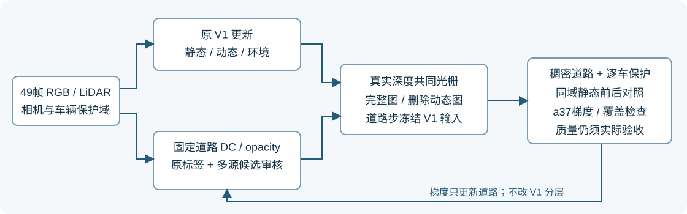

# V4.1 多源复核与真实 GPU smoke

## 当前结论

真实GPU生命周期 smoke 已执行完毕。正式30K、旧RP、B均未启动。CPU 41项测试、实际49帧513249次来源复核通过；原151文件和剥离两hook的train保持一致。道路14034点、R活跃1919，训练步函数、损失函数和渲染函数的AST与R5一致。

本轮多源扩展**新增有效标签为0**。R7完整保存R5的199108个标签与颜色，不能把R7版本号当成覆盖提高。a37仍131820/555950像素帧（23.71%），a6仍0/45418；这些不是世界面积或最终补全率。

## 来源筛选的真实结果

R7尝试对原R单元中R5拒绝的候选增加标签：固定7帧时间块，第2/5块用于验证，边界留1帧；拟合至少3个同色来源、60%支持、跨度至少4帧；验证至少2源及60%支持，RGB MAE阈值0.05；新增8邻域分量至少9像素。验证颜色只用于门控，不进入拟合目标。本帧车辆RGB从不进入道路标签；不是独立模型测试集。

a37候选106584，拟合共识23289，其中19289缺两个验证来源、3705颜色验证未通过、295通过颜色验证，但都未形成至少9像素的新增连通分量。有效观测集中在raw120–137，固定全局留出区间与局部可见时间不匹配。无来源和被拒绝区域仍明确未知，没有降低阈值强行恢复。

另作一次独立CPU候选审计：按几何可见性预留最后两个源帧、留1帧间隔，颜色阈值/至少3拟合源/跨度4/连通9不变。a37有1006像素通过两源验证，但连通筛选后仍0。该候选未接入训练，说明简单更换留出区间也未得到可接纳的连续监督；不应为提高计数反复试阈值。

## 验收口径

原静态→静态＋道路使用同checkpoint、同固定轮廓分母、同跨帧参考，报告MAE/MSE前后值和差值、改善/退化比例、逐车最差帧。R5原标签、新标签、并集分别汇总，避免标签扩展更换评价标尺。无标签误差为null，原始浮点另存；完整49帧主指标按V1先clamp[0,1]，PSNR/SSIM/LPIPS和各车内部/边缘单列。

smoke包含连续1000、500+恢复到1000、200/500/1000完整五件保存、原生评价、完整状态比较和正式评价入口。raw102/129/137单独审计a37颜色/实际贡献梯度，不用a5/a26梯度代替；同几何不透明道路探针用于观察可见性限制，不是物理上界。另并行评价200步节点，零额外训练更新。工程计划V1/道路各2000更新，与正式预算分开。

当前监督没有扩大，a6几何问题没有解决。真实smoke已覆盖接线、保存、恢复及评价；严格轨迹比较和质量验收未通过，不能替代30K最终结论。所有软损失仍可能冲突，quality_accepted=false。未增加199帧来源、非R资格、几何或V3分层修改。

## 实际smoke收口

V1/道路各完成 2000 次工程更新，正式更新0；两条路径六个五件节点完整。
原控制器状态：`FAILED_OR_INCOMPLETE_SMOKE`。错误：`第 3 阶段失败，保留完整现场`。
恢复后、下一更新前的原生状态核对：`PASS_EXACT_CUDA_RESTORE`；道路状态：`PASS_EXACT_ROAD_RESTORE`。
两次fresh CUDA训练在恢复前的200步已经不是逐位一致；这不能证明恢复错误，也不能据此宣布逐位轨迹一致。严格失败结果原样保留，未签发正式长跑准入。

|同1000步checkpoint、49帧浮点|原V1|加道路|差值|
|---|---:|---:|---:|
|psnr|21.790805|21.856501|+0.065697|
|ssim|0.757256|0.756040|-0.001215|
|lpips|0.238325|0.251955|+0.013630|

这只是1000步smoke，不能与30K的V3/V4直接比较，也不能据此判定最终质量已通过。
a37的删车前后误差只在固定跨帧参考域计算，完整轮廓分母保持555950，标签131820（23.71%）；未知区未当作成功。

|车辆|删车前MAE|删车加道路MAE|差值|有标签/全轮廓像素帧|
|---|---:|---:|---:|---:|
|a5|0.027625|0.018259|-0.009366|39123/121128|
|a26|0.027440|0.019046|-0.008394|28165/116261|
|a18|未知|未知|未知|0/13107|
|a6|未知|未知|未知|0/45418|
|a37|0.057785|0.037701|-0.020084|131820/555950|

a37固定困难帧梯度检查失败项：[]。非零梯度不等于已补全；a6仍无标签/新增几何。
a37同几何不透明道路探针：raw102/raw129/raw137的完整轮廓内、道路实际贡献≥0.25的像素比例分别62.93%/15.58%/0%。这是当前光栅与固定几何下的探针，非物理上界；raw137不能只靠把当前道路opacity提高就补齐。
a37标签域中74.95%像素误差改善、25.05%退化；改善像素只占完整轮廓累计17.77%，不能把标签域收益推广到全车后道路。
200步额外评价属于零优化更新诊断。所有checkpoint、旧失败现场、训练日志和完整49帧原始浮点保留远端；49帧最终PNG与浮点指标、raw102/129/137原始浮点、报告、源码及凭据取回本地。
按用户要求，完成收尾与活动任务排查后关闭AutoDL；实际关机观察单独记录在power_status.json。
