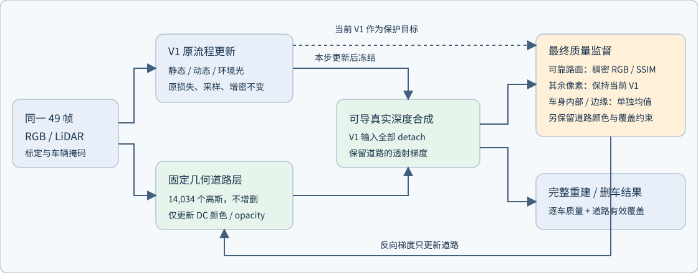

# V4.1 修订：复核三维框空角，约束有来源的删车道路

task=`WS-V82-R15-GN11-V41-PRE-GPU-20261023`；方法版本 `GN11_V41_DENSE_COMPOSITE_ROAD_R5_20261024`。仅固定几何 R；停在 GPU 启动前，真实场景训练更新 0。旧 R 模型、RP 暂停现场及所有旧监督域保留。



## 当前卡点与评价修订

同域原静态→静态＋道路误差增益、逐车最差帧、完整轮廓分母已补齐；真实smoke增加raw102/129/137逐车梯度和不透明道路可达性探针，零额外优化更新。49帧只读审计发现a37选源改进空间，a6仍需独立来源与几何路径；所有候选尚未晋升标签，训练方法保持R5。完整原因分解、原始研究依据、后续对照与边界见[卡点审计](BOTTLENECK_REVIEW.md)。

## 本轮修正了什么

三维包围盒包含车身轮廓外的空角，不能把射线穿框直接等同于实际遮挡。现在保留框相交标记，将它送入复核：像素须在车辆内部及边缘保护带外、属于原 R 可学习道路单元、通过同帧 LiDAR 小三角形/深度验证，且另一个不同帧存在**框外、车辆保护域外、深度一致**的观测。源帧双线性插值足迹须完整有效；新恢复像素不会互相循环担保。未知、先验单元和缺失几何均不升级。

raw102 的 4,277 个候选最终恢复 4,241 个，36 个仍缺跨帧证据。可靠道路像素从 9,344 增至 13,585，SSIM 窗口从 3,521 增至 5,399。用户指出的两个像素逐点来源见 `receipts/pixel_examples.json`（离线报告根目录也有副本）。

49 帧合计可靠路面 645,888 → 781,389（平均 15,946.71/帧），新增 135,501、移除 0；仍未通过的框相交候选 1,618。有效 SSIM 窗口 301,872。可见道路监督与车辆/边缘交集 0，UNKNOWN/PRIOR 获道路颜色标签 0。这是几何筛选结果，不是人工语义真值证明。

## 防止靠透明道路恢复指标

新增训练分支与既有默认删车评价一致：移除全部动态高斯，保留冻结的静态高斯和环境光，与道路按真实深度共同光栅化。不修改 V1 分层，不删除其静态残影。

目标区域 D 只取五辆目标车原轮廓下的**已有、R-observed 固定道路表面**。每个像素必须在另外两个不同帧得到框外可见 LiDAR 几何确认；按原帧序取前两个几何见证，颜色 MAE≤0.05 才保留，两颜色均值作为跨帧观测派生目标。没有本帧车辆 RGB、初始化灰色、邻域传播或生成颜色；同一49帧属于训练内观测，不是独立测试真值。

新增损失为 `1.0 × mean_actor(mean_D |C_delete - RGB_two_sources|) + 0.1 × mean_actor(mean_D relu(0.25 - A_road_in_delete)^2)`。后者使用同次光栅中的道路 T×alpha 实际贡献，不能用独立道路 alpha 或整景总 alpha 替代。D 不随预测 opacity/误差缩小，空域记 0 并显式计数，不冒充补全通过。每帧固定像素约束也覆盖相邻缺口，但有效连通性仍须实际验收；没有另加颜色平滑项，以免抹去车道线。

49帧 312,154 个候选中，302,100 有两个几何见证，199,108 通过两源颜色一致性检查。逐车像素帧数：{"5": 39123, "26": 28165, "18": 0, "6": 0, "37": 131820}。**a6 与 a18 为 0**，不会拿这两辆车的像素充当路面标签；a6 缺失几何仍未解决。

## 原有质量保护与控制变量

每一步先完成原 V1 更新，再只更新道路 DC/opacity；固定 14,034 个道路高斯、R 活跃单元 1,919，不改变位置、尺度、朝向、数量、V1 损失、采样、学习率、SGCM/NPS 和增密预算。仍为每步道路采样两帧、一次 Adam，正式双方各30K，每10K完整五件保存。删车前向在完整图 backward 后顺序执行，避免同时保留两套全景反传缓存；新增计算单列，非等计算量。

完整合成仍在 M 使用 `0.8 RGB L1 + 0.2 mask-aware DSSIM`，另保留稠密道路颜色来源 Charbonnier 项；P=非M使用冻结当前 V1 的完整图参考。每辆车内部、边缘及其余背景分别归一，各权重1；原 V4 中心独立覆盖权重0.1、目标0.95仍保留。11×11 SSIM窗口只统计 M 内像素，至少80%有效；车辆与未知颜色不进入路面 SSIM。

这些图像约束仍是**软损失**，不保证零退化。新的删车颜色/贡献目标可能与完整图保护冲突；原静态高斯若挡在道路前面，0.25贡献目标可能不可达。本轮不通过移动几何或改静态分层来隐藏冲突。固定 DC 的表达能力、跨帧阴影/反射变化及几何误差仍可能限制效果。权重尚未经真实实验校准。

## 验收与工程状态

151 个原文件一致，train.py 删除两处 hook 后逐字等于原 V1。34项V4.1 CPU机制/评价/诊断测试通过；28项继承回归在上次修订通过，本轮继承代码未改；同49帧相机/配置/数据绑定、原生恢复配置检查通过。实际证据复核重新投影 1,179,605 个来源检查，检查域、深度、两个不同源帧及源颜色均值。CPU解析光栅仅验证机制，不冒充真实CUDA反传或质量结果。

完整49帧使用原 V1 `[0,1]` 浮点 PSNR/SSIM/LPIPS，原始浮点另存；逐车内部、边缘、最差帧及正常背景单列。删车同时报告真实道路贡献、固定分母连通性，以及最终删车合成与双源颜色的一致性。旧同世界单元颜色代理与新逐像素双源指标分别保留，均不称隐藏路面GT。若只恢复完整图指标、道路仍透明/断裂，或补路伴随车身退化，均不能算成功。

真实约10分钟 smoke 仍必须覆盖200/500/1000保存与评价、500→1000完整恢复、下一阶段入口和49帧评价；新增检查要求逐车分离的删车梯度；a37在raw102/129有残差却没有有效DC/opacity路径时不能被a5/a26的梯度替代；raw137零标签标为未知。工程更新另计，成功不自动开正式长跑。当前未执行 GPU smoke、训练或评价，旧 RP/心跳保持暂停，没有电源操作。

## 复现入口

主机 `wm-vgpu-1011`；Python `/root/autodl-tmp/envs/drivingeditor/bin/python`。

```
campaign=/root/autodl-tmp/drivingeditor_repro/campaign/r15_gn11_stage1_v41_20261023
dense=/root/autodl-tmp/drivingeditor_repro/campaign/r15_gn11_stage1_v41_20261023_dense_r5/manifest.json
```

活动预处理入口为 `tools/prepare_v41_revision.py --bundle <原bundle> --previous <旧dense_r4> --output <新目录> --engine <V41 engine>`；原R2/R3/R4脚本和产物只保留作历史对照。`validate_v41_evidence.py`检查实际来源，`validate_v41_cpu.py`检查相机/配置/隔离绑定。正式与smoke入口仍默认dry-run；没有`--execute`不运行GPU。当前GPU启动前边界继续生效。

failure_ledger_refs=[V82-F01,V82-F06]；failure_ledger_delta=none；quality_accepted=false；human_verdict=null。
