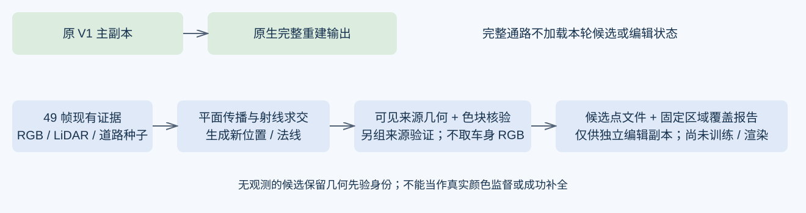

# V4.2：GaussianPro 机制的 CPU 实证与下一步边界

2026-10-24。已执行同49帧的全目标像素 CPU 检验，未启动 GPU、未更新优化器或原 V1/R/B checkpoint。**新增位置有局部收益，但本轮改进没有改善最关键的 a37 中央空洞，不能作为已成立的 V4.2 主方法。**



## 与“跨帧取色”的实际区别

[GaussianPro 论文](https://arxiv.org/abs/2402.14650)及[官方 version1.0 实现](https://github.com/kcheng1021/GaussianPro/tree/version1.0)的关键步骤是：从 Gaussian 几何得到局部平面，传播并选择深度/法线假设，经过多视图几何一致性检查后反投影生成新点。官方 `train.py` 使用2像素、1%相对深度的回投一致性以及至少两个来源；增点发生在训练内部。

旧 V4.1 在既定位置查询颜色。本轮实现显式的射线—平面求交、新 XYZ/法线、平面色块变换、来源几何复核和候选点文件，不再受原1919点输出资格或“四角均有原支撑”约束。**但它是机制级 CPU 对照，不是完整 GaussianPro 基线复现**：没有官方 CUDA ACMH 棋盘传播/随机搜索、Gaussian 深度渲染、训练内增密和法线优化；以现有可靠道路 Gaussian 中心/法线为种子。这些差别限制比较结论。

## 已运行的四个控制

| 控制 | 提议机制 | 核验 |
|---|---|---|
| 固定曲面 | 原有支撑曲面；取消旧R资格限制，但不增加几何 | 与下面三种相同 |
| 图像平面传播 | 两个投影邻近道路 Gaussian 平面与目标射线求交 | 同一核验器 |
| 米制平面传播 | 两个局部道路近邻平面；3m范围、位移约束 | 同一核验器 |
| 可见来源深度修正 | 在米制提议上，用拟合来源地面小三角形的深度修正平面；两轮、每轮法向≤0.1m、累计≤0.2m | 最终门限保持不变 |

第四项是首轮米制邻域未胜过图像邻域后的**一次有界算法回退**，不是改变接纳阈值。首轮结果完整保留。第二轮三个未改控制的588个输出数组与首轮逐项相同。两个传播控制各两个假设；深度修正有额外计算，不能声称等耗时。

可见性检查使用车辆及边缘保护、最近回波与同帧小地面三角形。最终几何检查为2像素回投、1%相对深度及0.3m绝对深度；色块来自拟合组中几何合格的首两个相隔至少2帧的来源，不按“最好颜色”挑帧。平面选择使用拟合组，另组只验证、不选择候选。每5帧一块交替划分来源；目标车身RGB不参与。

低纹理处NCC不能辨认深度，只有实测几何双源及颜色一致性可以支持接纳，相关数量单列。该数据已反复用于开发，种子几何仍使用全49帧，**分组一致性不是独立测试GT**。不存在对真正不可见纹理的真实监督。

## 49帧结果：改进未站住

下表均为在同一完整车辆轮廓分母上，通过拟合和另组颜色验证的累计像素。比“只拟合通过”更严格；原 V4.1 标签规则不同，不能把其131820直接与此表比较来断言覆盖退化。

| 区域 | 固定曲面同核验 | 图像平面传播 | 米制平面传播 | 可见来源深度修正 |
|---|---:|---:|---:|---:|
| a37，分母555950 | 28639 | **32135** | 31473 | 31304 |
| a6，分母45418 | 0 | 0 | 0 | 0 |
| a5，分母121128 | 43917 | 50669 | 47926 | **53804** |
| a26，分母116261 | 35009 | 41735 | 39943 | **44213** |
| a18，分母13107 | 0 | 0 | 0 | 0 |

深度修正对a5/a26有增量，但a37比图像平面对照少831个验证通过像素，不能用外围车辆的收益替代核心目标。a37拟合通过44486，其中43165具有另组验证，31304通过；另组未通过11861，需保持可见，不能全部升级为可靠监督。

若仅将新增、验证通过且旧标签未覆盖的候选与原标签作**离线并集**：a37深度修正新增5723，潜在标签域131820→137543，23.71%→24.74%。图像平面对照已能新增5696，改进只多27个，且总体验证数更差。此并集没有写入训练输入；旧标签也没有被新标准全部重验，不能称整片“已验证24.74%”。

深度修正在a37有2607个验证通过像素原本没有曲面支撑，证明代码确实补出了部分新位置。它们仍未解决中央车形残影。全场相对固定曲面验证集合新增的候选去重为1381个10cm体素，保存XYZ、法线、RGB和来源；只是候选资产，不是训练或渲染结果。

## 两个指定失败点

raw102的(255,240)、(256,219)属于a37。本轮平面传播可以提出位置，但两点的所有被测试假设都没有合格的实测地面来源：前者在其它48帧中只有1帧投影在车辆保护域外，后者为0；两点的小三角形地面确认均为0。逐假设、逐来源证据在 `critical_hypotheses.json`。

这仅约束本轮的平面和核验器，**不是“任意算法在49帧必然不可能”的证明**。不过它足以说明：继续在这些位置增加相同的双源匹配次数，不能自动创造颜色监督。也不能将生成的平面位置记为可靠路面颜色标签。raw129、raw137等困难帧本轮新增验证仍为0。

## 据此更新 V4.2

1. **保留实验组1：候选放宽控制。** 不再以它承担中心空洞的解决任务。
2. **观察到的路面增长：保留图像平面传播作为强控制。** 米制邻域及本轮深度修正不作为已验证主贡献；先不据此启动长训练。正式论文级 GaussianPro 比较仍须移植或运行官方完整机制。
3. **真正遮挡区域必须显式建模为补全任务。** 编辑副本需要允许从可靠道路 Gaussian 平面提出先验位置，而非只允许有双源颜色的点出生；但其颜色/几何是先验，必须与真实观测分账。原V3已有连续性损失，不能把这件事重新命名就算创新。
4. **下一项最小实验应检验补全算子而非重复匹配。** 在现有可见道路上按世界区域制造伪遮挡，移走该区域所有种子与RGB来源，只用区域外Gaussian几何/外观提出补点，再用保留的真实道路观测评价。先比较普通平面延拓/颜色连续性与GaussianPro传播，要求孔洞内部而非边缘获益。该实验尚未执行，不能声称已找到有效先验或新的主方法。
5. **填路与移除错误遮挡必须联动验收。** (255,240)删车后原静态污染权重接近1，单纯增加后方道路点仍可能不可见。后续只在独立编辑副本内，对已经有来源证据的污染做局部干预，保留未编辑区域与剩余车身质量；原V1主副本不接收这些改动。整根后代批量删除仍不被支持。

当前结论是“平面传播能扩展部分可观测路面，但不足以解决长期遮挡的关键失败区”。**V4.2算法尚未定型，不因完成CPU工程而宣称科学问题已解决。**

## 实现与复现

代码：`tools/cpu_plane_propagation.py`、`tools/critical_visibility_audit.py`、`tools/finalize_plane_audit.py`。原始证据导出：`tools/export_cpu_inputs.py`。依赖numpy、scipy、Pillow；无CUDA调用。运行目录必须新建，禁止覆盖旧现场。

```powershell
python tools/cpu_plane_propagation.py --inputs <CPU输入> --output <新目录r1>
python tools/cpu_plane_propagation.py --inputs <CPU输入> --output <新目录r2> --refine
python tools/finalize_plane_audit.py --inputs <CPU输入> --r1 <r1> --r2 <r2>
python tools/critical_visibility_audit.py --inputs <CPU输入> --output <r2>/critical_hypotheses.json
python -m unittest discover -s tools -p test_cpu_plane_propagation.py -v
```

4项实际数学/数据隔离检查：像素中心回投、射线平面与保护域、目标车身RGB不进入标签、深度修正不使用验证组。CPU运行首轮107.19秒、第二轮157.76秒；导出、传输与可视化开销另计。零GPU、零优化更新，无额外训练或重放。

本地49帧报告：`outputs/V42_GaussianPro_CPU_20261024/index.html`。本地完整数组：`work/v42/propagation_cpu_results_r1`、`work/v42/propagation_cpu_results_r2`。远端归档在V42 design campaign的同名子目录；数据不入Git。`quality_accepted=false; human_verdict=null`。
