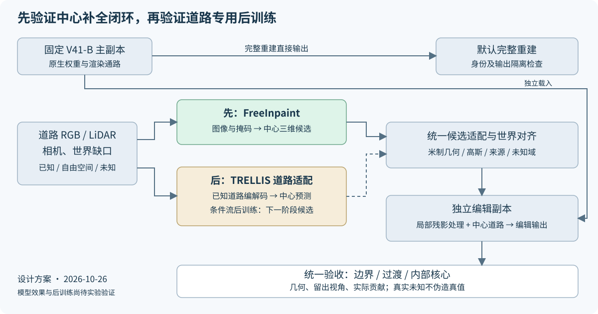

# V42 首轮实验安排：FreeInpaint 中心补全

> 2026-10-26完整片段核验补充：两个raw102关键中心在raw141–159已有真实道路证据。本协议未启动；正式输入须先登记完整片段后仍未知的区域或明确撤源控制，不能沿用“49帧无来源＝全片段未知”的假设。先参见[完整片段强控制](fullclip_20261026/README.md)。原固定B和零更新/独立编辑原则不变。


task ID：`WS-V82-GN11-V42-FREEINPAINT-20261026`。本文件是已接受研究路线的首轮执行协议；当前进度与启动条件统一记录在仓库 `docs/RESEARCH_STATUS.md`。用户将在 GPU 就绪后通知启动 smoke 与正式任务，不使用后台轮询或开机自动触发。



## 执行顺序与范围

`CPU 准备 → 用户通知 GPU 就绪 → 环境与官方入口接线 → 真实 smoke → 正式候选生成 → 编辑四组合评价 → 报告/取回/推送`。

首轮只验证 FreeInpaint 外部先验。V41-B 固定主副本直接输出完整重建；只在独立副本处理删除、候选插入和局部静态污染。TRELLIS 道路编解码、确定性中心预测和条件流属于后续阶段，不作为本轮自动接续队列。旧 V4 RP、R/B 训练均不恢复。

**首轮正式实验是冻结权重的推理与编辑评价，不是新的 30K 训练。**不重新训练 B，不后训练 FreeInpaint，不默认添加道路优化步数。若后续确需编辑优化，先登记参数集合、损失、采样、步数和保存节点，再进入相应 smoke；不得沿用旧 V4 的 30K 合同冒充已有预算。

| 角色 | 方法 | 用途 |
|---|---|---|
| C0 | 固定 V41-B 原生完整图、删除目标后的静态 | 重建保护和残影参照 |
| C1 | 已有确定性道路教师/曲面纹理延拓，在相同撤源与编辑协议下重放 | 强控制，不把旧开发域分数当独立测试 |
| G1 | 固定 FreeInpaint + 官方参考图生成路线 + 米制对齐 | 主要待检验的外部先验 |

此前放宽候选资格的结果保留作诊断控制；其中心缺支撑已知，不为此另开长训练。四种编辑组合为原静态、加候选、仅抑制确认污染、抑制后加候选；这是同一资产的渲染归因，不算四组训练。

## 固定输入与正式规模

- 真实失败案例：scene0008 的 a37、a6；评价覆盖 raw89–137 同49帧。raw102 两个像素仅定位，不替代全洞与内部核心。
- 加一块真实可见道路的全洞撤源控制，世界区域在推理前写入输入 manifest；已有教师使用过的样本必须标为开发控制，不声称独立留出。没有可信目标时不补造数值真值。
- 首轮主结果 seed=0；额外固定 seed=1、2 检验候选波动，三者全部报告，不按真值挑最好看结果。计划最多 3 个案例 × 3 个种子，共9套最终候选；FreeInpaint 官方支持视图迭代的中间候选另存，不算独立正式样本。
- 每例需要的输入帧数、帧 ID、掩码、提示词、参考/支持图策略、分辨率及相机预处理，在正式输出前一次性冻结为 `inputs/frozen_cases.json`。按官方入口和实测显存确定输入分组，不能盲目一次塞入49帧；输出仍投影到统一49帧评价。
- 若 smoke 因显存/接口需要调整输入分组，保留原尝试，冻结修订后重新验证相同入口；正式阶段不能为改善结果临时改提示词、阈值、seed或换模型。
- 外部模型上下文包括遮挡域外道路；目标车身、静态残影与全洞撤源证据不能进入道路条件。已知、自由空间、未知分别登记；生成标签单列。主副本曾看过真实道路的情况必须标为编辑测试，不能作为严格盲补全泛化证据。

## CPU 准备与 GPU 前检查

CPU 检查入口（不导入模型、不运行 CUDA、不启动进程）：

```bash
cd /root/autodl-tmp/motion_proj_v82_gn11_v42
CUDA_VISIBLE_DEVICES='' /root/autodl-tmp/envs/drivingeditor/bin/python \
  scripts/worldsim_v82/drivingeditor_shadow_rebuild_20261017/r15/gn11_stage1_v42_20261024/tools/check_v42_preflight.py
```

入口读取实验计划、原下载凭据与文件大小、B 四件、官方源码、隔离环境及冻结输入是否存在。它不替代权重重新哈希、环境实跑、输入合法性审计或真实 smoke；不会因为文件存在而声称模型可用。所有检查结果保存到 Git 外 campaign 的 preparation 目录。

需要完成的实现工作：a37/a6 世界缺口与投影数据包、FreeInpaint 离线加载绑定、原相机与预测相机的尺度/坐标变换、候选高斯映射、编辑副本渲染与受控污染抑制、完整评价与状态恢复。现有 CPU 原型不能当作这些 GPU 入口已实现。使用独立 FreeInpaint 环境，原 drivingeditor 环境不改。

## 真实 smoke 与进入正式运行

约10分钟真实环境 smoke，按实际完成度记录时长，不用空等凑时间。必须主动走到后续入口：

1. 官方权重离线加载、真实图像/掩码预处理、参考图生成、三维前向；输出有限，记录分阶段耗时与峰值。
2. 保存候选、相机、尺度变换、掩码、配置、版本和 Python/NumPy/Torch/CUDA RNG；从独立进程恢复到下一阶段。推理任务没有 optimizer，明确登记不适用，不伪造 optimizer 恢复通过。
3. 实际执行坐标对齐、原相机渲染、四组合编辑评价；接通三维洞和核心指标，原 B 完整通路保持独立。
4. 重启后从已存候选继续评价及进入下一案例，防止重复生成或覆盖旧目录。若引入可训练模块，追加真实前反向、非零梯度、参数/optimizer/scheduler/RNG/采样状态完整恢复与下一更新对照。
5. NVML 每秒监测全程和阶段峰值，另记录实际 CUDA allocated/reserved；不得把采样峰值称为精确分配器峰值。首轮严格串行，不提前承诺显存需求。

任何关键接线未覆盖，smoke 判为未完成；不得以 finite loss 或 CPU 检查替代。工程 smoke、必要重试和正式候选分目录、分账。工程检查通过后继续已安排的首轮；质量表现差仍如实评价，不通过无限改参追求预设成功。

## 评价、停止与交付

有真实道路目标的撤源控制：核心/过渡/边界分层报告表面误差、法线、自由空间侵入、RGB/SSIM/感知误差与留出视角。真实 a37/a6 未知中心：报告完整面积分母、有效支撑、坡度和接缝合理性、多视角漂移、实际道路贡献和人工图像，不报告未知真值 PSNR。

污染抑制与道路插入分别归因，逐车最差帧及保留车辆/背景损伤单列。完整主副本身份不变；历史 B/V1 跨运行经验波动尺度不能掩盖主副本被改动。

首轮完成固定9套候选或遇到可复现、无法通过现有接口修复的前置失败即收口，不追加 seed/阈值网格。工程错误按既有授权修复、精确恢复；无法对齐为同一米制表面、中心仅扩大外围、最终贡献仍被错误静态遮挡，分别归因，不混称同一种生成失败。TRELLIS 是下一阶段唯一后训练候选，不在此自动下载数据或启动训练。

交付中文报告与简单组件图、49帧可视化、全部候选/选择记录、浮点指标、显存峰值和烟测恢复证据；更新同一当前状态、提交推送代码文档、取回必要结果并验证。`quality_accepted=false`、`human_verdict=null`。`failure_ledger_refs=[V82-F01,V82-F06]`；本次仅计划登记，`failure_ledger_delta=none`。

资源释放遵循最终交付顺序；只有完成远端依赖并排查其他活动/控制器、确认带GPU模式且无可推进任务才关机。等待用户开GPU期间不因无卡空闲关机，不部署自动启动控制器。
