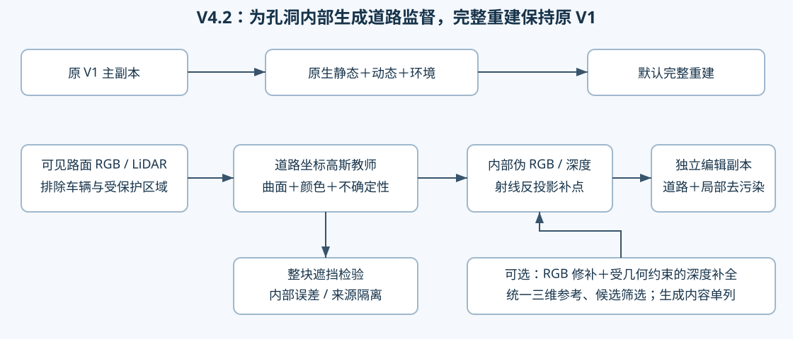

# V4.2：遮挡内部的道路伪真值教师



本轮把“内部没有可匹配观测就没有监督”的断点补成了可执行 CPU 原型。它推断道路先验，并提供道路补点与显式内部损失；不把推断颜色伪称观测真值。原 V1 主副本不参与这些计算。完整编辑训练引擎、原生 CUDA 新补点渲染和局部静态抑制仍须接入验证。

## 为什么不能继续只做匹配

raw102 的 `(255,240)`、`(256,219)`，在已经测试的曲面上没有合格的跨帧实测道路来源。前一轮固定曲面／图像平面／米制平面／深度修正均未给这两个位置增加观测标签。这些负结果保留在 CPU_PROPAGATION.md。GaussianPro 用邻域平面传播、光度与几何核验引导新高斯，但不会凭空提供长期遮挡区域的真实颜色。这里需要明确增加“缺失内容的推断”，而不是给同一匹配器换名称。

## 已实现的算法

1. 从49帧小三角形地面 LiDAR 支撑、车辆保护区外的像素构建世界道路观测图集。每帧每10cm格先取中位数，再跨帧取中位数，避免近景像素密度和重复视角支配教师。没有使用被删除车辆 RGB，也不使用残影静态高斯深度。
2. 在道路局部纵向／横向坐标中使用归一化各向异性高斯核（标准差6m／0.25m）传播路面外观；用同一组实测供体拟合局部低曲率平面。纵向前后估计不一致、源颜色离散和距供体距离组成不确定性。该不确定性是启发式量，损失权重不是正确率；没有足够纵向供体时使用明确标记的各向同性后备。
3. 对目标轮廓**内部每条相机射线**求道路曲面交点，输出伪 RGB、相机轴向深度、软损失权重、`source_kind=2`。这不是跨帧匹配通过域。它不依赖旧1919点资格；按10cm世界格去重输出位置、法线、颜色、薄高斯尺度的补点请求。
4. 对独立编辑副本使用两条梯度入口：道路单独渲染对教师的颜色／深度／覆盖损失；真实删车合成对同一教师的颜色和道路实际贡献损失。**前一条保证静态残影不透明时道路仍能学；后一条要求道路最终可见。** 教师纹理是推断，不对其施加“真实细节”SSIM。内部和边界分别归一，防止外围占掉全部优化预算。已有双源真实参考优先，伪标签损失显式排除 `observed_reference_valid`；缺失该字段时接口拒绝运行。
5. 编辑副本还需要按原生贡献追踪筛出的局部污染高斯做受保护的抑制，并保护未编辑车身／背景。没有整根后代批量删除、没有改原 V1 主副本。CPU损失接口验证了主副本存储隔离、完全遮挡下道路梯度、零权重无强制梯度。它不等于真实光栅器接线已经完成。

本轮的算法假设是“道路坐标中的重复结构可提供孔洞内部软监督”。不同于 V3 仅对既有道路点施加连续性，这里生成新的内部目标和新位置，并让梯度绕过不透明残影。高斯核插值本身并非新发明；创新是否成立取决于后续与原生传播、普通插值、3D道路补片及生成方法的对照，不宣称已达到顶会水平。

## CPU 实测：核心像素不再没有目标

| raw102像素 | 推断局部坐标 x/y/z (m) | 伪深度 (m) | 软权重 | 新道路单独CPU光栅 alpha |
|---|---|---:|---:|---:|
| (255,240) | 14.660 / -0.380 / 0.067 | 13.113 | 0.165 | 0.9966 |
| (256,219) | 19.164 / -0.537 / 0.082 | 17.618 | 0.153 | 0.9998 |

两点都没有双侧纵向证据，权重因此较低。alpha来自新增薄高斯的近似CPU道路单独渲染，不是含污染静态的实际联合贡献，也不是最终编辑质量。光栅期望深度与曲面射线交点深度的定义不同；CPU实现不冒充原生CUDA复现。

49帧 a37 原轮廓555950像素帧、向内5像素核心481617像素帧均已生成先验目标；a6核心21968也已生成，其中8832使用各向同性后备。a37核心566使用后备。全目标共35648个去重10cm格补点请求。**这些是可优化目标的生成计数，不能与此前23.71%的真实双源标签覆盖直接当作同口径提升，更不能当作补全率。** 其中排除原真实双源参考后，a37实际伪标签训练域为424130像素帧、核心371735像素帧；不会用平滑先验覆盖已有真实标签。尚未把全部请求装入模型，后续容量预算待确定。

## 整块遮挡检验，单独测内部

在真实可见路面上预设8m×2m矩形孔洞，撤掉孔洞内**所有帧、全部颜色及几何供体**；内部评价再沿纵向缩1m、横向缩0.4m。20个预设区域中9个有足够参考：5个开发孔洞2179格、4个验证孔洞2420格。原计划 x=36 的验证区无足够参考，实际验证只来自 x=20 的4个横向位置。不是独立场景测试，邻近孔洞还可能有空间相关性。

| 验证孔洞内部 | RGB MAE ↓ | PSNR ↑ | 90%分位绝对误差 ↓ | 路面高度MAE ↓ |
|---|---:|---:|---:|---:|
| 最近邻 | 0.02615 | 26.149 | 0.04807 | 0.02714 m |
| 各向同性高斯 | 0.03148 | 25.684 | 0.07045 | 0.01526 m |
| 道路方向高斯教师 | **0.02330** | **27.725** | **0.03579** | **0.00521 m** |

这证明在这批可检验孔洞上，内部推断有用；不证明被 a37 长期挡住的真实路面就是这个颜色。开发域道路教师 MAE 0.03722，反而高于最近邻0.03456和各向同性0.02804；PSNR26.138较高说明误差分布不同，不能只选有利指标。车道线、路面字符、阴影等细节会被平滑，原生CPU预览也能看到色差边界。故保留生成式后备，不把此版直接判成最终补全成功。


### 更严格的撤源复核（主要依据）

首轮世界格撤源仍共享小三角形预处理，邻近保留格的几何可能间接依赖孔洞内LiDAR。因此又把每个孔洞的撤源范围向外扩大1.7m，超过1.6m三角形最长边加10cm格量化余量；评价仍在原孔洞同一核心进行，未改变算法参数。相机标定、全局地面分类共用，仍是教师级同场景测试。

| 更严格验证核心2420格 | RGB MAE ↓ | PSNR ↑ | 高度MAE ↓ |
|---|---:|---:|---:|
| 最近邻 | 0.06478 | 19.620 | 0.09030m |
| 各向同性高斯 | 0.03249 | 25.914 | 0.06969m |
| 道路方向高斯教师 | 0.03152 | 26.015 | 0.01197m |

增加隔离带后，**几何优势较明显，颜色相对各向同性只有小幅改善**，不能继续用首轮较大的颜色收益作主要结论。更严格开发域MAE为道路教师0.03602、各向同性0.03083，颜色劣势仍在。该结果支持把原生道路教师作为几何与低频颜色先验；复杂外观保留受几何约束的生成式后备。数据见strict_withdrawal.json，原始首轮结果全部保留。

## 生成式后备：用几何约束生成，而非信任任意生成深度

建议优先评估 **InFusion式 RGB修补→尺度对齐深度补全→高斯初始化**。其官方实现已有推理代码和预训练权重，训练代码尚列为待发布。它接受已有深度与相机，但不保证本场景道路度量正确。我们已有的真实地面LiDAR、道路法线和轨迹应作为锚点，不能把污染静态渲染深度交给生成器当硬条件。[论文](https://arxiv.org/abs/2404.11613) · [官方实现](https://github.com/ali-vilab/Infusion)

**3DGIC**可借鉴的部分是先利用可见背景缩小真正未知域，再修补；这能保留已知道路，但不能替代全程被挡住的中心生成。[作者项目](https://peterjohnsonhuang.github.io/3dgic-pages/)

**GS-RoadPatching**应作为有力的非生成对照：直接在三维高斯道路中搜索、替换和融合相似补片。它同样指出长期遮挡、缺乏可靠参考时会受限；本项目当前普通高斯/来源账与其特征嵌入神经高斯表示不同，不是直接接入即复现。[论文](https://arxiv.org/abs/2509.19937) · [项目](https://shanzhaguoo.github.io/GS-RoadPatching/)

具体后备流程：选少量参考视角或统一道路坐标图集生成RGB候选→以真实地面边界约束深度补全→恢复成同一世界坐标曲面→只在未知域补高斯→重新投影到所有49帧形成**同一个三维教师**。不让49帧分别独立生成并互相监督；生成候选按边界深度/法线连续、已知LiDAR误差、留出孔洞内部误差和重投影一致性筛选。只有条件内一致的结果成为软监督，全部生成内容单列来源；它们仍是可能的道路，不是被恢复的历史真值。

已为raw102/129/137准备 RGB、a37孔洞mask、仅实测地面深度、推断道路深度、相机矩阵与坐标约定，位于本地报告 `generative_inputs/`。这些是通用输入包：InFusion正式调用前还需要完成RGB修补和其适配预处理。未下载大模型、未执行生成式推理、未启动GPU。评判外部模型使用同一整块遮挡基准，不能仅比较视觉漂亮程度。

## 复现与后续接口

```bash
python tools/road_teacher_cpu.py --inputs INPUTS --output NEW_OUTPUT
python tools/finalize_road_teacher.py --inputs INPUTS --results NEW_OUTPUT --output NEW_REPORT
python -m unittest discover -s tools -p test_road_teacher.py -v
```

本地输出：`work/v42/road_teacher_cpu_r1`；报告：`outputs/V42_Interior_Road_Teacher_20261024/index.html`。远端归档：`/root/autodl-tmp/drivingeditor_repro/campaign/r15_gn11_stage1_v42_design_20261024/`。CPU主运行389.4秒，训练更新0；5项教师/梯度检查在真实远端PyTorch CPU环境通过。本地PyTorch缺typing_extensions，原样保留失败记录，未改用户Python全局环境。

下一执行边界是独立编辑副本的原生可导渲染接线、局部污染门控和预算受控的补点选择；通过CPU证据后才进入用户授权的真实GPU smoke。届时必须覆盖保存、评价、完整恢复和下一入口，不能用这次CPU测试替代。
