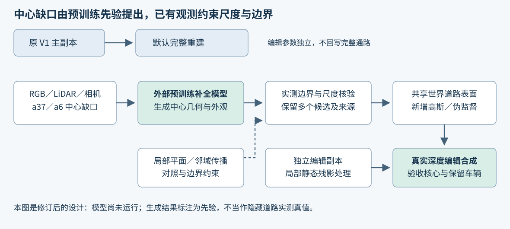

# V4.2：用外部预训练先验补 a37／a6 中心

调研核验：2026-10-24，优先检索 2025-10 至 2026-10 的论文、作者代码和权重。状态：设计修订与公开资源核验；未下载权重、未运行模型、未产生新的训练结果。quality_accepted=false，human_verdict=null。

## 本次纠正

a37／a6 车底中心就是当前要解决的主要缺口。外部预训练模型应直接用于这个中心任务，不再等邻域传播继续失败之后才作为后备。已有跨帧匹配、局部平面和道路方向高斯教师保留为对照，以及观测边界和尺度约束；它们没有提供来自大规模外部训练的道路知识。

用户要的是：已有道路证据约束生成的接缝、尺度和方向；预训练先验提出原表示中不存在的中心几何与外观；生成结果再形成高斯补点及编辑监督。中心补全不能以旧 1,919 个活跃点、旧四角支撑或双源观测资格作为出生前提。生成标签单独标识，也不能因没有真实双源标签而一律排除。

## 近一年候选与实际选择

| 方法与日期 | 已核实机制 | 资源与本项目判断 |
|---|---|---|
| **WINGS，2026-09-29 预印本，在审** | 在 TRELLIS 的三维潜空间补缺口，另配结构补全网络，再解码几何与外观。 | **概念上最贴近目标。**本次未核实到完整官方代码和专用结构权重；仅有 TRELLIS 权重不等于可复现 WINGS。其物体级先验、64³ 表示与道路尺度适配需要验证。[论文](https://arxiv.org/html/2609.37816v1) |
| **FreeInpaint，2026-10-08；作者标注 NeurIPS 2026** | 适配 DA3 的三维补全网络，利用 PowerPaint 生成参考和盲区支持，再预测深度与高斯。 | **第一可运行候选。**作者公开推理代码、专用权重及高斯导出；尚未证明驾驶道路中心适配。此处指 Rorisis 版本，不是同名 AAAI 图像修补方法。[论文](https://arxiv.org/abs/2610.11857)、[代码](https://github.com/Rorisis/FreeInpaint)、[权重](https://huggingface.co/jyproris/FreeInpaint/tree/main/checkpoints) |
| **GPGS，AAAI 2026，论文页发布 2026-03-14** | 用预训练 Point-MAE 补不可见点云几何，再用修补参考图改善外观。 | **直接三维几何对照。**官方代码提供 Point-MAE 权重接入；其预训练来自 ShapeNet，并非道路专用知识。属于学习式点云补全，不把它说成新的三维扩散基础模型。[论文](https://ojs.aaai.org/index.php/AAAI/article/view/37515)、[代码](https://github.com/yongjoon99/GPGS)、[预训练来源](https://github.com/Pang-Yatian/Point-MAE) |
| **Gen3R，2026-01；CVPR 2026** | 联合视频生成和 VGGT 几何潜变量，可生成 RGB、深度及点云。 | 有公开权重，但官方入口主要为单图、双图和全图重建，未核实局部删车掩码接口。保留研究候选，不作为首个中心适配器。[论文](https://arxiv.org/abs/2601.04090)、[代码](https://github.com/JaceyHuang/Gen3R) |
| **CoIn，2026-06；ECCV 2026** | 扩散修补与三维重建双向反馈，用几何引导跨视图一致性。 | 官方代码可读；适合研究一致性优化，但不是独立的三维几何生成预训练模型。[项目](https://hana001106.github.io/CoIn/)、[代码](https://github.com/hana001106/CoIn) |

上述排序是根据任务匹配程度和资源可用性作出的工程判断，不是道路实测排名。WINGS 暂作为方法方向；可执行验证先用 FreeInpaint，GPGS 用于区分三维学习先验带来的收益。旧 InFusion 为历史参考；GS-RoadPatching 与邻域外推退为非生成对照。

## 中心测试如何接入

1. **冻结失败区域。**同时准备 a37 与 a6 的世界缺口、投影轮廓和内部核心；核心与外围单列。raw102 的 (255,240)/(256,219) 保留为定位点，不能只在两个点或外围报告成功。现有外部输入包仅完成 a37 的部分帧，a6 与多视图模型适配尚待实现。
2. **移走错误条件。**输入保留可见道路、相机与地面 LiDAR；目标车身、其残影及污染静态深度从补全条件中屏蔽。其他车辆作为遮挡保留，不替模型假设其下方有观测。完整 V1 主副本不变。
3. **让外部先验生成中心。**首个实现使用 FreeInpaint 官方权重，保留生成参考、支持图、深度、相机预测与高斯。需要验证多帧动态输入与训练场景域的差异。不能将旧平面教师填满的图喂入后再宣称模型独立解决了几何。
4. **对齐到已有世界坐标。**FreeInpaint 会估计自己的相机与几何，不能直接拼进原场景。只利用遮挡域外、可靠道路点拟合尺度与刚体变换，并在独立留出的边界点检查残差；不能以错误静态深度作锚。如果局部几何无法在同一世界系一致对齐，则拒绝该候选。
5. **形成共享三维监督。**生成世界道路表面或高斯候选后投影到原相机序列，保留 RGB、深度、法线、来源模型和版本。允许多个生成假设；每个假设是一块共享三维路面，不是每帧独立想象。跨帧重投影一致只能证明自洽，不能冒充隐藏道路真值。
6. **在编辑副本显示出来。**新道路单独渲染之外，还要处理已经追踪确认的错误静态遮挡。只对 edit 副本做局部门控或替换，连同正常背景和保留车辆一起验收。否则中心虽然生成了路面，最终图仍会被黑色静态残影挡住。

## 明确验收对象

首先比较中心内部的有效几何覆盖、深度连续性、法线/坡度、实际道路合成贡献及跨帧漂移；外围接缝单独报告。真实参考只用于有观测的区域；对于真实全遮挡中心，报告几何合理性、稳定性及人工观感，不能报对未知真值的 PSNR。

在确实可见的道路上另做整块遮挡测试，同时撤去所有帧中的区域 RGB、LiDAR 和供体，测试外部模型是否胜过已有低频外推；区域、候选数、随机种子与选择规则在运行前固定。已看过输入的 V1 只提供编辑上下文，不能把这种测试宣传为整系统从未见过该场景。

核心失败判据：只增加外围、内部只有大面片/漂浮路面、车道线不一致、中心仍被污染静态遮挡，均不能算解决。模型之间自洽也不能替代真实观测。

## 当前资源边界

已核实 FreeInpaint 权重目录列出 freeinpaint.pth（5.43 GB）和 PowerPaint 文件；文件大小不是显存需求。官方环境需 NVIDIA GPU、Python 3.12、PyTorch 2.9.1/CUDA 12.8。实际推理峰值未测；不能承诺在某张卡上可运行，也不能把论文单次三维前向速度当包含修补和全部后处理的端到端时长。

本次没有改变环境或启动推理。下一实现工作是模型适配器、a37/a6 核心数据与世界坐标接入；真实 GPU 检查另按已约定的 smoke 规则执行。原生完整通路仍由 V1 master 输出。
