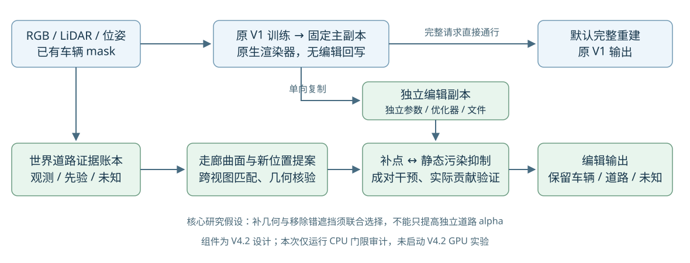

# V4.2：保留原 V1，面向编辑的道路补全与静态污染处理

2026-10-24。状态：**完成 CPU 门限、传播及内部教师审计；按用户澄清，将外部预训练几何／生成先验改为a37/a6中心补全主线。完成近一年候选与公开资源核验，模型尚未运行，关键缺口尚未解决。** 从 V4.1 提交 `2706091d53d77b3dac7898c81e907b189bd80e44` 建立独立分支 `research/worldsim-v8.2-drivingeditor-v42`。原 R/B 的 checkpoint、配置和训练现场不变。quality_accepted=false，human_verdict=null。

## 目标与边界

当前方法优先级：**由外部预训练先验生成a37/a6车底中心的几何与外观，再以已有实测道路约束边界、尺度并转成高斯补全。**邻域外推和跨帧匹配保留为控制实验与观测处理，不再把生成式路线放到外围补全之后等待。见[中心补全选型与实施合同](PRETRAINED_CENTER_COMPLETION.md)及其组件图。FreeInpaint为首个可运行候选，GPGS为学习式几何对照，WINGS为三维原生生成方向参考；这不是道路效果排名或新实验启动声明。

默认完整重建直接使用原 V1 主副本及其原生渲染器。编辑请求进入独立副本，才允许道路几何增长、局部静态污染抑制和对象编辑。V1 原算法自身已有静态、动态和环境组件；“原 V1 通路”意味着完整保留这些原有行为，不是把它改成另一种无分支模型。

当前查看器切换到 R 同 checkpoint 的 native_v1 输出，只改变显示来源，还没有完成这一架构。V4.2 必须隔离模型存储、进程内参数、优化器和输出来源。双通路能保护默认完整输出，但不会自动保证编辑时剩余车辆、背景和新路面正确，后者仍是主要研究问题。

## 新实证对本设计的约束

用户要求的 GaussianPro 方向已落实为CPU平面传播、新位置和法线提议、平面色块选择、几何回投核验及来源深度修正；不是继续只在固定点取色。全49帧实测：同核验下a37图像平面对照验证通过32135像素，深度修正31304，a6与两个指定中心点均0。深度修正对a5/a26有益，但不能据此将其提升为a37主方法。它是CPU机制对照，尚未复现官方完整CUDA基线。

因此以下算法设计仍是待证假设；保留候选放宽控制，保留图像平面传播强控制；米制邻域/深度修正不再作为已成立的主改进推荐。下一步需检验长期遮挡区域的补全算子，而非重复可见来源匹配。详见[CPU机制、结果与停止边界](CPU_PROPAGATION.md)。原V1主副本＋独立编辑副本架构不变。

## 一、排除规则是否过于保守：实际 49 帧审计

使用现有 RGB、LiDAR、位姿、车辆掩码及原固定网格，逐帧重算九项门限。九项布尔数组与原 bundle **差异均为 0**。这说明以下结果是在正确复现原筛选后得到的敏感性分析，而不是换一套投影悄悄改变输入。CPU 审计新增优化更新 0，未生成新训练标签。

基线 26,088 个候选网格单元中，14,034 个有原支撑并已创建；其中 1,919 个至少两个合格来源、226 个一个来源、11,889 个零合格来源。零合格来源不等于“从未被任何相机观测”，而是没有来源同时满足全部门限。原 R 的 1,919 个最终全部输出；其余不是训练后被剪掉。

### 单项敏感性

| 修改，其他规则保留 | 合格单元 | 新增/失去 | a37 查询区域新增 | a6 查询区域新增 | 判断 |
|---|---:|---:|---:|---:|---|
| 基线 | 1,919 | — | — | — | 只覆盖原合格集合 |
| 掩码膨胀 2→0 像素 | 1,937 | +18 / 0 | 0 | 0 | 收益很小，车边界风险更大 |
| 深度误差 0.3→0.5 m | 1,966 | +47 / 0 | 2 | 0 | 不应靠整体放宽深度解决中心空洞 |
| 观察角度余弦 0.12→0.06 | 3,641 | +1,722 / 0 | 43 | 0 | 有真实保守性，值得保留为调参对照 |
| 完全取消三维框遮挡 | 2,344 | +425 / 0 | 137 | 27 | 诊断上限，不能作为安全启用规则 |
| 稀疏 LiDAR 邻近半径 1.5→3 像素 | 2,040 | +121 / 0 | 67 | 0 | 会跨深度边界；优先用局部几何代替盲扩散 |
| 来源要求 2→1 | 2,145 | +226 / 0 | 98 | 0 | 少一份独立确认，不能直接当可靠观测 |
| 投影面积 0.25→0.1 像素² | 1,919 | 0 / 0 | 0 | 0 | 本数据中不是剩余瓶颈 |
| 清晰度门限取消 | 1,919 | 0 / 0 | 0 | 0 | 本数据中不是剩余瓶颈 |

逐车区域是该车 49 帧查询单元的**世界单元并集**，不同车辆可能重叠；不能相加，也不是像素覆盖率、某一帧的实际道路贡献或成功补全率。新增候选数不能替代重新渲染后的质量评估。

角度放宽新增的 1,722 个单元，局部前向坐标中位数 23.3 m，四分位数 19.5–28.3 m。采用每五帧一块、交替分成两组的诊断，要求两组各至少两份来源、均值 RGB 差≤0.05：1,068 个具备检查条件，1,067 个颜色一致。换用小三角形 LiDAR 几何、掩码、框外检查且不沿用旧 0.12 角度门限，818 个具备检查条件且颜色一致。**这支持存在被角度阈值误排的候选，不证明新增点全部正确。** 小基线、弱纹理、邻帧相关和共同几何误差仍可能产生假一致；该检查不是真正独立测试集。

### 实际点，而非只看总数

| 单元 | 局部坐标 (m) | 原来源→新来源 | 实际证据 |
|---|---|---|---|
| 2403，a37 查询区域 | (17.5, −1.9) | 0→2，角度放宽 | raw136/137，投影约(303,238)/(304,240)，余弦 0.10574/0.10768；仅角度不合格，其他八项通过 |
| 3928，a5 查询区域 | (22.1, 5.5) | 0→10，角度放宽 | raw95 的余弦 0.07351，raw137 为0.08197；其余门限通过 |
| 3045，a37 查询区域 | (19.5, −1.9) | 0→2，取消框 | raw134/135，仅框遮挡门限拒绝；仍须确认车框空角而非漏检车身 |
| 9452，a6 查询区域 | (39.1, −2.9) | 0→5，取消框 | raw125/136，仅框门限拒绝；不是截图中心两个缺口单元 |
| 1183，a37 查询区域 | (13.1, 0.1) | 1→1，单来源 | 仅 raw137 通过全部门限，不能因缺第二帧自动判错或自动接纳 |

报告附全部候选世界位置、逐点来源计数、可选变体和实际来源图。图中的新增点是**待验证候选**，不是已经训练或渲染成功的道路。

### 为什么不能只把阈值改小

1. `v4_road.py` 同时要求 `provenance==1`、至少两个正权重来源和几何支撑；`FixedSurface.observed` 又重复限制。单改 `minimum_views` 不能把 UNKNOWN 的 226 个点自动提升为观测。必须从同一份来源账本重建分类、训练资格、稠密监督域和导出元数据。
2. V4.1 对三维框误排的修复主要发生在**已是 R 活跃单元的像素监督域**，没有同步放开旧中心来源资格。因此“稠密像素修复了”不等于“新道路单元获得了资格”。
3. 本次小三角形＋跨帧框复核替换得到 1,903 个合格单元，其中新增155、失去171；新增中49个通过分块颜色检查。它不是单调扩域，不能宣称无条件优于旧规则。可以把新增有证据者作为候选，再做留出验证；不因新证据缺失批量删旧点。
4. 统一原生像素中心约定的诊断得到1,910个，新增89、失去98。这是坐标一致性工程项，应单独固定和验证，不混作方法收益。
5. 几何支撑半径0.8→1.2 m，可把潜在支撑单元14,034扩到16,869。但这只增加2,835个候选，**未验证高度、法线、跨路缘连接或颜色，也未插入高斯**。应改为有边界约束的局部曲面提案，而非直接放宽半径。

### 两个截图像素的边界

raw102 的(255,240)和(256,219)，对应参考曲面的单元1652、2987，四角均无原几何支撑，未创建、未活跃、无删车标签。只在已创建14,034点内调整来源资格，不能补这两处。前述坐标依赖拟合路面假设，不是实测隐藏道路。

中心(255,240)先前原生追踪的静态合成权重约99.99%，道路独立alpha也为0。补出后方路面以后，前方错误静态高斯仍可能使实际道路贡献接近零。因此必须区分：**没有路面表示、没有可靠监督、路面被错误静态遮住**。

## 二、V4.2 架构合同：完整重建主副本与独立编辑副本

| 组件 | 允许的行为 | 禁止混淆 |
|---|---|---|
| `V1Master` | 原 V1 训练完成后固定 checkpoint；原生静态＋动态＋环境直接输出 | 不加载道路、静态抑制门或编辑优化器；不使用编辑后的参数 |
| `EditScene` | 从指定主副本独立载入参数；明确目标对象；编辑自己的静态/动态/道路状态 | 不能共享可写 tensor、optimizer 或参数文件；不能把“同R原生输出”冒称独立B |
| `SourceLedger` | 每个世界单元记录逐帧RGB/深度/掩码、失败原因、基线、可见性与证据类别 | 不把低置信度当观测，也不把零通过来源永久视为无希望 |
| `EditRenderer` | 按实际深度合成已编辑对象、保留对象、局部静态与道路 | 不把道路抬到车表面盖污染；不以2D贴图覆盖代替三维处理 |
| `RouteDispatcher` | 无编辑请求直接调用 master；有编辑请求才载入 edit state | 编辑文件缺失/错误不能改变无编辑输出；不得静默落到联合道路渲染 |

建议先用独立进程、独立目录重新载入 checkpoint 实现隔离；不以共享可写内存或硬链接作为“副本”。路线接口拟定为 `render_complete(master, camera)` 与 `render_edit(edit_scene, camera, request)`。完整通路没有 road、gate 或 edit optimizer 参数入口。

默认基准以正式原 V1-B 30K 的明确身份登记；比较仍同时保留 R 同checkpoint原V1，以分开“独立训练轨迹差异”和“加入道路的影响”。现有正式49帧clamp浮点结果：B完整PSNR36.7909，R原生36.6206，R道路合成33.7581；R与B原生状态严格比较不一致，不能声称参数/optimizer完全相同。V4.2不再把“道路与V1参数隔离”当成完整画质已经守住的证据。

必须验证：同一 master、相同相机和原生渲染设置下，编辑前后完整通路浮点输出一致；如果存在渲染非确定性，先报告重复原生渲染的噪声界并分析，不能直接提高容差遮掩回写。编辑副本还需独立检查未编辑车辆内部、轮廓和正常背景。这些是实现后的GPU验收项目，本次没有声称完成。

## 三、算法主张：由编辑需求驱动的补点与污染抑制联合决策

本节的原生候选、来源核验与合成干预保留为编辑基础组件。其中心监督来源现由第七节的外部预训练模型主线替代；不能将下述仅靠现有观测的路径继续当作全遮挡中心的主解。

**研究假设：**普通重建残差看不到被动态车遮住的静态污染；几何增点只处理“缺表示”，而不处理“错遮挡”。在世界道路表面上维护证据，并按删车后真实合成的收益选择“补点、抑制污染或暂不处理”，可能比只做几何增长或只做清理更有效。该假设尚未通过实验，不预先宣称顶会创新成立。

### 1. 建立可扩展候选曲面，证据不足保留未知

由已有多帧地面LiDAR、可靠道路种子和车辆/自车轨迹形成局部道路走廊。轨迹只能给出道路可能经过的位置，不保证宽度、坡度或车后高度；路缘、坡折与观测冲突限制延拓。优先保留现有Gaussian渲染器，用贴面的薄高斯表达候选，避免一开始更换整个渲染后端。

沿可信边界提出局部平面或低阶曲面，以及受限的高度/法线候选。缺口较大时允许多假设，不把一个全局平面当真值。通过距离、曲率、LiDAR残差和法线一致性标注“几何有证据”“仅几何先验”“未知”。新增位置不受旧规则网格中心限制，但保留统一世界单元账本以便前后比较。

### 2. 从其他真正可见的帧中补监督

当前车身像素不能作为道路目标。对每个候选，在其他帧选有视差和时间间隔的来源：先排除前景实测冲突、车辆mask和视野外，再做平面诱导patch匹配、双向几何检查和多源颜色/曝光一致性。用原RGB、位姿、LiDAR和Gaussian深度/法线即可实现核心步骤，无需先引入生成模型。

框相交从永久硬拒绝改成**需要更强证据的状态**：只有像素级前景检查及独立来源几何支持能解释框空角时才复核通过。实测前景比候选更近属于矛盾证据，不能被一个soft weight掩盖。掠射角、投影面积、图像清晰度用于估计观测可靠度，不宜三者各设硬门后一票否决；弱纹理、低视差的多帧颜色一致也不等于几何可靠。

来源账本分为：多源验证、单源待复核、仅几何先验、无证据、存在冲突。没有颜色证据的区域可以优化曲面连续性，但不得产生“观测RGB标签”。若显示低频颜色延拓，必须标注先验输出和覆盖范围。

### 3. 用真实贡献判断需要补点还是处理污染

沿射线，高斯贡献为 `w_i(p)=T_i(p)·alpha_i(p)`，道路贡献为 `A_road(p)=Σ_{i∈road} w_i(p)`。独立道路alpha不包含前方静态遮挡，不能用它判断编辑成功。

在**编辑副本**做局部、只读候选干预：比较原删车图、仅加入候选路面、仅抑制疑似污染、二者同时执行四种结果。污染候选由来源谱系、曾位于车辆mask内的几何证据、跨帧不一致和实际Tα贡献共同提出；不能把某个初始化根的所有后代一刀切删除。

对有验证参考的目标区域，用固定分母计算颜色/几何损失下降；对正常背景和未编辑车辆计算损伤；对道路检查真实贡献和连通性。若仅增点被静态完全挡住、而联合干预有证据支持，允许在edit副本局部降低对应静态opacity；若删污染后露出错误背景且没有可信路面，则拒绝或保留不确定，不把明亮空洞当成功。

一个待验证的候选排序形式为：

`score(op) = ΔE_valid_road − λp·ΔE_protected − λu·uncertainty − λb·added_budget`。

其中每个Δ都相对**同一编辑副本、同一固定区域**；`uncertainty`在校准之前只是启发式，不称概率。候选选择使用开发/验证数据，最终测试区域不参与选择。`op`可以是增点、局部抑制或二者成对执行；因此研究对象不是把已有损失简单相加，而是验证这类成对干预是否比独立处理更有效。

### 4. 编辑优化目标与防逃避

拟定目标 `L_edit = L_visible_road + L_verified_crossview + λg L_geometry + λp L_protected + λs L_sparse_static_change + λc L_effective_coverage`。各项权重、预算与调度须先在开发数据上确定，正式实验前冻结。

- 可见路面与验证过的跨帧参考上用RGB/SSIM及几何一致性；SSIM窗口不能混入车辆真值。
- 非目标对象及正常背景以同一 master 的未编辑输出作保留约束，并另报对真实图像的误差；它不是隐藏路面的真值。
- 只允许edit副本局部静态门控、道路位置/方向/尺度/颜色/opacity更新。先冻结非目标动态对象，按明确编辑目标移动/删除目标对象。
- 覆盖约束只作用于几何/颜色有相应证据的域，不能让模型通过任意高opacity、抬高路面或涂抹大高斯达标。对未知域报告不确定性，禁用“强制0.25贡献即正确”的判断。
- 参数隔离使默认完整通路不受影响；编辑通路还必须联合验收外观、深度、遮挡及剩余车辆，不能拿默认输出遮掩编辑失败。

## 四、与已有方法的区别及创新风险

| 已有工作 | 已有机制，不能再声称原创 | 本项目需要验证的差别 |
|---|---|---|
| [GaussianPro, ICML 2024](https://arxiv.org/html/2402.14650v1) | 平面传播、多视图一致性筛选、新Gaussian创建，补原始clone/split难覆盖的空洞 | 我们的增长由对象编辑显露区域及错误静态遮挡联合决定，不只普通重建残差 |
| [VAD-GS](https://arxiv.org/html/2510.09364v2) | 可见性体素、视角多样性、patch几何匹配后增点，是非常接近的先例 | 必须以它为近邻方法讨论；本方案候选补点与静态抑制的成对干预是否必要、是否有效需要对照 |
| [RoGS](https://arxiv.org/html/2405.14342v2) | 轨迹引导道路初始化、地面高程和Gaussian路面 | 走廊不是创新本身；它在本方案中只提供可撤销几何候选 |
| [PGSR](https://arxiv.org/html/2406.06521v2) | 平面深度/法线、多视图几何与光度一致性 | 借其约束，不把已有几何正则重新命名成贡献 |
| [DeSplat, CVPR 2025](https://aaltoml.github.io/desplat/) | Gaussian静态与干扰物分解 | 对编辑对象特定残影做证据驱动的局部干预；不把全部场景重新分解当最小起点 |
| [GScream, ECCV 2024](https://w-ted.github.io/publications/gscream/) | 删除物体后的几何与外观一致性优化、遮挡区恢复 | 外部深度/特征机制不是本轮首选；其任务与评价必须纳入比较 |
| [PRIMU, CVPR 2026](https://osvia.org/PRIMU/) | 从Gaussian误差、覆盖和视域构造并校准不确定性 | 不把简单来源数当全新置信度；需验证是否能预测编辑误差 |

GaussianPro/PGSR的几何核验保留为观察域控制。RoGS、VAD-GS或GScream完整实现可能含外部语义/深度模块，不能笼统称全部“纯原生”。用户进一步明确a37/a6中心需要外部学到的先验，现优先推进预训练模型中心补全；旧InFusion输入包只是此前准备，不等于已完成新模型适配。本轮未执行外部模型。

自评：**双通路是合理的工程保护，不是论文创新；角度阈值修正是必要的强基线，也不是创新。**有潜力的主线是“删车反事实暴露的表示缺口与静态污染联合建模、成对选择和验证”。若简单调角度加标准GaussianPro就达到同样效果，应收缩复杂算法，不能靠包装坚持新模块。真实全遮挡纹理仍不可辨识，Gaussian内部机制不能凭空恢复从未观测的车道线。

## 五、评价设计：怎样证伪，而不只展示好看的区域

1. 固定同一原V1 master，不在各编辑方法间重新训练基线。保留原始30K与编辑适配更新分账；编辑适配不是又一次“原V1 30K”。
2. 比较无编辑基线、固定几何调参、标准多视图增点、只清理污染、增点＋独立清理、成对决策。走廊、来源复核、不确定性分别做必要消融；共享输入、候选/高斯预算与编辑计算预算。**这是拟定实验矩阵，本轮未启动任何组。**
3. 对原本可见、有真实道路观测的区域构造留出遮挡。必须从BUILD输入中同时移除对应RGB/点云信息；如果V1 master已看过所有49帧，应明确称“编辑器留出验证”，不能冒充整系统无泄漏测试。独立场景/轨迹测试需要在master构建时就确定拆分。
4. 训练/提案、验证选择、最终测试分离。不能同时用同一跨帧参考生成颜色、选择候选，再把该参考误差当泛化成绩。最终需要多场景、多随机种子、弱纹理/坡折/长遮挡子集，而非只raw102。
5. 分别报告：完整输出一致性；编辑输出未改车辆内部/边缘及背景PSNR/SSIM/LPIPS；已知路面的深度、法线和颜色误差；实际道路Tα贡献、有效连通覆盖、残影；整个目标区域分母及未知比例；峰值显存、时间和点预算。
6. a37保持全目标分母，原双源参考只覆盖约23.71%像素帧；a6原无标签不能报颜色改善率。需要几何候选和来源验证路径，同时承认其可能仍只能得到先验路面。两个中心像素是定位案例，验收范围应为世界区域及跨帧结果。

## 六、落地顺序与当前完成项

已完成：独立V4.2分支/工作树；九门精确CPU复现；门限、框/三角形复核和支撑半径敏感性；实际候选ID/来源帧/世界分布；双通路合同；算法与先例差异、评价矩阵；GaussianPro机制CPU平面传播及一次来源深度修正、全49帧固定目标域验证。该匹配原型中关键a37未胜过图像平面对照，a6与中心仍0。随后已实现内部道路教师：独立于旧资格规则推断RGB/深度、提出新高斯；两个中心得到伪标签而非新观测，完成整块撤源孔洞验证与遮挡下直接道路梯度检查。输出JSON/NPZ和报告已单独保存，不混入V4.1训练数据。

下一实现顺序：

1. 先接原V1主副本与独立edit目录/加载器/渲染入口，测试加载缺失edit状态仍能正常complete；单车删除保留其他车辆。
2. 接统一SourceLedger，消除provenance与来源数的多处硬编码；保留旧1919结果作为精确复现模式，另建候选池。实现角度放宽＋逐像素框复核的简单强对照。
3. 停止把重复跨帧匹配与邻域外推作为关键空洞主解。已有教师更严格1.7m撤源带验证：MAE0.03152/PSNR26.015、高度MAE0.01197m；颜色收益有限，开发MAE变差，保留为低频先验对照。下一步适配FreeInpaint官方预训练权重，同时准备a37/a6内部核心与真实相机坐标核验；生成候选后再接编辑副本和真实光栅器。推断标签单列，已有真实标签优先。
4. 接实际Tα归因与局部成对干预选择，仅作用于edit副本；再接需要的道路几何优化。
5. GPU执行前完成CPU数据/接口检查；正式长跑前真实环境约10分钟smoke，主动覆盖完整通路身份、前反向、逐目标有效梯度、显存峰值、checkpoint保存、评价、完整状态恢复及下一阶段入口。CPU审计不替代smoke。本次设计不等于GPU启动授权。

V4.1正式R/B已经完成30K和49帧评价，其最终交付仍应独立收口。新设计不修改这两组的科研结论或追加训练。发布报告和取回必要证据之前不能关机。

## 七、中心补全主线：外部预训练先验

近一年论文、代码、权重核验和实际选型见[PRETRAINED_CENTER_COMPLETION.md](PRETRAINED_CENTER_COMPLETION.md)。中心缺口直接交给外部预训练先验提出几何与外观；已有观测约束世界尺度、道路边界和保留对象。新高斯不要求先通过旧中心资格规则；生成来源与真实观测分账。单个共享三维候选投影到多帧，不独立生成49幅互相矛盾的道路。最终仍需在edit副本处理确认的静态污染，检验真实合成中的中心贡献。

此前原生教师实现、实测与来源隔离见[INTERIOR_ROAD_TEACHER.md](INTERIOR_ROAD_TEACHER.md)，作为保留对照。已输出49帧软目标、CPU近似道路渲染及部分a37外部输入；a6和新模型适配尚待实现。原生可导编辑渲染、局部静态污染门控尚未接通，未启动GPU或外部模型推理。
