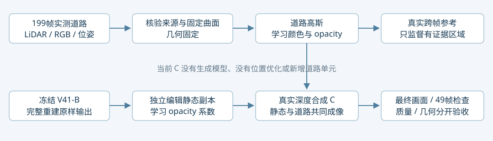

# 用户选定的 C：保背景编辑为什么有效

**更正：C 是 `edit_smoke_preserve/full199/checkpoint1000_from0.pth`，不是 `edit_visibility/full199`。** 用户截图明确选择的是“保背景版本：加入道路”。此前提交dd785189错误绑定了C，并把增大道路贡献作为主线，偏离用户目标。强透射版本及其证据保留为另一项实验，不能据此替换C或要求C中每个像素由新道路承担。

Task: WS-V82-GN11-V42-SELECTED-C-MECHANISM-20261026。本轮固定选中checkpoint，10种推理干预×49帧、raw102八点原生CUDA缓冲追踪及三帧空间归因。新增训练0；未改变C任何参数、损失或预算。原V41-B默认完整重建不变。quality_accepted=false，human_verdict=null。

## C 的组成和目标

C使用冻结B静态/环境、独立编辑静态opacity乘子、199帧初始化的7848道路高斯及学得颜色/opacity。位置、尺度、旋转固定。它的目标是参考域编辑画面正确、背景得到保护；新增道路和已有静态可共同承担输出。默认完整重建使用原B，编辑副本不写回。

原C优化包含跨帧删车RGB、目标外原静态保护、道路贡献软目标和可见道路颜色监督；没有后来新增的整射线负对数透射项。这里不追加或强化任何贡献目标。FreeInpaint、追加498点资格救回也不属于选中C。状态仍依赖B、初始化、相机与引擎，并非独立场景包。

## 主要发现：C 利用了两种互补作用

raw102同一7000个跨帧参考像素，原静态A MAE 0.19989 → C门控移除道路B 0.05535 → 完整C 0.00879。以下按C最终道路权重做描述性分组；分组不是优化目标或成功门槛。

|区域|像素|A原静态 MAE|B仅C静态抑制 MAE|C加入道路 MAE|解释|
|---|---:|---:|---:|---:|---|
|道路权重<1e-6|3485|0.29043|0.01134|0.01134|改善由已有静态的opacity重分配承担|
|道路权重0.000001–0.05|509|0.22048|0.00819|0.00728|主要是静态改善，道路小幅调整|
|道路权重≥0.05|3006|0.09144|0.11436|0.00608|道路补偿静态抑制后暴露的不良输出，2944/3006像素优于B|

因此，**只做静态抑制并不足够；强行让所有位置改由道路负责也没有依据。C的有效机制是：一部分区域重用原静态中的可用颜色组合，另一部分区域由道路修补，二者在同一个深度合成中联合优化，并受外围保护约束。** 这里尚不能把复用的静态直接认定为几何正确路面。

raw129、137也存在同样的两类作用：道路权重零域静态抑制后MAE约0.00851/0.00814；道路有明显作用域B→C为0.10256→0.00367、0.11882→0.00347。三帧均参与优化，只证明拟合解的机制；不是独立泛化验证。raw102的16021目标像素还有9021无可靠标签，不能用上述7000推断全部成功。

## 两个标记点的精确解释

原生缓冲重放的RGB、alpha和depth_sum误差均0。中心(255,240)原RGB约[0.087,0.094,0.118]，C变为[0.341,0.372,0.425]；上缘(256,219)原RGB约[0.626,0.766,0.809]，C变为[0.293,0.320,0.361]。两个点移除道路后RGB逐位不变，累计静态权重仍约0.9999，环境权重约0.0001。因此不是新道路覆盖了中心，也不是变成空洞后露出环境颜色。

静态位置和颜色没有训练；学习的opacity系数改变了前后高斯的合成权重。两个点原Top20高斯权重总和分别0.2890→0.1851、0.2572→0.1356，其他原静态高斯相对贡献上升。具体行号、lineage、颜色、深度和权重见pixel_trace.json。这个推理移除实验不能排除道路在联合训练过程中对门控学习的间接影响，不能据此断言训练时可以删去道路分支。

## 与未选强透射版本的区别

同一三帧16921参考像素加权MAE：选中C **0.00760**，强透射版本 **0.01336**；49帧目标外变化MAE：选中C **0.00378**，强透射 **0.00904**。这是相同参考域下两种已有短程解的对比，不是新正式实验。强透射虽使标记点道路贡献上升，但在这些质量指标上更差，不能以责任转到道路作为优越证据。

选中C仅约345215/2022726行静态乘子低于0.5；此前106万行的数字属于强透射版本，不能套用到C。候选仍非语义污染分类，不能整批删除或称全部已证错误。

## 沿正确的 C 继续

1. **固定选中C为编辑起点。** 目标是最终编辑质量、背景保护与多视角稳定；道路贡献只用于解释，既不作为越大越好的指标，也不要求中心必须更换为道路分支。
2. **先定位C残余失败。** 分开检查近处条带、其他车辆残影、最坏外围帧和无标签区域；仅对有证据的具体失败做最小改动。复用静态若在多视角下可靠，就保留。
3. **几何评估作为独立问题。** 两个点的静态贡献加权中心深度为9.585/12.326m，初始化道路参考为13.077/17.413m。前者不是首交路面，差值不能直接当几何GT误差；但它说明颜色改善尚不能证明表面正确。需要对原静态与道路共同输出做留出实测几何/换视角检查，而非先规定只能靠道路。
4. **几何与生成外观分开。** 已有199帧真实观测优先；仅剩余未知外观考虑生成候选，附着经验证的几何并检验最终合成。若静态或道路几何确有错误，再由证据决定是否调整几何或增点，不先改问题来追求道路贡献。

原始强透射实验及错误归因报告保留在VISIBILITY_VARIANT_AUDIT.md和远端c_mechanism目录，均标记为未被选中的分支。此更正不删除负结果、不伪造此前决策正确。failure_ledger_refs=[V82-F06]，failure_ledger_delta=更正同卡中的C身份与机制结论，新增训练0。
