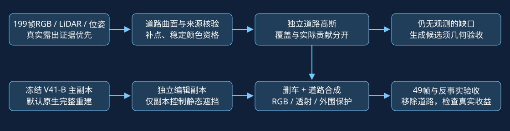

# 199帧真实道路与独立编辑：有界控制实验

Task/run：WS-V82-GN11-V42-CONTROLLED-SMOKE-20261026。用户授权两条路线控制变量先做smoke，最新优先级为199帧真实观测→残影遮挡→剩余未知生成候选。本轮正式/原生B更新0；所有7003步均为工程/机制短程，失败与恢复额外更新单列于远端execution_ledger.json。quality_accepted=false，human_verdict=null，failure_ledger_refs=[V82-F01,V82-F06]。

## 输入、控制与真实观测收益

原V41-B四件30K冻结、默认原生完整输出独立。匹配49/199初始化同20cm网格与几何门限；额外199帧为BUILD输入，不能声称同输入算法提升。EDIT优化仅raw102/129/137；49帧检查同序列且与BUILD重叠，不是泛化证据。真实删车标签来自138–169帧逐像素几何核验与颜色共识：raw102有效7000/16021、129为5903/6968、137为4018/5193，未知不算成功。

固定49帧车身内缩5像素核心分母a37=461346、a6=19313。独立道路alpha≥0.5覆盖：a37 24.40%→65.68%，道路颜色/opacity1000步后75.86%；a6 0→95.56%，1000步后不变。原静态+道路实际贡献≥0.05：a6仍只有26/19313=0.135%。单元支撑/资格与Gaussian足迹覆盖不是同一量。本轮FixedSurface.camera完整射线参考面与先前subset_rays全局平面起点有小幅口径差，不能混用精确计数。

raw102 a37核心12620像素，未启用6844，其中多几何来源但首对颜色不一致6632、零来源134、单来源78。保持原7848合格点不变，追加满足时间分块颜色共识的498点，共8346；核心独立覆盖59.35%→78.97%，近处条带34.11%→53.21%。(256,219)中心单元恢复资格，独立alpha0.7161→0.9928，但原静态合成贡献仍0。此为发现首源暗异常后追加对照，非预注册结果；未知不全放开。

## 编辑对照与透射机制

原有中心/足迹/深度三种硬删静态控制都未同时守住背景与中心道路可见性，原输出保留。全局行选择仅是实验候选，不能解释为永久污染分类。独立编辑参数只有道路DC/opacity及静态opacity乘子，原B不写回。

先用原始跨帧RGB、目标外原静态保护、实际道路贡献软目标和可见道路颜色监督。强初始抑制(.001)使raw102中心道路贡献0.994/0.936，但目标外MAE0.08172；保守(.999)使标签域MAE0.19989→0.00879，目标外0.00270，两个中心道路贡献却仍0。移除道路后MAE0.05535，说明道路在其他位置有收益，但中心拟合依靠原静态透射变化，不能据此称道路完成。

随后对两组加入同一额外约束：只在真实跨帧有效∩固定199帧独立alpha≥0.5射线上，最小化0.1×[-log(1-alpha_static)]。保留原RGB/目标外保护/道路损失与同seed、同三帧采样，各1000步。199帧组raw102标签MAE=0.012832，目标外MAE=0.007727；两中心道路实际贡献=0.912070/0.927888。49帧组同域MAE=0.043994。这是机制短程结果，不是正式30K或已通过质量验收；显式打开静态透射可能伤及目标外，应看visibility49全部帧与最坏帧，不能只看三帧均值。

## 外部生成控制

FreeInpaint官方固定提交9ac03f14b652c8d03d65f770bdf61da253da0fef，gsplat固定0b4dddf04cb687367602c01196913cde6a743d70（版本1.5.2）。独立Python3.12/Torch2.9.1cu128环境，不修改原drivingeditor环境。三视图102/109/116，336×504，seed0，冻结推理0优化；1pass与max3pass入口均运行，原alpha停止机制实际都在1pass结束，不伪称做了3轮STR。

可见非车辆LiDAR做Sim(3)，24像素空间块分拟合/核查；不使用隐藏中心对齐路面。a37/a6可见道路核查点3D误差中位数约0.763/0.764m，P90约3.49/3.45m，未达到本轮米制接入门限。a37图像出现浅色条块，候选未写入编辑，未覆盖199帧真实道路。该结果是当前输入和适配路径的否定，不是所有生成模型能力的否定。

## 工程验收与资产

各训练短程保存100/101/500/1000完整参数、Adam、torch/CUDA/NumPy/Python RNG及采样器，评价入口实际执行。独立进程恢复瞬间精确，续一步CUDA差异1e-7至1e-6，保留严格比较失败，不冒称逐位续训一致。FreeInpaint首次前向完成、渲染编译失败，状态已保存；固定CUDA12.8头文件并安装精确gsplat后恢复渲染，另进程RGB/深度/alpha逐位一致。旧失败输出保留。

NVML一秒采样与各CUDA分配器峰分开；NVML启动前的初始零更新控制/最早组件短程存在采样缺口，不能称全程无缺口。所有过程实际峰值见gpu_memory_peak.json、execution_ledger.json；不靠空等凑10分钟。纯道路组件1000步约9秒；后续成对联合透射短程真实GPU运行约10分钟。未启动新的30K或无关任务。

远端结果：/root/autodl-tmp/drivingeditor_repro/campaign/r15_gn11_v42_controlled_20261026。本地审阅：outputs/V42_Fullclip_Controlled_Smoke_20261026/index.html，包含49帧、资格分项、移除道路反事实、生成候选和原始JSON。报告仅作证据与工程验收，质量交用户评审。文件取回与推送凭据独立记录。
