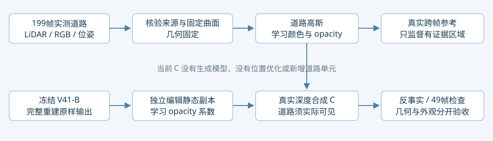

> 更正：本文曾错误把强透射版本称为用户选定C。它实际是未选中的edit_visibility对照；数字保留，但不能作为C归因或当前主线。当前见[C选定版本](C_MECHANISM.md)。

# C 为什么有效，以及沿 C 继续的边界

Task: WS-V82-GN11-V42-C-MECHANISM-20261026。所属 campaign 仍为 r15_gn11_v42_controlled_20261026。本轮额外训练更新 **0**，原工程7003步账不变。检查10种固定状态干预×49帧；不是把每种干预重新训练的消融实验。quality_accepted=false，human_verdict=null。

## C 的明确身份

“C”在这里绑定到 `edit_visibility/full199/checkpoint1000_from0.pth`：冻结V41-B原生30K，独立静态opacity系数，199帧初始化的7848个合格道路高斯，1000步学习道路DC颜色和opacity；显式真实道路射线透射约束。旧 `edit_smoke_preserve/full199` 是另一个RGB拟合对照，中心道路贡献仍零，不能混称同一效果。追加498点的资格救回尚未用于这个C，FreeInpaint也没有参与。

这不是一个现成外部work的复现：是在原生高斯深度合成上实现的实测道路补层＋独立编辑遮挡控制。这里证明的是机制依赖，不宣称新论文贡献已经成立。

## 固定状态反事实

统一raw102/129/137的16921个可信跨帧标签像素。它们参与了训练，因此这是机制诊断而非泛化质量。目标外域为每帧两车mask膨胀2px以外，49帧按像素加权。未clamp背景可超出[0,1]，大于1的MAE不能与clamp后的图像指标混比；result.json同时保留逐帧clamp指标。

|固定已训练状态的干预|三帧有标签域 RGB MAE（未clamp）|49帧目标外变化 MAE|
|---|---:|---:|
|原B静态删车|0.226955|0.000000|
|原静态＋初始199道路|0.228197|0.014256|
|原静态＋学得199道路|0.228346|0.009514|
|C静态抑制，无道路|1.265210|0.042946|
|C静态抑制＋初始199道路|0.102283|0.016303|
|C：抑制＋学得199道路|0.013362|0.009041|
|同C抑制＋初始49道路|1.164829|0.024663|
|旧RGB拟合版本|0.007597|0.003780|
|C抑制＋学得颜色，初始opacity|0.099302|0.013709|
|C抑制＋初始颜色，学得opacity|0.020355|0.011958|

## 已成立的机制

1. **真实道路供给必不可少。** 199帧在原先缺支撑的中心引入可核验道路；同一个C静态抑制换回49帧道路，空洞和错误背景重新暴露。新增真实输入的收益不能包装成同输入算法收益。
2. **供给和让路必须成对。** 只插入学得道路仍被原静态挡住；只抑制静态而移除道路，显示的是错误背景。两者共同合成才有效。静态门控只能属于编辑副本，不能写回完整重建主副本。
3. **opacity学习是当前主要增量，颜色学习再改善外观。** 同C门控下，初始道路误差0.10228；只替换学得颜色为0.09930，只替换学得opacity为0.02036，二者一起为0.01336。这是已拟合参数的替换依赖，不能解释为独立训练各模块的收益比例。
4. **不能只看RGB。** 旧RGB拟合对照的误差甚至更小，但两中心道路贡献零。C中(255,240)/(256,219)实际道路合成权重0.91207/0.92789，证明这些位置的改善已由道路承担。

## 尚未成立的几何与保护结论

道路位置、尺度、旋转与初始化逐张量相等，未补出新的道路单元。新增可见覆盖部分来自opacity和有限高斯足迹，不能当成训练学出了正确曲面。

中心道路贡献加权高斯中心深度为12.813/17.103m，对应初始化参考曲面射线深度13.077/17.413m。差0.264/0.309m；三帧同参考面平均绝对差约0.40–0.46m。这里是高斯中心加权深度与曲面交点的**内部一致性诊断**，不是首交面、不是独立深度真值误差，不能直接断言几何偏移了这么多米。斜视路面有限足迹也会产生这种差异。下一步必须用未参加建面和拟合的实测几何检验，区分表面问题与光栅深度定义。

当前静态候选1223319/2022726行，1056343行乘子低于0.5、179250行低于0.1；候选非常宽，不能称为识别出了同样数量的污染点。当前透射项是 `-log(1-alpha_static)`，会压低整条静态射线的累计遮挡，没有区分正确路面、道路前方污染和道路后方静态。这与外围变化一起构成下一步的明确失败边界，不能靠继续压大权重解决。

## 后续主线：沿 C 收敛，而非换骨架

- **固定保护通路：** 默认完整重建保持V41-B；编辑副本修改须在默认通路关闭，验收逐像素与基线一致。本轮49帧重复渲染最大差0，文件状态未变。
- **第一优先级是选择性解除遮挡：** 在可靠道路深度和跨帧证据下约束“到道路之前”的遮挡，保护路面和后方合法静态；替代压空整条静态射线的目标。有限高斯足迹必须按实际像素贡献核验，不能仅用中心高度或整条祖先后代删除。先比较固定C与改进C，几何/数据/采样/预算一致。
- **第二优先级是几何独立验收：** 建面帧、优化帧、核查帧分组后冻结；报告中心/边界的深度、法线、留出视角、真实道路贡献及目标外最坏帧。若只靠opacity扩足迹，不能记成几何补全；有证据的小位移/尺度调整另立对照。
- **外观生成只处理剩余未知：** 先保留199帧真实几何和经验证颜色，给生成模型的是缺口掩码、已知相机、道路深度/法线及可见上下文；预测外观候选再投到同一曲面，并按多视角一致性筛选。当前FreeInpaint整段无米制几何不直接替换C。确无几何观测的区域需独立、不确定性标记的几何假设，不拿生成纹理当几何证据。
- **打包边界：** 本次保留checkpoint与依赖清单，仍依赖B、初始化、相机及引擎，并非独立完整编辑场景。后续发布需明确打包完整编辑资产或使用可校验依赖加载器。

本轮以归因和后续设计为范围，未偷偷继续10K/30K，也未启动新生成模型训练。所有旧失败与原始渲染保留。failure_ledger_refs=[V82-F06]，failure_ledger_delta=同一残影机制补充证据。
