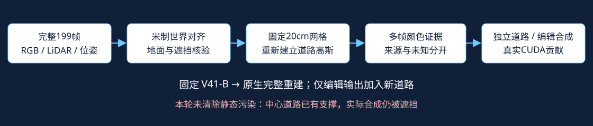

# 完整片段道路初始化验证

你的判断得到验证：完整约19.9秒、199帧中存在此前49帧未包含的中心路面观测。本轮重新建立道路高斯，未修改V41-B、R或原初始化。CPU可以完成几何、来源、颜色和初始化；GPU只用于49帧零更新原生渲染核验。

|同一CPU初始化口径|49帧|199帧|
|---|---:|---:|
|10cm 去重地面点|49,181|86,848|
|有支撑的20cm道路单元|14,034|21,626|
|至少两帧几何来源单元|1,847|9,011|
|首对颜色一致单元|1,624|7,848|

两个对照使用同一26,088格候选范围、20cm间距、0.8m几何支撑半径、0.15m地面平面带；不是缩小网格或放宽角度/深度门限来增加数量。原R创建14,034、输出资格1,919；本轮49帧对照的1,624采用额外标注矩形保护、小三角形几何和首对颜色一致性，因此不能将它伪称为旧R逐位复现。源点池49,181与历史49,182相差一格，受本轮局部float32缓存/去重边界影响，支撑单元14,034一致。

|raw102关键像素|同一世界道路点的新增证据|独立道路alpha|编辑合成实际道路贡献|
|---|---|---:|---:|
|(255,240)|raw141–149，9帧|0.8529|0.0000|
|(256,219)|raw149–159，11帧|0.7161|0.0000|

两点在49帧对照中的独立alpha及实际贡献均为0。第一点原四角缺支撑，完整片段恢复了支撑与颜色资格。第二点同样恢复了支撑，但首个来源raw149明显较暗，raw150–159较稳定，首对颜色门限仍拒绝其中心单元；相邻有效高斯已产生0.716独立alpha，不能据此说该中心单元已启用。追加的有界分块颜色诊断确认该单元：fit150/151/152/156/157/158，check153/154/155/159；该诊断未替换主对照或用于以上GPU结果。颜色证据支持恢复其资格，暗首源的成因可能包含车辆阴影和投影边缘，未把原因判死。

[同一世界位置的露出帧](/root/autodl-tmp/drivingeditor_repro/campaign/r15_gn11_fullclip_cpu_20261026/review/witnesses.jpg)

## a37与a6：分清屏幕缺口和车辆物理足迹

在49帧固定车辆轮廓内，内缩5像素的核心分母固定：a37为461,346像素帧，a6为19,313像素帧。投影到具备颜色资格单元的核心覆盖：a37从84,531（18.32%）到215,044（46.61%）；a6从0到13,953（72.25%）。这是初始化单元投影覆盖，不是逐像素真值，也不是删车成功率。

另用raw102车辆真实三维框的世界地面足迹检查：a6中心55格中，几何支撑8→55、双源0→55、首对颜色资格0→25。a37物理足迹中心50格原本就都有几何支撑，其首对颜色资格1→2，没有明显改善。它与屏幕车身位置向后相交到的道路区域不是同一分母；不能拿其中一种ROI替另一种宣布全面补全。

[固定世界范围覆盖](/root/autodl-tmp/drivingeditor_repro/campaign/r15_gn11_fullclip_cpu_20261026/review/world_coverage.png)

## GPU复核与限制

固定V41-B原生主通路在49帧插入道路前后逐帧重复输出最大差0；四件基线文件大小/mtime不变，无optimizer、无训练更新。NVML一秒采样峰值4580MiB（约4.47GiB），CUDA allocated 3.01GiB，reserved 4.20GiB。原生只读渲染耗时56.4秒。NVML采样不等于分配器亚秒精确峰值。

新增道路已覆盖关键中心，但原静态污染仍位于它前方：两点的编辑合成道路贡献都是0。不能把点数/独立alpha增长当作干净删车。当前颜色是未训练的来源融合，opacity0.5、切向sigma0.13m、法向sigma0.015m；不是30K新模型，不报告无GT中心PSNR。

完整视频与原始记录raw0/102/198核对，归一化RGB MAE分别0.00416/0.00497/0.00468（视频压缩及缩放差异）；完整原始记录才用于初始化。无外部模型、无生成式伪标签。相机沿用原流程的标定与位姿，未新增畸变/滚动快门修正。新增帧是额外BUILD输入，不能作为独立测试帧；与旧49帧方法比较应明确输入预算变了。

## 对V42的调整

先把完整片段的真实观测作为道路补全强控制；这两个中心已经有证据，不再归入“全片段从未观测”。接下来应把可见性、颜色稳定性、编辑副本的局部静态污染抑制接起来。FreeInpaint保留给全片段核验后仍未知的区域，以及明确撤源的控制；不把已露出中心上生成式结果当作证明外部先验必要。原V41-B完整重建保持独立。

资产：`full199_initialization.npz`包含世界/模型位置、法线、尺度、旋转、opacity、来源RGB、逐帧资格和来源索引；`window49_initialization.npz`为同口径控制。`*_color_consensus.npz`仅为额外诊断。它们是初始化资产，不是可直接替换V41 checkpoint的完整训练状态；现有49帧硬编码接口仍须适配后再做训练smoke。

工程记录：原CPU读取器完成前段后，换用已对11个真实数组逐元素核对的packed-float读取器续接，旧日志保留；第一次GPU读取因torch mmap不接受Path对象中止，修为str后在gpu_r2独立目录成功，旧gpu目录/日志保留。所有尝试训练更新0。quality_accepted=false，human_verdict=null，failure_ledger_refs=[V82-F01,V82-F06]；本轮未新增训练失败类型。
