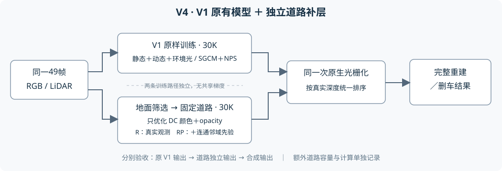

# GN11 V4：V1 原模型＋独立道路补层

当前范围：只改代码和做 CPU 工程检查。没有启动真实场景训练、GPU gate 或评价。V4 从五身份 V1 的训练源码复制；不继承 V3 训练模型、梯度路由或分层改造。



## 改动边界

`tools/v4_train_hooks.py` 向原 V1 的 `train.py` 只增加两个标注区块：V1 初始化与恢复完成后创建独立道路；V1 每步的优化、SGCM、评价、保存全部完成后，道路更新一次并独立保存。删除两个区块后，源码必须逐字等于 V1。其余 V1 文件直接复制，尤其 `gaussian_renderer/__init__.py`、`scene/gaussian_model.py`、混合损失、SGCM、NPS 和 checkpoint 机制不修改。Git 仅保存两处调用的插入脚本，不再重复提交整份 V1 train.py。

V1 仍使用原全图/静态/动态监督、完整动态 mask opacity MSE100、测量深度、环境光梯度、寿命/速度约束、SGCM/NPS、学习率和原增密/裁剪预算。无 V3 车身路由、动态深度替换、前遮挡处罚、动态颜色泄漏项和分支屏幕梯度融合。道路参数不加入 V1 模型、V1 optimizer、训练渲染或增密统计。

## 道路定义

- 复用 `r15_gn11_stage1_v3_20261020/road_multiview_002` 已核对的49帧输入，不重建网格，不扩到199帧。这里只复用输入证据和初始化公式。
- 每个有地面支撑的0.2m单元一个薄层 Gaussian。切向 σ=0.2×0.65m、法向 σ=0.015m；使用原测量切平面法线。初始 RGB=(0.18,0.18,0.18)，opacity=0.5。
- 位置、尺度、旋转和 ID 为 buffer；只有 DC SH 和 opacity logit 是 Parameter。不增加高阶 SH，不增密、不裁剪、不重置 opacity、不学习时间或速度。
- DC/opacity 的 Adam 学习率分别为0.0025/0.005，固定30K；V1 原学习率计划不变。道路均为额外容量，不能从 V1 静态预算扣除。
- R/RP 初始化全部受支持道路单元，数量和几何相同；未知单元不参加训练光栅，也不用于合成。无支撑的单元不创建。

## 三组强控制

| 组 | V1 更新 | 道路更新 | 目标 |
|---|---|---|---|
| B | 原 V1，fresh 30K | 0 | 基线 |
| R | 同 B | 每步一次，共30K | 可靠真实曝光颜色＋可见道路覆盖 |
| RP | 同 B | 每步一次，共30K | R＋连接到可靠道路来源的邻域先验 |

三组配置只有 `model_path`、`v4_arm` 不同，`v4_bundle` 相同。seed0、49帧raw89–137、初始化、相机采样顺序、V1 学习率及保存节点均来自同一 V1 配置。三个实验重新从共同 fresh 起点开始；不使用历史 V1 的20K→30K恢复模型冒充配对基线。不追加第二阶段。

道路用私有 `random.Random(seed+104729)` 无放回采样每步2帧，每49次抽样重建来源栈。初始化和每步调用均保存/恢复 Python、NumPy、Torch CPU/CUDA 的全局 RNG；V1 原私有 CameraSampler 不交给道路。道路更新只接收其自己的参数，不对 V1 反传。CPU toy 对照验证这些合同；真实 CUDA 数值一致性仍须在用户批准实验后检查，不能据结构测试承诺跨运行逐位确定性。

这是等步数、额外容量/额外计算的对照。记录原 V1 既有时间日志，并新增道路点数、每步道路耗时、累计道路耗时。道路计时含来源渲染/反传/更新并在 CUDA 同步后结束；不含 sidecar 序列化。合成/离线评价计算另计，不能把道路开销隐入 V1 原迭代时间。

## R 的监督

来源必须通过原九项硬门限，包括道路支撑、实测 LiDAR 一致性、视角/分辨率/质量、选中五车与所有车辆/原生遮挡 mask、框遮挡等。至少2帧有来源才是可靠观测；单帧候选仍为 UNKNOWN。R 使用所有可靠道路单元，包含上下文；RP 保持同一真实观测项。

道路独立光栅输出预乘 RGB、alpha、深度加权和。按实际原生投影坐标双线性采样，以 RGB/alpha 和未融合来源 sRGB 比较，使用 Charbonnier：`mean(sqrt((pred-target)^2+0.05^2)-0.05)`。覆盖项为 `relu(0.95-alpha)^2`，权重0.1。以全49帧固定可靠权重总和为分母，每步来源 batch 乘49/2。不使用自适应可靠性，不拟合 V1 残差，不给未知位置灌入车辆 RGB。

深度只用于原输入的可靠来源筛选、坐标绑定和道路独立期望深度的一致性记录，本轮没有可优化的几何或深度损失。原输入 `source_depth` 是经测量门限检查的道路位置相机深度，不伪称每个道路单元都有同像素稠密 LiDAR。

## RP 的额外先验

只在有支撑、非 UNKNOWN 的四邻图中，从可靠观测传播可达性。孤立分量、无支撑和单来源 UNKNOWN 不能成为桥。先验损失只在至少一端是可达先验单元的边上作用：两端 DC 颜色的平均平方差＋两端 sigmoid opacity 的平均平方差，整体权重0.1。不加位置/法线/尺度/几何处罚，不引入异位置供体颜色目标。

R/RP 的真实颜色和覆盖目标完全一致；RP 只增加上述连续性。邻接先验可反馈到道路真实曝光单元，这是 RP 要测量的代价；不会反馈到 V1。先验是推断，不是真实隐藏纹理 GT。

## 未知与输出

初始化灰色不作为恢复结果。可靠观测单元必须在实际道路 step 中遇到合格来源才进入输出；先验单元除可靠来源图可达外，还必须实际收到过非零 DC 颜色梯度并执行更新。无可靠连接的单元永远不输出。`road_units.npz` 保留 observed、connected_prior、source_seen、output_mask 和未创建 ID，不能用初始总点数冒充恢复覆盖率。

`utils/v4_road_render.py` 为新增输出模块。调用 V1 原 `prepare_rasterization` 取得原静态/动态高斯，再与固定道路合并，统一交给一次原生 rasterizer；保留真实时间 alpha 和 z 排序。没有车辆像素贴片、z 前移或掩码覆盖。环境色在联合透射率之后补入一次。道路训练不接触此联合合成路径。

若原 V1 黑色静态高斯挡在道路之前，道路仍可能不可见。输出同时记录道路独立 alpha 和同次联合光栅中道路实际 `Tα`，用于区分学到道路与道路暴露，不能自动删除原背景。

## 准备、未来运行与检查

准备脚本只复制代码/配置并验证已有输入，不执行优化：

```bash
python tools/build_v4_campaign.py --source <V1训练源码> --baseline-config <V1配置> \
  --bundle <已核对49帧bundle.json> --destination <全新V4目录>
```

`tools/run_v4_arm.py --campaign <V4目录> --arm B` 默认只展示配置。R/RP 同理。只有显式 `--execute` 才训练；本轮没有使用该参数，也没有排队或定时任务。入口只允许 fresh30K，已有运行不覆盖、不自动恢复。底层 sidecar 已实现恢复与私有来源状态保存，供后续显式恢复流程使用。

第一项验收必须是原 V1 分支一致性：`tools/compare_v1_states.py` 比较 B 与 R/RP 同节点静态、动态、环境参数/optimizer及训练 RNG/相机采样状态，配置只排除输出路径和 v4 字段。发现不一致则先定位，不能继续声称控制变量成立。

`tools/evaluate_v4.py` 读冻结节点，分别保存原 V1、道路独立、完整合成、删除全部动态前后。支持显式传入与当前动态行对应的 bool keep 文件进行既有删车选择；本轮不新造逐车归属规则。每帧先核对无道路合成器与 V1 原前向，R/RP 再以 `--reference-eval <同节点B评价>` 核对原 V1 浮点输出。

保存完整图、车身内部、边缘、非天空背景的 MAE/PSNR。提供 B 评价时，固定正常背景为 B 原误差≤0.05且位于车身7px膨胀域外、非天空的像素。误差使用原浮点；PNG 仅展示。逐帧另记录固定可靠世界来源的 V1/合成/道路 MAE、道路 alpha 和深度一致性，不根据输出 alpha 或效果缩减分母。隐藏道路无干净 GT，删除结果不与原车辆 RGB 计算重建误差，不用同一车形掩码充当隐藏道路真值。`evaluation_contract.json` 规定评价域与未知分母；运行入口记录含初始化、评价和 checkpoint 的完整训练墙钟，离线评价另记墙钟。

道路 sidecar 单独保存 `road_chkpntN.pth`：固定几何/DC/opacity、实际更新数、来源 sampler 栈/状态和 Adam 状态；V1 四件原 checkpoint 格式不变。`v4_checkpointN.json` 在道路 sidecar 完成后发布，未来消费者必须同时检查两侧节点，不能把尚未写入道路的 V1 event 当成完整 V4 节点。

## 验证边界

16项 CPU 回归覆盖 RNG/V1 toy 轨迹隔离、已有 V1 梯度不变、固定几何、未知图桥拒绝、两类参数、灰色抑制、R 关闭先验、sidecar 严格恢复、步数合同、SH/深度组装和前黑后路的解析深度遮挡。另由 `tools/validate_v4_cpu.py` 检查新 engine 的151个其余 V1 文件未改、两处 hook 去除后与原 train.py 相同、真实道路输入与三组配置，并用已保存49帧 V1 相机元数据实例化 CPU 道路层，不执行真实场景 step。原相机与道路归一化外参最大差6.19e-13。

未运行真实 CUDA 光栅/反传、真实 V1 配对30K或正式49帧评价；不能由 CPU 检查认定道路有效或车身不会退化。质量验收由用户评审，`human_verdict=null`，`failure_ledger_delta=none`。
