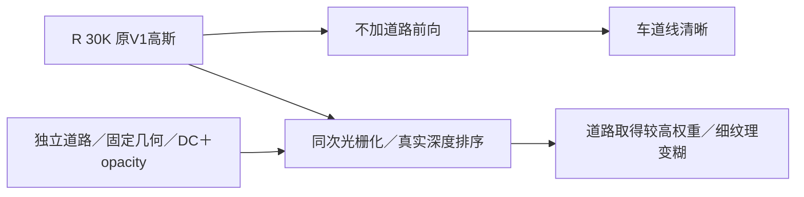

# R 30K 道路退化定位：同 checkpoint 的合成损伤

2026-10-23，用户要求先暂停RP，检查原离线诊断页中R的完整重建道路退化。自动化 `gn11-v4-r-rp-30k` 已暂停；不得自动恢复或重放RP。

## 直接证据

同一个R 30K checkpoint，不含道路的原V1前向保留清晰车道线；加入道路后，黄线、白色自行车标识与路面纹理明显变糊。此处同 checkpoint 的对照隔离了输出时加道路的影响，不需要把历史V1当成严格同起点基线。页面的3D点云抽样不影响2D原生图像。

49帧raw89—137、480×320、同一GT PNG、RGB限制在[0,1]，逐帧指标算术平均：

| 输出 | PSNR ↑ | SSIM ↑ | MAE ↓ |
| --- | ---: | ---: | ---: |
| 同一R：原V1分支，不加道路 | 36.7963 | 0.96862 | 0.008334 |
| 同一R：加入道路合成 | 28.3808 | 0.92281 | 0.019565 |
| 历史V1：辅助观感对照 | 36.5563 | 0.96818 | 0.008446 |

49帧的PSNR、SSIM全部下降。这里使用已保存的8-bit PNG／无损WebP，是显示图像诊断，不能与未量化浮点的历史正式指标直接混用。R原V1训练日志的未量化平均PSNR 36.8503、SSIM 0.969671、LPIPS 0.035525。新合成的正式未量化评价和LPIPS49帧未完成；没有虚构数值。

SSIM按原V1的11px、sigma=1.5高斯窗口、零填充公式以SciPy分离卷积复算；raw102另用原V1 PyTorch实现只读核对：原V1输出0.9788028／合成0.9371762，与复算值最大相差约2.1e-6。可选CPU VGG LPIPS尝试因实例仅0.5 CPU核、预计需数十分钟而停止，没有发布其汇总；本次已完成的49帧指标及同checkpoint图像证据足以定位合成退化。

## 影响范围与机制

以已导出的同次光栅道路贡献大于0.05作诊断域，两路输出使用完全相同的域：平均占全图20.53%，其中道路平均贡献52.03%；原V1的MAE 0.00652，合成后0.06065。该域由输出定义，只定位影响，不能冒充预注册道路GT mask。

实现中道路网格20cm，切向sigma=13cm，法向sigma=1.5cm；每点只有DC颜色和opacity。颜色目标只约束可靠来源投影中心的归一化道路颜色，覆盖目标推动独立道路alpha达到0.95；没有对最终合成的正常道路／车道线保持提供监督。R输出1919点的opacity中位数0.9123，42.57%的点超过0.95。

因此，固定几何虽然排除了位置漂移和尺度增长，仍允许低频道路颜色在最终真实深度排序中取得较大权重，遮住原V1已重建的细纹理。图像差异与代码共同支持这一机制；各因素独立因果份额没有消融量化。不能仅凭独立道路loss低或几何不动，判断合成质量合格。

## 状态与证据入口

- R的10K／20K／30K完整五件checkpoint及manifest均保留，V1与道路各30000更新。
- 用户暂停请求时原控制器14982与RP训练20412已不存在，远端没有GPU设备文件；未声称是代理成功SIGSTOP了仍在运行的进程。RP完整磁盘节点只有10K；进度日志最后13030，预更新journal到13031，道路每100步日志13000。最终完整更新数不可据此伪造；没有保存的更新不得当成可精确恢复状态。
- `serial_status.json` 已由过期RUNNING标为 `USER_PAUSED_PROCESS_ABSENT`，旧状态备份保留；心跳PAUSED，恢复需用户明确指令。
- 旧首次R失败执行V1 10000／道路9999推断更新单列；此次诊断零优化、零新GPU任务，未改损失、采样、学习率或道路几何。
- 当前这里只确认同R的合成损伤，未宣称R/RP原V1参数、optimizer、RNG及采样状态已严格一致，也未新增B。

原离线页：`GS_Reconstruction_Diagnostics_20261021_Evidence_r1/index.html#workspace`。R接入绑定指向 `r15_gn11_stage1_v4_replay_r1_20261022/arms/R/run30k`，发布凭据为原页面 `data/v4_R/ready.json`，原V1重放误差不超过半灰度级，道路组贡献追加与原合成器浮点前向一致。

运行证据：`/root/autodl-tmp/drivingeditor_repro/campaign/r15_gn11_stage1_v4_replay_r1_20261022/diagnostics_user_pause_20261023/`。原生R浮点和PNG仍在 `arms/R/run30k/eval/train_30000_render/`；新合成来自 `/root/autodl-tmp/gsdiag_v4_R_30k_20261023_r1` 的原生CUDA导出。

本地对照交付：当前聊天 `outputs/V4_R_road_diagnosis_20261023/index.html` 与 `analysis.json`。后续先审查正常路面覆盖、道路纹理容量及合成保护目标，由用户确定修改方向；保持RP暂停。`quality_accepted=false`，`human_verdict=null`，`failure_ledger_delta=none`。
