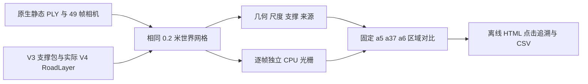

# V4 固定道路初始化验收

当前任务 WS-V82-V4-INITIALIZATION-AUDIT-20261022。只检查初始化，不读取正在训练的 V4 检查点，不恢复训练。基线代码参考 c9385395；与其后的 R/RP 串行训练代码共存。原模型指当前 V4 原生输入及初始化公式，不是历史 V1 的 30K 后代候选。



## 直接发现

区域固定为 raw102 的实际车辆 OBB 水平投影。上下文另外外扩 1.2 米。切换 raw89–137 相机不改变世界选区。按格中心是否落在区域定义共同 0.2 米网格分母；不因有无预测、支撑或来源缩小分母。

| 区域 | 共同格数 | 原模型初始地面中心 | 原模型有中心的格 | 新道路已创建 | 未创建原因 | R / RP 可训练格 |
|---|---:|---:|---:|---:|---|---:|
| a5 左车道 | 210 | 838 | 183 | 210 | 0 | 143 / 204 |
| a37 近中间 | 210 | 866 | 145 | 200 | 10 格不在原候选网格 | 103 / 180 |
| a6 前中间 | 225 | 4 | 2 | 134 | 91 格无足够实测支撑 | 0 / 134 |

a37 的原模型初始点数与 a5 相近，但落在更少的格内；不能只根据点数判覆盖相同，也不能把其残影直接归因为初始点少。包含邻格的实际水平 3σ 足迹代理在两处均接近完整；初始 opacity、时间权重、透视与训练候选范围仍会造成实际覆盖差异。a6 有明确的支撑/创建缺口。未创建原因分为“不在原候选网格”和“候选内无支撑”，不能合并。

V4 与 V3 使用相同 26,088 候选、14,034 已创建道路 ID 和位置、σ=[0.13,0.13,0.015]米、初始 opacity=0.5。V4 先归一化法线再构造四元数，与 V3 原函数的浮点顺序有差别：最大旋转差 0.002540°、四元数分量差 2.21628e-5；不宣称逐位相同。独立计算两套投影地图，未复制 V3 数值作为 V4。全49帧最大逐像素 α 差见 receipt.json；个别接近光栅阈值的像素可放大浮点差。

raw102 新道路独立初始 α：a5 平均0.9597，a37 平均0.8693，a6 平均0.7364。统一 opacity=1 / 时间权重=1 的几何参考中，a5/a37 的 α≥0.95 覆盖为100%，a6约68.61%；因此 a6 的问题不只是初始 opacity。该参考保留0.99钳制和原生早停，不是逐像素严格上界，不是训练/输出结果。

## 数据口径

- 原生 static：实际 points3d.ply 的60万点，严格复原所有动态点 `<0.1m` 排除后585,943；地面诊断子集71,120。原生3NN均方距离尺度由CPU复原，非保存的CUDA step0。初始 opacity=.01，49帧实际 loader duration=[-.48,.48]，σt=sqrt(.096)，cycle=.2。不能与道路 .5 的初始 α 差异全归因于几何。
- 多帧支撑：49帧原始地面1,065,640点，原算法10cm去重后49,182；原0.8m内最近8点至少3有效点才创建。实际支撑数量、距离、原始创建标记逐项核验。
- 道路：真实 V4 RoadLayer 的 CPU 初始 buffer。可靠实测1919、连通先验11082、有支撑但未知1033。R训练1919，RP训练13001，0步输出0；已创建、可训练、允许输出分别显示。固定 xyz/scale/rotation/ID，仅DC/opacity可训练。
- 公共网格补入189个原候选区外格（a37上下文），合计26,277；其高度只作拟合面参考，不伪装隐藏道路实测值。
- 来源：每格保留49帧九门限、实际权重；仅正权重真实来源才显示RGB。通过几何门限不是隐藏道路纹理GT。
- 足迹：协方差水平投影3σ椭圆，每格16个固定子点，包含邻格高斯。它是几何代理，不是渲染α，不是像素可见贡献。
- α/深度：先以全层模型进行各层独立CPU光栅，再按固定世界网格的投影四边形并集统计。原模型只取地面诊断子集；不是整个静态背景或删除图。使用真实投影/协方差/时间权重/深度排序/钳制/早停。深度为独立α加权期望相机z，不是首交面。
- LiDAR：当前帧同像素最近实测z，可能是车身；没有回波明确显示未知，不能当被车挡住的地面GT。
- 地图显示仅导出三个固定上下文投影并集，domain_mask外未导出，不能当零覆盖。α为uint16/65535，深度为厘米；全部统计在量化前计算。

## 使用与一键导出

用户原index.html的“实验组”下拉框直接登记V4 R（仅真实来源）和V4 RP（真实来源＋先验），均为可选占位，不增加B。完整结果尚未导出时，available=false，选择后清空旧实验图像、几何、指标、来源和GPU干预，显示状态快照与“结果待导出”；同帧对照保留两组，未知指标为—，不请求不存在的V4资产。切回已有实验恢复原功能。训练完成状态也不自动当作已导出结果；需真实资产及检查点绑定核验后才可用。首页大块嵌入撤回，初始化验收保留为辅助导航v4_initialization.html。以后完整或单页导出会同时刷新两实验状态快照。先按“原模型地面 vs 新增道路”看a5/a37/a6；再按“V4道路 vs V3初始化”；“R vs RP训练候选”检查哪些已创建格实际可训练。世界网格左右同尺度、同点大小，可切中心数量、实际足迹、来源、高度；点一格查看支撑/世界位置/49帧来源及当前相机深度。

```sh
cd scripts/worldsim_v82/drivingeditor_shadow_rebuild_20261017/r15/gn11_stage1_v4_20261022/initialization_audit
CUDA_VISIBLE_DEVICES= OPENBLAS_NUM_THREADS=1 OMP_NUM_THREADS=1 /root/autodl-tmp/envs/drivingeditor/bin/python export_initialization_audit.py --output /root/autodl-tmp/gsdiag_v4_initialization_NEW
python validate_initialization_export.py /root/autodl-tmp/gsdiag_v4_initialization_NEW/v4_init
```

Windows：原包 export_offline.ps1 默认指向 V4 checkout，完整一键导出会携带此验收页；只更新本页可运行 export_v4_initialization.ps1 -Destination 原离线包。脚本数据通过同目录JS加载，无需HTTP服务。导出不修改已存在的训练目录。

## 验证与限制

6项新增数学测试、23项V4 CPU测试通过。49帧1470个量化图/浮点统计对照通过，最大均值误差4.25269e-7。10项真实页面JS/解压/Node Canvas测试通过；Canvas暖重绘约8ms只代表测试环境，非浏览器FPS。151原生文件原样、去两处hook后train源码与原版一致，B/R/RP共同起点一致；只读检查保留已有R/run30k，不以fresh-only校验器绕过运行目录限制。未执行训练或GPU调用，不宣称新CUDA全幅验收或真实浏览器UI验收。

quality_accepted=false，human_verdict=null，failure_ledger_refs=[V82-F01,V82-F06]，failure_ledger_delta=none。初始化证据不能单独证明残影的训练因果；V4训练/编辑质量需要真实终态另行评价。
