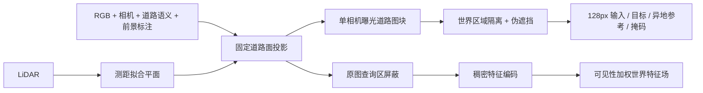

# 固定世界道路外观数据与特征场



`dataset.json` 使用 `road_material_dataset.v1`。RGB 为 sRGB 8 bit，描述参考曝光下的道路外观，不表示真实 albedo、PBR 参数或隐藏表面真值。

- `hole_mask=255` 表示待填；`valid_mask=255` 表示有合法可见源支持的整个目标域。评价只使用 `hole & valid`，无效域为灰色 128。
- `reference` 是异地世界地块的完整可见外观；`reference_valid_mask` 独立标注其支持域。参考来自训练世界区域，不包含评价查询位置。
- `world_from_uv @ [u+.5,v+.5,0,1]` 给出 texel 中心，单位米。精确固定坐标另存 `world_xyz.npy`。
- 修订 clean 包的图块为 2.56m×2.56m、128×128、0.02m/texel；世界特征 atlas 为0.04m/cell，因此 `point_ids`/`atlas_indices` 每个粗格重复2×2，表示特征索引，不表示重复的RGB texel。
- `source_uv_native`、`source_weight` 和 `target_source_raw` 保留单曝光来源。相机是 OpenCV 轴约定、原图 Brown 畸变投影。
- `sources.json` 仅允许用 `feature_input` 编码：所有伪遮挡查询世界区域先在所有源帧中投影屏蔽，之后才编码。`observations` 保存合法 `point_ids/uv_native/weight/depth`，每帧每世界格只保留一条观测。
- `atlas/feature_exclude_world_mask.npy` 排除所有查询洞；`atlas/exclude_world_mask.npy` 额外排除完整评价图块，供候选库使用。合法评价外围上下文保留。
- `candidates[].input` 是清晰单源原图整块投影；候选颜色禁止从 `supervision_only_rgb` 读取。

`world_feature_field.fuse_dense_features` 只对合法原图特征做双线性采样和可见性加权聚合，不改几何。字段分别表示同世界可见观测、异地材质参考、生成预测和 unknown，不把推断写成观测。

首版 `scene065_pilot` 保留为工程接线记录：局部残差面与逐格切换曝光产生不连续灰域/拼缝，未通过数据质量检查。128格/5.12m严格单源筛选失败和中断的2.56m逐格测距筛选也保留，不用于正式材质评价。clean 修订使用固定测距拟合平面，外观资格依据道路语义与前景 guard，LiDAR不作为每texel的独立真值认证。

该包是同街段空间留出的小规模可行性实验。样本数不是独立街段数；可见道路伪遮挡分数不能衡量真实隐藏道路恢复。原生高斯、渲染器和已有模型/结果均不更新。

最终修订 `scene065_v3_clear64` 对全部 train/eval/reference/candidate 统一要求投影 Jacobian 最小轴跨度至少64原图像素/2.56m，完整有效率至少.98、中心全有效；完整候选池60块，其中23块有可见标线，再以固定seed划分12train/4eval，评价预留2块标线。44块未作为query的清晰地块构成参考候选。旧r2的评价块仅有约3原图像素纵向支撑，不用于纹理质量检验。

固定E参考以世界中心距离选择最远候选，输入只有query世界bounds、候选世界坐标和确定的候选次序，不读取评价target隐藏区域颜色。`audit_reference_selection.py` 仅用这些几何输入重放全部reference选择。E的单独参考条件与C/D的世界特征绑定对照是两个实验轴。

复现依次运行（需配置中的既有输入路径）：

```bash
python build_road_dataset.py --config scene065_config_v2_clean.json --output BASE
python select_clear_revision.py --base BASE --output FINAL
python audit_road_dataset.py --dataset FINAL
python audit_reference_selection.py --dataset FINAL
python repair_continuous_source_masks.py --dataset FINAL
```

BASE为64格的准备atlas；selector从原始RGB重新warp输出128像素，所有数据路径来自配置，不含按场景ID分支。`finalize_clean_dataset.py` 仅保留为旧r2接线记录，复现最终包不需要该步骤。

最终特征入口为 `dataset_fineguard.json` → `sources_fineguard.json`。旧coarse中心掩码检查曾遗漏fine texel，已保留旧source输入并作废对应缓存。连续面修正将每个hole扩大为世界包围矩形，四边各采65点、Brown投影取凸包填充、原图再外扩4像素；跨相机平面时保守遮住整帧。全部199帧保存连续mask；51实际编码源上42,000 fine中心、168,000四角和42,000格内随机点全部通过零泄漏审计。E图像、参考、几何、valid及划分均不变。此修正是C/D共用输入保护的工程修复，不是多输入方法差异。

精简包把连续保护版manifest作为 `dataset.json`，同时保留 `dataset_fineguard.json` 和旧manifest追溯入口；不复制原始51张RGB。原图路径与native allowed mask均保留，可用 `materialize_feature_inputs.py` 重建编码输入。

## 统一包入口


本目录数据模块、[features](features/README.md)、[train](train/README.md)和[bridge](bridge/README.md)支持repo根目录下`python -m scripts.worldsim_v82.road_material_field.<模块>`，亦保留直接脚本入口。数据/模型/纹理/输出通过清单或CLI提供；`scene065_config_v2_clean.json`是本轮输入资产的示例配置，移到其他数据源时替换路径。导入数据模块不修改`CUDA_VISIBLE_DEVICES`，包不注入`sys.path`。

不同阶段使用各自匹配环境，不安装或修改共享环境：数据为NumPy/Pillow/SciPy CPU；DINOv3/SuperPoint本轮使用Torch2.7.1/Transformers4.56.2既有overlay；LoRA使用`/root/autodl-tmp/envs/v42-freeinpaint/bin/python`（Torch2.9）；原生CUDA光栅使用`/root/autodl-tmp/envs/drivingeditor/bin/python`（Torch2.2与既有cpp扩展）。所有权重、checkpoint与大型缓存保持在artifact路径，不进Git。特征CLI显式接收DINO与官方SuperPoint权重，训练CLI显式接收SD1.5九通道inpaint权重，bridge始终显式接收原生`--raster`路径。

有效特征入口为`dataset_fineguard.json → sources_fineguard.json`，结果修订为`native_controls_r3_fineguard_r1`。冻结A/B/C/D均0参数更新，4个伪洞上简单A仍优于D约7.47%，没有无训练性能优势结论。独立LoRA确实训练600更新、797184个attention参数，固定终点不按留出指标选checkpoint；D参考追加检验仅16张零更新前向，不是额外后训练。仅单场景12train/4eval、可见道路伪遮挡和曝光外观；真实隐藏GT、跨场景、全场景编辑及人工画质验收均未成立。

原run源码、失效缓存、模型和结果保留；本包只进行参数化路径与正常包import适配。CPU坐标回归及public package真实GPU bridge逐值重放是发布验收，不新增训练或改变已执行算法、相机与超参。
