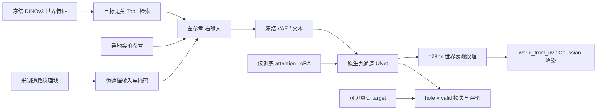

# 道路表观纹理：原生 inpaint 与小样本 LoRA

所有输入、模型和输出由`--dataset/--model/--out`提供，可从repo根以`python -m scripts.worldsim_v82.road_material_field.train.road_inpaint_lora`调用。也可用`ROAD_INPAINT_MODEL`指定既有权重。本轮执行现场保留于 `/root/autodl-tmp/drivingeditor_repro/campaign/road_material_field_20261112_r1/train`；该历史路径不是代码依赖。复用`v42-freeinpaint`环境（Torch2.9），原生30K和共享环境均不修改。



模型为既有 SD1.5 inpainting 权重，九通道分别对应 4 通道噪声 latent、1 通道掩码、4 通道 masked-image latent。[Diffusers v0.36 官方 inpaint 文档](https://huggingface.co/docs/diffusers/v0.36.0/en/api/pipelines/stable_diffusion/inpaint)直接推荐当前模型，相比普通 text-to-image 权重更适合此任务。缓存来源是[原 Runway 权重的社区镜像](https://huggingface.co/stable-diffusion-v1-5/stable-diffusion-inpainting)，镜像明确说明其与 Runway 无关联，不应称为当前官方分发。无需新增权重下载。

参考和输入每块 128px，统一等比放大至 256px，再左右拼成 512×256；没有非等比拉伸。原生和 LoRA 使用相同参考、输入、掩码、prompt、DDIM 20 步、guidance 3 和 seeds 101/202。原生禁用 LoRA；启用零初始化 LoRA 的零步输出须逐像素等于原生。目标图像只参与训练目标及评价。推理输出按 hole 与原输入合成，孔洞外精确保留。

LoRA rank=alpha=4，仅更新 UNet attention 的 q/k/v/out，合计 797,184 参数。VAE、文本及原生 UNet 均冻结。学习率 1e-4，AdamW，bf16 前后向、fp32 LoRA/Adam 状态；bf16 不使用动态缩放，仍保存空 scaler 状态。目标为 epsilon MSE，以 `hole × valid` 按面积下采样到 latent，并按有效面积与四通道归一化。世界纹理定义为参考曝光下的 sRGB 表观，不代表真实 PBR 材质。

checkpoint 保存 LoRA、完整 Adam、scaler、Python/NumPy/Torch CPU/全部 CUDA RNG、独立训练 CUDA generator、样本排列/游标/epoch/采样器 generator、更新步及固定学习率合同。`audit` 覆盖磁盘恢复后下一更新逐值一致；`replay` 从独立进程重载模型及编码缓存后再次检查。`eval` 是下一阶段实际入口；`predict` 对无真值的 `split=query` 世界块只输出先验，不计算真值指标。

工程证据：合成 CUDA 载模/推理成功；10 分钟合成 smoke 和真实 v1 的 32 状态更新为工程开销，均不进入正式 600 更新账。真实 v1 的原生/零 LoRA、进程内和独立进程恢复均通过，并从非空 Adam 状态跨越 epoch 边界重放核验。v1 实际更新 37 次（32 主状态、5 次工程重放/恢复核验）。v1 存在来源碎条与参考灰洞，已保留并拒绝作为干净纹理质量结论；r2 的接口检查通过，远处 eval 来源分辨率仍被拒绝。正式训练只使用最终视觉与来源验收的数据，从干净目录开始，预先固定 600 更新，200/400 仅作诊断，eval 不用于选择最优 checkpoint。

正式采用 `scene065_v3_clear64`，12 train / 4 eval，参考来自 44 个独立 clean candidate。600 更新恰好每个 train 世界块 50 次。保留 0/200/400/600 checkpoint，原生与零 LoRA 图逐像素一致，600 独立进程恢复后的评价图也逐像素一致。所有图均为同一场景空间块留出；128px / 2cm 是世界网格间距，原图最低 64px 支撑分辨率须另记，不等于恢复 2cm 真实细节。

| 固定参考与权重对照 | 原生 MAE | LoRA600 MAE | 留出范围 |
|---|---:|---:|---|
| E：固定远处参考 | 0.0291271 | 0.0186040 | 4 eval × 2 seed，21,000 有效像素对 |
| D：fineguard 世界特征 Top1 | 0.0263989 | 0.0231615 | 同 4 eval / mask / seed，仅换参考 |

E 的平均误差下降 36.13%，但仅 3/4 世界块、7/8 seed 对更好。D 是同一个终点权重的零更新端到端检验，4/4 世界块均值、7/8 seed 对更好，`eval_012 / seed202` 回退。D 训练后未超过 E 训练后，两个协议并列报告，不据此重新选择方法或 checkpoint。原生及 LoRA 仍有明显紫色孔洞色差、接缝和局部标线误差，不能按平均 MAE 声称画质通过；`human_verdict=null`。

旧 D 编码掩码存在 coarse→fine alias，226 个细格可进入特征编码器；其 8 张原生前向保留于 `eval_retrieved_D_invalid_coarse_mask226` 并明确作废。唯一有效 D 来源为 `native_controls_r3_fineguard_r1` 和 `dataset_fineguard.json`；其独立 fine 审计为 42,000 texel × 51 source 无 allowed/RGB 违规。新 D 共 16 张生成、320 个 DDIM 迭代，新增训练 0。合成/真实工程训练实际更新共 2,101 次，另有正式 600 次，不混账。

最终便携权重位于 `formal600_r3/portable_lora/pytorch_lora_weights.safetensors`，256 个导出 tensor 与完整 checkpoint 对应值精确一致，可用 Diffusers `load_lora_weights` 载入；完整 optimizer/RNG/sampler 恢复使用 `checkpoint_step000600.pt`。本地取回目录为 `formal_evidence/formal600_r3`、`retrieved_D_evidence/eval_retrieved_D`，后者含 `references/<query_id>.png` 及两个模型的 world atlas。

运行示例（正式目录仅在数据验收后启动）：

```bash
PY=/root/autodl-tmp/envs/v42-freeinpaint/bin/python
$PY -m scripts.worldsim_v82.road_material_field.train.road_inpaint_lora train --model "$MODEL" --dataset "$DATASET" --out "$RUN" --steps 600 --save-every 200 --eval-every 200
$PY -m scripts.worldsim_v82.road_material_field.train.road_inpaint_lora eval --model "$MODEL" --dataset "$DATASET" --out "$RUN" --resume "$RUN/checkpoint_step000600.pt" --label restored_final
$PY -m scripts.worldsim_v82.road_material_field.train.compare_native_lora --dataset "$DATASET" --run "$RUN" --steps 600
```

数据接口为 `road_material_dataset.v1`，每个 sample 含 `id, split, input, reference, hole_mask, valid_mask, world_from_uv`，训练/评价还须有 `target`。所有路径相对 JSON；RGB 为 sRGB uint8，mask 为 0/255，白孔洞，白有效支持。query 可省略 target，未知孔洞完全排除真值评分。像素中心遵循 `world_from_uv @ [u+0.5,v+0.5,0,1]`，输出仍为 128px，世界变换不变。

`comparison.json` 给出配对 MAE、世界块胜率和有效像素分母；`native_vs_lora.png` 并排保留参考、输入、原生、后训练和真值；每阶段 `world_atlas.json` 可交接到世界材质查询和渲染。灰色拒绝域、实际未知道路和伪洞真值域须分开。单场景世界区域留出不能支持跨场景泛化结论，人工 verdict 保持 null。
## 便携 LoRA 正常消费验收

全新 `StableDiffusionInpaintPipeline.from_pretrained` 后，仅用标准 `pipe.load_lora_weights(portable_dir, weight_name="pytorch_lora_weights.safetensors")` 载入便携权重；未加载完整 checkpoint、训练 Runner 或 target。离线 Diffusers 0.36 必须显式给 `weight_name`。固定 E 参考的 `scene065_eval_012 / seed101 / DDIM20` 实际 GPU 生成，512×256 原始画布及 128×128 孔洞合成图均与 full600 checkpoint 对应图逐像素一致（uint8 最大误差 0）。标准加载得到 256 个 bf16 LoRA tensor、797,184 参数、所有 LoRA scale=1。额外开销为 1 张生成 / 20 个 DDIM 迭代 / 0 训练更新；成功过程 5.77s，峰值显存 2.65GB。首次未显式指定文件名时在离线加载阶段退出，生成张数 0；该日志保留。

独立消费验收 CLI（`ROAD_TRAIN_ROOT` 指实验快照的 `train` 目录）：

```bash
ROAD_TRAIN_ROOT=/root/autodl-tmp/drivingeditor_repro/campaign/road_material_field_20261112_r1/train
ROAD_DATA_ROOT=/root/autodl-tmp/drivingeditor_repro/campaign/road_material_field_20261112_r1/data/scene065_v3_clear64
ROAD_TRAIN_PYTHON=/root/autodl-tmp/envs/v42-freeinpaint/bin/python
"$ROAD_TRAIN_PYTHON" "$ROAD_TRAIN_ROOT/verify_portable_lora.py" \
  --model "$ROAD_INPAINT_MODEL" \
  --weights "$ROAD_TRAIN_ROOT/formal600_r3/portable_lora" \
  --weight-name pytorch_lora_weights.safetensors \
  --dataset "$ROAD_DATA_ROOT/dataset.json" \
  --sample-id scene065_eval_012 --seed 101 \
  --expected-output "$ROAD_TRAIN_ROOT/formal600_r3/eval/lora_step000600/scene065_eval_012_seed101_output.png" \
  --expected-raw-canvas "$ROAD_TRAIN_ROOT/formal600_r3/eval/lora_step000600/scene065_eval_012_seed101_raw_canvas.png" \
  --out "$ROAD_TRAIN_ROOT/formal600_r3/portable_lora/gpu_consumption"
```

`ROAD_INPAINT_MODEL` 为已缓存的九通道 SD1.5 inpaint snapshot。验收代码独立于训练 Runner；`expected-*` 仅在生成后读入作输出比较。收据及图已取回本地 `formal_evidence/formal600_r3/portable_lora/gpu_consumption/`，完整收据为 `portable_gpu_consumption_receipt.json`。完整 optimizer/RNG/sampler 的继续训练仍使用 `checkpoint_step000600.pt`。
