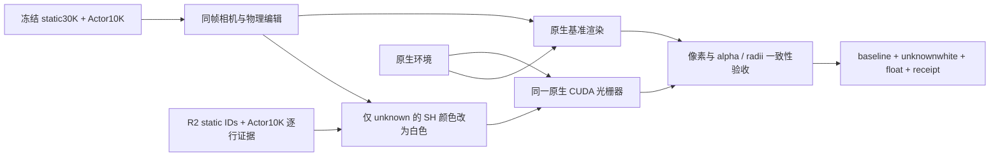

# 同帧 unknown 白色高斯原生渲染

当前状态为 **complete**。2026-10-30 已完成 scene1 的 6 组、204 个 group/frame 原生 CUDA 白材质重渲染；raw113 六分支有限重放另计约9.97秒，完整204帧约197.90秒，训练更新0。远端与本地完整float/PNG/行ID核验均通过，完整1.904GB归档已取回。24次实际Canvas导航与6组参数清空恢复通过；未声称浏览器布局或人工语义质量验收。

原工作台新增图位于左侧RGB下方，与右侧灰色unknown精确使用同一行集合。默认5px/20%；1K/5K/V1及场景2/3仍需各自匹配证据。报告位于 outputs/V43_Ownership_20261027/gpu_v43/unknown_white_20261030/index.html。后文保留CPU准备与精确复现说明。



`render_unknown_white.py` 默认仅使用 CPU 准备输入。`render_inputs/input_contract.json` 引用只读复制的 R2 证据和原始 RGB。`render_manifest.prepared.json` 没有渲染图像路径，全部待渲染帧保持 `prepared`。

支持范围：`v43_actor_10000` 的 raw077–125，以及 `v43_motion_no_edit`、`v43_motion_delete_target`、`v43_motion_translate_lateral_1m`、`v43_motion_turn_left15`、`v43_shift_3m` 的 raw086–116。1K、5K 与 V1 原生入口均明确标为 `evidence_needed`。

Actor unknown 精确复用当前 `r2_ownership_runtime.js` 的默认 5px / 0.2 规则；static unknown 精确取同帧 R2 `final_removed_ids`。编辑只携带原观测行标签，像素贡献由原生光栅器重新计算。车辆核心保留原生颜色。unknown 行的 SH DC 改为 `(1 - 0.5) / C0`、高阶系数清零；不改变几何、opacity、mask、排序输入或环境，不使用二维涂白或局部范围裁剪。半透明高斯仍按原 alpha 混合，因此输出像素不保证纯白。

CPU 审核已执行：

```text
python work/v43_unknown_white_20261029/verify_cpu_inputs.py
```

`cpu_input_audit.json` 记录 49 帧 Python 分类与实际 JavaScript 分类逐行一致、204 张原图完整且校验一致、未导入 torch。CPU 检查不代替真实 CUDA 验收。

后续已获 GPU 执行授权并将 bundle 放到实际服务器后，使用新输出目录：

```text
python render_unknown_white.py --enable-gpu --input-contract render_inputs/input_contract.json --output <fresh-output>
```

可用 `--groups v43_actor_10000 --raws 113` 做有限重放，输出顶层状态为 `partial`；完整执行全部 204 帧才成为 `complete`。脚本也服从现有停止标记与资源授权，不自动排队或修改授权。

真实执行逐帧验证：Actor checkpoint SHA、相机/帧/时间/姿态绑定、基准 PNG 像素严格相同、unknown-white 与基准 alpha/radii/depth/辅助特征严格相同、其他 SH 与所有非颜色输入不变、源模型和环境不变。每帧验收后才写 `status=verified`，保留 `baseline.png`、`unknownwhite.png`、未重编码的 `source.png`、原始 float NPZ 与 receipt。源资源不会被覆盖。

输出 manifest 使用 `v43-native-unknown-white-v1`，路径相对于输出根目录。UI 安装器将 manifest 绑定到 `window.UNKNOWN_WHITE_DELIVERY`。发布器把已核验资产放到对应 scene 的版本目录，并为涂白 PNG 提供现有独立查看器所需的 `.png.js` 字节包装。每帧唯一键为 group/raw，另须匹配 `radius` 与 `fraction`；参数变化时旧 PNG 不可冒充新结果。

真实 GPU 交付取回后，先用 CPU 发布器验证，之后省略 `--validate-only` 发布：

```text
python work/v43_unknown_white_20261029/publish_unknown_white.py --render-manifest <returned-output/render_manifest.json> --input-contract work/v43_unknown_white_20261029/render_inputs/input_contract.json --validate-only
```

发布器拒绝 `prepared`、失败或缺少真实 CUDA 凭据的结果。它核对当前页面原图、group/raw/参数、checkpoint/行命名空间、实际 NPZ 中的精确 unknown IDs、alpha/radii、PNG 与 float 对应关系和各项 native checks。通过后将结果复制到按 manifest 校验和分版本的目录，保留此前资产，再更新 manifest 并调用现有 `install_unknown_white.install(root)`。发布器本身不执行 GPU、SSH 或渲染。

真实发布和实际图像 QA 通过后，可生成简短 GPU 交付报告：

```text
python work/v43_unknown_white_20261029/build_delivery_report.py --manifest outputs/GS_Scene_Diagnostics_20261027/14705303724557273004_3105_000_3125_000/unknown_white_manifest.json --qa <real_native_canvas_qa.json>
```

报告脚本只接受已发布 GPU manifest，以及 `v43-real-unknown-white-canvas-qa-v1` 的真实 PNG 检查结果；QA 的 `manifestSha256` 与 `verifiedEntries` 必须匹配交付。默认生成 `outputs/V43_Ownership_20261027/gpu_v43/unknown_white_20261030/` 下的 `index.html`、`summary.json`、模块箭头 `architecture.svg` 和六组 raw113 的 `raw113_pairs.png`。排图只粘贴原尺寸 RGB 并校验原像素未改变；人工结论仅转录已有记录，不补写验收或召回改进。脚本本身不执行 GPU。
