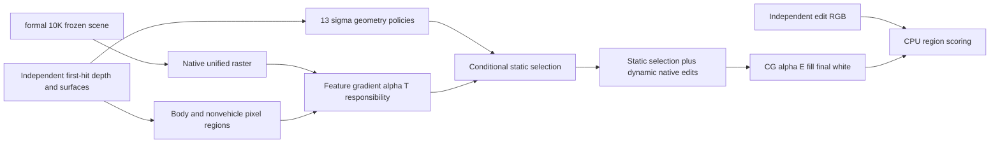

# M1 frozen conditional assignment diagnostics

`strict_r2` (.15m, >=2 support, >=.9 purity) and `balanced` (.35m, >=1 support, >=.5 purity) are geometry-supported diagnostic references. They are post-hoc scalar policies, not ideal ownership and not a mathematical upper bound. First `strict` attempt is preserved after a float64/float32 interface error. No training, model, optimizer, color, opacity or geometric update occurs.

`recall_verified` uses actual unified static+dynamic native raster alpha T contribution summed over independent body pixels. Selection is >1e-4 pixel-weight without a near-depth gate or background-conflict veto. Features gradient alpha channel sums conserve actual masked raster alpha; unused depth channel gradient is zero. Its per-row nonvehicle-surface contribution records conflicts. This is a conditional same-view contribution diagnostic; persistent identity remains unsolved. Wrong-depth/unmatched evidence is not a negative owner label.

Geometry policies omit much actual static body-pixel responsibility: strict 13.49/1.44/2.42%, balanced 33.53/7.58/6.96% across three keyframes. Recall captures >99.94% but deletes substantial background contribution; exposed-road error worsens. Thus both recall limitations and shared representation must be distinguished, and no arm establishes best possible editing.

`heldout_recall` reuses original frame8 selection at the independently declared lateral camera; it never reads heldout geometry for selection. It renders delete, with FP32/white. Independent heldout delete reference was subsequently generated in heldout_edit_refs_r1 and used only after rendering. Heldout fixed-recall delete MAE is .033983 full image and .221215 in original-body/newly-exposed footprint. Tiny independent none-render parity differences are recorded in the reference receipt.

Remote root: `/root/autodl-tmp/drivingeditor_repro/campaign/v43_ownership_20261028/sim_mechanism_20261030/m1_assignment_r1`.

Local lightweight evidence is under `evidence/`, with remote-relative filenames and SHA256 manifest. All full FP32 and per-static-row selection tables stay remote. `causal_receipt.json` carries compared metrics; `recall_verified/responsibility_summary.json` carries conservation receipts. No threshold was changed using reference scores. Main task owns shared report/Git/publishing. AutoDL remains running by instruction.

`recall_moments` adds six native-feature first-moment gradients for vehicle/background first-hit XYZ, using original training geometry only. It exports actual alphaT weighted model-space targets and valid flags; selected exactly matches recall_verified. Weight parity uses rtol2e-5/atol2e-6 because native GPU reduction has tiny roundoff differences. No extra filtering occurs. Delete-after same-body alphaT is recomputed by actually rasterizing remaining static rows after removing selected static and all dynamic; original weight coverage is not post-edit responsibility coverage.

Complete heldout suite is in `heldout_suite_metrics.json`: M0/M1 four edits, fixed original-frame8 recall selection, none identity max difference0. Final independent evaluation preserves raw and clamped errors. `postdelete_depth_audit.json` compares alpha-normalized composite expected depth to independent delete first-hit depth within original body footprint; near-road-depth pixels may be valid revealed road, and alpha coverage alone does not identify a ghost. Mean depth errors remain reconstruction diagnostics rather than Gaussian identity labels.
