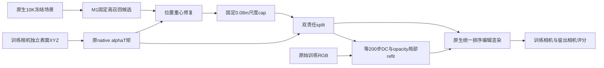

M2完成了固定归属候选下的位置、尺度与受控拆分机制参照，并补了等200步局部外观重拟合控制。所有结果均为真值辅助诊断；没有把它叫理想修复、数学上界或可部署模型。

主候选为M1 recall_verified的逐元素相同selected，三帧分别11429、12678、10299行；moments pass只提供first-hit坐标目标与valid。错深度贡献未被深度阈值排除。位置是原native alphaT加权的独立first-hit XYZ重心，不是精确mesh投影。尺度cap固定为世界0.08m最大轴并保留轴比，不搜索阈值。

split仅在原body/background alphaT均大于1e-4且两目标有效时触发；三帧新增8443、10457、8927行。车辆子参与编辑、背景子保持静态；二子继承原SH/旋转与cap后尺度。opacity按光学厚度分数分配，比例body/(body+background)截断到[.01,.99]。同位同footprint的transmittance最大误差约2.1e-7；移动后不声称像素alpha守恒。未选中static、原dynamic与environment均冻结。

中帧全图raw MAE（越小越好）：

| arm | none | delete | shift | rotate |
|---|---:|---:|---:|---:|
| M1 recall | .003552 | .024603 | .017371 | .032055 |
| M2 position | .082009 | .024603 | .079318 | .094818 |
| M2 position+cap | .015726 | .024603 | .025240 | .030681 |
| M2 position+cap+split | .015296 | .023594 | .024602 | .031984 |
| M1 +200-step refit | .003133 | .024603 | .017599 | .033390 |
| M2 split +200-step refit | .010111 | .019962 | .021554 | .031021 |

局部控制只使用原始中帧训练RGB，全图raw composite L1，Adam eps1e-8，DC lr=.0025、opacity lr=.05，恰好各200步；不训练高阶SH或几何。M1训练12678行，M2训练原候选加10457背景子，共23135行，容量差明确记录。保存DC/logit/optimizer后恢复并渲染，两臂最大差均0。M2 none的L1由.015296降至.010111，外观适配确实减轻损伤，但仍明显差于同预算M1的.003133；不能据此断言更充分优化也无效。

主M2三臂各12训练相机+4留出编辑渲染；留出直接重放中帧修复后geometry与局部参数，不用heldout GT构造候选/修复。留出独立编辑参考只有RGB，故区域只用固定原车footprint，不伪称edited-body GT。统一raw/clamped指标用heldout_uniform_metrics.json，避免混列比较。

原none附加depth feature曾继承修复前z，已在新的*_depth_r2目录完整重放48个前向；修复后的features从实际means3D重算。depth_replay_parity.json证明旧/新C、alpha、E、final逐元素不变，深度NPZ请只使用新目录。旧结果现场保留。

解释：将所有对原车像素有贡献的高斯直接搬到车表面，会把mixed/宽尺度/错误外观一起搬动，造成显著损伤。受控split与局部DC/opacity拟合能改善部分delete指标，却没有产生一致的none/shift/rotate优势。这证明本次具体修复操作的局限；没有证明表示修复不存在潜在收益，也没有量化为“剩余可改善空间”的上界。

证据入口：evidence/recall_comparison.json、evidence/local_refit_comparison.json、evidence/heldout_uniform_metrics.json、evidence/final_completion_receipt.json。主PNG在evidence/recall_*及evidence/heldout_recall_*；refit PNG在evidence/refit_*与evidence/heldout_refit_*。远端完整checkpoint/FP32/修复geometry保留在ROOT/m2_repair_r1；实例保持运行，未关机。
