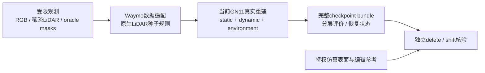

# 独立仿真 → 当前 DrivingEditor 重建入口

本目录仅实现 M0 数据接入与真实重建工程闭环。第一轮方法输入明确为 **16 帧、480×320、单前向相机、有限稀疏 LiDAR、simulator sensor oracle body/sky masks**；这些是理想传感器条件，不构成可部署的预测 mask pipeline 或实景泛化证据。仿真车辆的网格、返回点 owner、固定表面标签及编辑参考图均不进入初始化或训练。



真实训练源目录是 `/root/autodl-tmp/drivingeditor_repro/campaign/r15_baseline_owner5_20261018/training_source/scene0008_089_137`，训练入口为其 `train.py::training`，解释器为 `/root/autodl-tmp/envs/drivingeditor/bin/python`。`gn11_base.json` 是远端正在继承的完整 GN11 配置快照，来自同 campaign 的 `training_configs/scene0008_089_137_GN11.json`。新入口不修改该共享源码，也不包含自建训练循环。

## 接口

`adapt_scene.py` 只读取 `observations/manifest.json` 中明确列出的文件和可选 `ideal_tracks.json`。每帧格式为：

```json
{
  "id": "000000",
  "rgb": "rgb/000000.png",
  "body_mask": "body_masks/000000.png",
  "sky_mask": "sky_masks/000000.png",
  "lidar": "lidar/000000.npz",
  "intrinsics": [[400, 0, 240], [0, 400, 160], [0, 0, 1]],
  "camera_to_world": [[1, 0, 0, 0], [0, 1, 0, 0], [0, 0, 1, 0], [0, 0, 0, 1]]
}
```

示例矩阵仅说明字段尺寸；实际数据必须是生成器的 OpenCV 相机姿态，x 右、y 下、z 前，世界 Z 向上、米为单位。LiDAR NPZ 的 `xyz_world` 必须为非空有限的 N×3 raycast 返回；不接收稠密网格替代。`intrinsics` 也可命名为 `K`。mask 必须二值，动态 body 不含投影阴影。`ideal_tracks.json` 只复制给后续编辑入口，不参与动态种子的几何筛选。

适配器输出 `P0`、`Tr_velo_to_cam_0`、米制 Z-up ego pose、float32 N×6 velodyne、完整二值 mask 和原生带时间 PLY。动态种子保留 actor_cpu 的2×2最近深度+0.5m、0.5m主连通分量阈值；像素mask查询按仿真角点坐标改为 `floor(uv)`，其像素中心在 `(col+.5,row+.5)`，旧 `floor(uv+.5)` 会偏移中心射线查询。该工程差异写入 `pixel_coordinate_contract` 和适配收据，K、pose及深度/分量阈值不变。静态初始 PLY 默认仍按原流程从全部稀疏返回用 `RandomState(0).choice(..., 600000, replace=True)` 采样，loader 继续执行动态最近距离严格小于 0.1m 的静态排除。重复采样只重复已有返回，不能增加观测覆盖。

`frame_interval=.02` 是原生模型时间，不冒称仿真物理秒；16 帧对应模型时间 `[-.15,.15]`。仿真 `timestamp_s` 留在原始 observation 中。数据由原 49 帧、1920×1280 降采样到480×320，改为原生16帧480×320、scale1；实际差异进入 `config_delta.json`。

## 执行

以下代码路径由主代理上传到专用 campaign 后替换 `CODE` 和数据路径。输出目录必须是新的 attempt，旧数据和模型不覆盖。

```bash
PY=/root/autodl-tmp/envs/drivingeditor/bin/python
CODE=/absolute/new/campaign/code/reconstruction
OBS=/absolute/new/sim/observations
SCENE=/absolute/new/native_scene
"$PY" "$CODE/adapt_scene.py" --observations "$OBS" --output "$SCENE"

# 短实际计时：30个真实训练秒后，完成同一步原生保存和全视图评价才返回。
"$PY" "$CODE/native_worker.py" --scene "$SCENE" --output /absolute/new/timing \
  --smoke-seconds 30 --steps 30000
"$PY" "$CODE/inspect_bundle.py" --run /absolute/new/timing

# 小时级实验前：约600个真实训练秒，覆盖两次完整恢复、保存、评价、下一阶段入口。
"$PY" "$CODE/run_smoke.py" --scene "$SCENE" --output /absolute/new/smoke \
  --leg-seconds 300 --steps 30000

# 正式预算由主代理依据计时确定；正式从零开始，独立计算smoke成本。
"$PY" "$CODE/native_worker.py" --scene "$SCENE" --output /absolute/new/formal \
  --steps 30000 --checkpoint-every 5000
```

`--steps` 只改变额外配置字段 `v43_update_budget`，在该步完整保存后退出；真实训练器的 `iterations` 与 `position_lr_max_steps` 均保持30000，因此动态模型直接依赖 `iterations` 的学习率计划也完全保留。短阶段是原30K轨迹前缀。恢复时必须从保存的完整配置开始，不能用 `--steps` 改写先前合同。`--smoke-seconds` 与 `--entry-steps` 在完整保存边界停止，不删除原有 checkpoint。若正式上限可能小时级，只有 `smoke_summary.json` 中 `approximately_ten_minutes_contract=true` 才满足约10分钟 smoke 要求。

## 保留的机制与工程差异

完整未预乘 mask 的 dynamic alpha 全图 MSE、静态 RGB、静态寿命/速度绝对约束、LiDAR 深度及其衰减、NPS、SGCM 与 addition guard、原生 optimizer/densification、配对 sampler 的 select/capture/restore 都沿用当前实现。静态、动态、环境分支共同训练。没有 actor 冻结静态背景替代整场景重建。

历史 `CameraSampler.__init__` 的49视图数量 guard 被替换为 manifest 的唯一观测数量 guard；其采样分布、time-shift 概率、Python/NumPy RNG 和精确恢复方法不变。Scene binder 同样按 manifest 校验身份、时间和实际480×320尺寸。评价仍执行原生分层 raw FP32、固定姿态 static-time 和完整 checkpoint event；没有静默删除对原分辨率有依赖的验收。

`next_stage_entry.json` 指向同一完整 event 和静态/动态/环境/恢复 sidecar。`inspect_bundle.py` 验证所有观测图、原生分层 FP32 finite、固定姿态检查和下一阶段入口。真实恢复入口额外比较参数与优化器、相机顺序、sampler、所有 RNG、scale、runtime flags、EMA、SGCM geometry；不承诺 CUDA 轨迹 bitwise 等价。

`run_smoke.py` 在两段真实训练和额外两步恢复之后，还会调用 `evaluate_edits.py`，实际恢复一次推理模型并渲染第一关键帧的 none/delete。它检查 none 与 `gaussian_renderer.render` 一致、checkpoint 没有修改，不以一个 JSON 指针代替下一阶段真实入口。

计时从首个 loss record 起计算 host 训练循环墙钟，扣除实测原生评价、组件保存、continuation capture 和 checkpoint event 发布；其余前向/反向/optimizer/densification/日志开销计入，不称为纯 GPU kernel 秒。两段各自在扣除后达到300秒才触发保存，`stop_trigger_timing.json` 固定记录触发值，最终 `smoke_summary.json` 只用两段触发值核验合计至少600秒，不能拿末尾保存评价补时。恢复包含在首 record 前初始化墙钟内，组件恢复和完整 continuation 恢复验证另给诊断子项，不能与初始化相加重复记账。

## 原生编辑与独立评价

```bash
"$PY" "$CODE/evaluate_edits.py" \
  --event /absolute/new/formal/checkpoint_events/iteration_005000.json \
  --output /absolute/new/edit_eval \
  --reference-root /absolute/new/sim/privileged

# 参考仍在生成时可先真实渲染；参考完成后仅CPU读取固定FP32结果评分。
"$PY" "$CODE/evaluate_edits.py" --score-existing /absolute/new/edit_eval \
  --reference-root /absolute/new/sim/privileged --output /absolute/new/score_eval
```

该入口默认3关键帧，读取真实 Scene、checkpoint 与现有原生 prepare/raster helpers；直接恢复模型而不初始化新的种子或创建 optimizer。输出每个 none/delete/shift/rotate 的累计预乘 `C`、原生 `alpha`、环境 `E`、实际回填 `fill=(1-alpha)E`、`final=C+fill`、白底 `C+(1-alpha)` 与加权深度和，全部保存FP32，同时输出PNG。逐分支必须同时检查 E 和实际fill，并核对C+fill合成，不以E单独替代回填验收。none 额外逐像素核对原生 `gaussian_renderer.render`，最大差须小于等于2e-6；评价前后核对模型 tensor versions 和 checkpoint 文件长度/时间。

推理加载还逐帧核对训练 `cameras.json` 的 model-space 外参和按实际渲染尺寸缩放的 K，最大数值误差须小于等于1e-5，结果单独保存为 `training_camera_restore_verification.json`。同相机 none/native 相等只验证光栅和合成接线，不能替代这个训练相机核对，也不能证明独立参考的编辑质量。

删除整条 learned dynamic branch；shift 为世界+Y1.5m；rotate为世界+Z30°、以合法 ideal-track object root 为中心。旋转均作用于当时位置和协方差 quaternion，继承世界坐标 SH，不声称重光照或新视图外观完成。这里是**动态分支路由编辑 baseline**：不能把分支当作物理 owner GT，也不能据此报告 V43 已正确归属。

独立评价才读取 `privileged/`。body/road/newly-exposed-road 区域来自独立 first-hit semantic surface；`shadow_road_current_effect_contrast_proxy` 和 `shadow_road_original_effect_contrast_proxy` 是道路接收面上 vehicle-shadow-on/off RGB 的最大通道差大于2/255的像素，排除 body 自阴影。32 samples的有限Monte Carlo渲染尚未证明收敛，开关差可能包含采样变化；该分区仅是已登记的关联效果对比代理，不是GT shadow mask，不用于训练或逐Gaussian GT标注。报告 raw 与clamped误差、原车体占位区域、effect-contrast-proxy内外道路，以及E和实际fill数值范围与越界比例。PNG抗锯齿边界与中心射线表面编号可能不同。

## 单个留出相机

```bash
"$PY" "$CODE/render_heldout.py" \
  --event /absolute/new/formal/checkpoint_events/iteration_010000.json \
  --reference-root /absolute/new/sim/privileged --output /absolute/new/heldout_eval
```

`render_heldout.py` 只渲染独立参考 manifest 中一个 `lateral_y_plus_1m` 留出相机的 none。它使用完整 camera-to-world（包含平移后重新瞄准的旋转），以训练 world→model 统一变换映射相机；旋转去掉归一化scale，平移保留scale，K不偏移。时间映射到原中帧的模型 timestamp，不能把仿真物理秒直接送入时间场。`query_camera.json` 保存原始与模型相机、K、位移、模型/物理时间与原训练相机恢复证据；可用 `--query-only` 先在CPU验收，完全不读取参考RGB/geometry。

推理沿用同一原生模型 restore 和 raster helpers，不创建optimizer或初始化新种子，Camera.image是全零占位。前向完成后才读取独立RGB及first-hit分区评分，输出C/alpha/E/fill/final/white FP32和PNG，原参考另存`reference_rgb.png`。none/native仍须小于等于2e-6，完整相机重建须小于等于1e-5，checkpoint和tensor不改变。该视角只有shadow-on参考，因此不伪造留出shadow mask或effect-contrast-proxy。结果严格标记为 **1个已观测时间的留出视角诊断**，不能据此声称实景或多视角泛化。

本目录没有关机、电源、旧控制器恢复或自动正式长跑逻辑。首轮只有实际输出通过后才报告真实训练成功；是否自然产生编辑污染由独立 delete/shift 参考核验决定，不能由 renderer 权重或语义分配直接宣判。

## 当前验证

六个 Python 入口通过 `py_compile`。CPU 临时 fixture 已验证相机/LiDAR 坐标往返、稀疏点初始化、二值 mask、模型时间以及 privileged 路径拒绝；独立分区评分fixture验证零误差、删除后新暴露路面和原effect-contrast-proxy计数，CPU评分不导入Torch。留出query fixture验证完整旋转、去scale、模型时间映射与投影不变性，最大投影误差1.11e-16，GT文件不存在仍可完成query验收。fixture 不属于研究数据，也不能替代真实 CUDA smoke。远端只读确认当前环境为 PyTorch2.2.2+cu118，CUDA、OmegaConf、Open3D、OpenCV、SciPy 和 rasterizer 可用。真实 CUDA timing/smoke 由主代理统一执行并登记。
