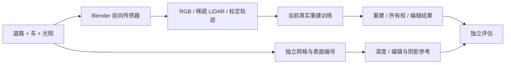

# 最小前向仿真数据

本生成器固定普通道路、程序化汽车、光照和相机，生成受限前向 RGB、稀疏 raycast LiDAR 与轨迹；当前重建训练随后只读取 `observations/`，让污染由真实训练自然产生。`privileged/` 中的独立网格、固定三角面编号、深度和编辑参考用于评估。程序化车含车身、深色不透明玻璃代理、轮胎与轮毂，属于**非写实机制和接口验证**，不能据此声称真实道路泛化。



运行依赖为完整 Blender 3.6.23 运行时及其内置 Python/numpy。CPU Cycles 默认 8 线程、16 samples；`validate_dataset.py` 另需普通 Python 的 numpy、Pillow。AutoDL 上完整 Blender 路径为 `/root/autodl-tmp/paper_blender_runtime/blender-3.6.23-linux-x64/blender`。系统 `/usr/bin/blender` 为 3.0.1，检查时出现颜色管理文件缺失，故不用它生成正式 RGB。

先渲染一帧核验实际耗时与图像：

```bash
BLENDER=/root/autodl-tmp/paper_blender_runtime/blender-3.6.23-linux-x64/blender
"$BLENDER" -b --python generate_scene.py -- \
  --output /root/autodl-tmp/v43_sim_preview \
  --frames 16 --frame-ids 0 --reference-keyframes none \
  --heldout-keyframe none --width 480 --height 320 \
  --samples 16 --threads 8 --no-save-blend
```

完整序列默认 16 帧、480×320、5 Hz；3 个关键帧生成 `none/delete/shift/rotate × vehicle_shadow_on/off` 参考，另有中帧相机向世界 +Y 侧移 1 米的留出视角。生成器不会把留出视角加入训练 manifest。每帧完成后打印 `SIM_FRAME_READY` 并刷新观测 manifest；正式完成才将状态改成 `complete`。输出目录必须为空，避免无声覆盖旧现场。

```bash
"$BLENDER" -b --python generate_scene.py -- \
  --output /root/autodl-tmp/v43_sim_full \
  --frames 16 --width 480 --height 320 --samples 16 --threads 8
/root/autodl-tmp/envs/motionproj/bin/python validate_dataset.py \
  /root/autodl-tmp/v43_sim_full
```

AutoDL 的 `dataset_r1` 已实测：Blender 3.6.23、CPU 8 线程、32 samples、16 帧和 37 条原始/编辑参考，加 1 条留出视角，总耗时 87.64 秒。该计时仅对应本场景和这组硬件配置。生成器不启动任何训练或长任务控制器，也不执行电源操作。

当前 r2 生成器显式关闭 denoising、adaptive sampling、animated seed 和 8-bit 输出 dithering，固定每帧所有编辑的 sample 数和 seed。删除车辆时所有部件均隐藏，其无效的 shadow visibility 标记规范为相同值，但 on/off 参考仍分别实际渲染。删除配对验收仍要求解码 RGB 逐像素完全相同，未放宽容差，也未复制图像凑配对。

本轮 32 samples 是有限采样的工程接口验证。非空车辆的 shadow 开关会改变光线路径，同 seed 也不能消除全部 Monte Carlo 估计差异，逐像素 RGB 差不能当作纯阴影 GT。本轮不声称采样收敛，不随采样噪声调整判据；后续若要精确量化阴影，应另行登记样本收敛对照。

输出合同：

| 路径 | 内容与角色 |
|---|---|
| `observations/manifest.json` | 合法训练输入清单和逐帧入口，声明 ideal sensor/tracks 条件 |
| `observations/rgb/` | 固定光照、曝光和色彩管理的前向 RGB |
| `observations/body_masks/`, `sky_masks/` | simulator sensor oracle 二值 mask；车体 mask 不包含投影阴影 |
| `observations/lidar/` | 24 beams × 160 水平方向的独立稀疏 raycast；点云没有 owner、semantic 或 surface 标签 |
| `observations/cameras.json`, `ideal_tracks.json` | 已标定相机与明确登记的理想车辆轨迹/包围盒 |
| `privileged/geometry/` | 完整局部网格、对象目录、固定表面采样；禁止作为方法输入 |
| `privileged/original/` | 原序列每帧的独立 depth、range、surface/object/semantic IDs 和法线 |
| `privileged/poses/` | 各物体每帧 object-to-world 变换 |
| `privileged/references/` | 关键帧编辑和车影开关 RGB、独立 depth/IDs |
| `privileged/heldout/` | 一处独立相机留出视角，仅用于验证 |
| `privileged/scene.blend` | 保存可重放的原始场景；默认停在原始第 0 帧 |
| `dataset_manifest.json`, `validation.json` | 配置、来源、耗时、边界与验收记录 |

`observations/manifest.json` 的每帧字段为 `id, frame_id, timestamp_s, width, height, K, intrinsics, camera_to_world, world_to_camera, rgb, body_mask, sky_mask, lidar`；所有文件路径相对 `observations/`。点云 NPZ 的 `xyz` 和 `xyz_world` 是同一组 `(N,3)` 世界坐标米制浮点数，另含 `intensity, depth_z_m, range_m, uv, beam_index, sensor_to_world`。这是一种无测量噪声的明确理想传感器控制；body/sky 和 tracks 是 simulator oracle，不能冒称 RGB 预测或可部署完整管线。后续预测 mask 条件应独立登记。

坐标为世界 +Z 朝上、车辆 +X 朝前、+Y 朝左；相机采用 OpenCV +x 右、+y 下、+z 前。矩阵以 row-major 数组保存，作用于齐次列向量。像素左上角为 `(0,0)`，中心射线经过 `(column+0.5,row+0.5)`；`u=fx*x/z+cx, v=fy*y/z+cy`。`depth_z_m` 是相机光轴 z 深度，`range_m` 是传感器光心到首个 mesh 交点的欧氏距离，未命中为 0。

表面编号是所有 evaluated mesh 三角面的固定编号加 1，0 表示未命中，完全不依赖重建 Gaussian。`mesh_reference.npz` 顶点位于对应对象局部坐标，应按 `vertex_object_id` 应用 `poses/` 中 object-to-world。固定表面样本保存局部位置、法线、三角面 ID 和重心坐标，可在每帧重放；其 `xyz_world_frame0` 明确仅对应原始第 0 帧。连续阴影开关通过 Cycles `visible_shadow` 控制动态车部件，因此会同时移除车辆投影和自阴影视觉；静态几何、照明、曝光与同帧采样种子保持一致。

生成器不读重建结果，不注入高斯污染。验收脚本只检查输入隔离、相机与深度数值一致、mask 朝向、稀疏路面覆盖、阴影配对与留出视角；这些检查通过也不等于重建、编辑或泛化质量通过。

`dataset_r1` 在玻璃舱 winding 修正上传前已生成：object 104 的 12 个三角面向内，固定表面样本中 561 个对应该对象。原始数据保留冻结。该项影响有符号外向法线约定，first-hit 交点、深度、遮罩和表面编号仍内部一致，RGB/编辑参考不需要因此整套重渲染。若评估使用有向法线，须显式登记对 object 104 的 `normal_world`/`normal_object` 乘 −1 的读取修正；不得静默改写已完成数据或重排 surface ID。当前生成器已改为朝外 winding，验收器另行报告 `oriented_normals_status`，避免把几何一致性通过视作全部法线约定通过。

r1 还暴露了独立参考的末位不确定性：删除车辆的第 0 帧 on/off 完全相同，第 8、15 帧各 16 个 RGB channel 值相差 1/255，未出现更大差异，且变化零散分布在 sky、road 和 roadside。实际场景为 OIDN 开启、dither intensity=1，不能仅凭这些输出区分两者各自贡献；因此 r2 将上述后处理和采样状态全部显式固定，再按原严格判据重验。r1 的不通过记录保留，不作为合格参考发布。
