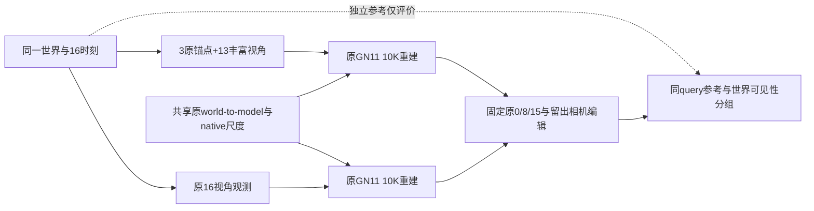

本控制在同一程序化世界、同16个时刻上，只改变合法传感器观测轨迹：保留0/8/15原相机，其余13帧换成半径8m、高3.5m的环绕视角。每时刻仍只有一组RGB+稀疏LiDAR；物体运动、材质、灯光、分辨率、K、渲染种子、LiDAR射线模式和原GN11训练配方不变。这是观测bundle的机制控制，不把RGB覆盖效应与LiDAR初始化效应拆开宣称。

共同优化预算为从零10000步、seed0，保留原30000步引擎与学习率周期。静态初始化仍是RandomState(0)从合法稀疏LiDAR返回中有放回抽600000点，随后原生排动态规则不变；动态种子仍由原mask投影、近深度与主分量规则决定。观测变化导致真实返回数、动态种子数及原生过滤后高斯数量变化，这些都记录，不拿网格或GT补点去强行做容量相等。

为消除观测轨迹引起的坐标尺度混淆，使用原baseline合法标定导出的同一world-to-model similarity，scale=.1。当前Scene对static/dynamic初始化的spatial_lr_scale均硬编码1，已从旧checkpoint核对；另把独立的camera extent固定为baseline值5.092908100662823，保留与其有关的native阈值尺度。旧、新模型不各自重新使用不同PCA坐标和尺度。独立数学检查在16个随机相机上验证行列变换，最大世界相机坐标误差1.13e-14；真实Scene还会断言extent并检查保存模型scale。

采集耗时95.8秒。所有16时刻所有对象world pose严格相同，原/新mesh的顶点、三角面、object/surface/semantic数组逐元素一致。0/8/15相机/K同源；由于Blender浮点camera矩阵重组，原始RGB有极小数值差：max3/9/4个uint8级，MAE .000063/.000777/.000208个uint8级，460800通道中仅23/241/87通道变化。登记微差，不称逐像素同图。较大平移暴露出Blender float32逆矩阵导出闭合误差，保留c2w/RGB/LiDAR并只在新数据中以float64 inverse(c2w)重导w2c，原导出文件备份保留。

完整effective_config逐键对比，只有source_path、model_path、followup_scene_spec变化；seed、损失、学习率和步数预算无其他变化。新的真实CUDA smoke为300秒fresh+300秒完整恢复+2步入口，另行记账，覆盖保存、所有16视图评价、optimizer/RNG/sampler/SGCM状态恢复及none/delete渲染。正式10K不继承smoke更新。

主评价使用原0/8/15相机的none/delete/shift/rotate及同一原中帧留出相机，不能把新模型在新训练视角的分数与M0原视角分数直接横比。道路分组只在评价时读取旧16帧精确FOV+BVH可见性mask：旧可见、旧不可见、旧恰好1帧、旧至少2帧；再与当前独立编辑参考的道路语义相交。此GT从未进入适配或训练。

轨迹是受控多视角取证，有跳视角，不代表可实现连续驾驶策略。最终质量与结论以evidence/completion_receipt.json、edit_samequery/reference_metrics.json、stratified_metrics.json和heldout_samequery_metrics.json为准；human_verdict保持null。原现场不覆盖，不追加新M2或分类器训练，不关机、不提交Git。

正式已完成10000步，未追加更新。采集95.785s；正式进程墙钟1475.537s，native训练循环代理1314.922s，测得保存/评价等149.407s（其中evaluation142.006s、component save7.381s）。真实smoke600.032s、额外5400更新与2步恢复入口单列；完整状态恢复和下一阶段none原生恒等检查通过，最大差0。数据来源桥接probe曾短时同GPU，因此不做纯训练速度比较。

容量并不相等：

| 状态 | M0 static / dynamic | 丰富观测 static / dynamic |
|---|---:|---:|
| 原native过滤后初始化 | 564213 / 2869 | 528958 / 6719 |
| 正式10K终态 | 667559 / 1133268 | 1157894 / 302428 |

中帧新native的none/delete/shift/rotate全图raw MAE分别为.00375377/.01194839/.01178087/.00862300。delete和留出delete图仍清楚保留红车形残影。三锚显露道路共10995px的分组结果如下，所有分组都由训练前固定的旧观测世界可见性定义：

| delete道路分组 | 像素 | M0 raw MAE | 丰富观测 raw MAE |
|---|---:|---:|---:|
| 全部显露道路 | 10995 | .176553 | .198542 |
| 旧至少1帧可见 | 5557 | .144224 | .191122 |
| 旧从未可见 | 5438 | .209590 | .206124 |

旧从未可见组若使用clamped MAE，则是.201020→.206124，不能混列写成改善。更充分合法观测在这次固定10K原native配方下没有自动解决删除残影；它不证明更充分优化、其他表示约束或其他场景也必然如此。

132个JSON/PNG文件已取回，逐个SHA256与远端delivery_manifest一致。终态模型、原始FP32、完整checkpoint与恢复状态继续留在远端独立目录。sourcegeneric来源复查使用独立私有Scene并在加载前安装shared_gauge，不覆写此控臂活动transform。
