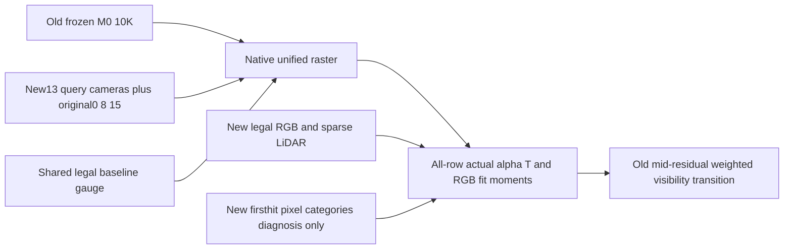

# Fixed old model, new observation bridge probe

This probe holds the old weights fixed and changes only the16 legal observation queries, retaining common cameras0/8/15 and the same physical/model times. It is separate from the new fresh10K reconstruction. A private Scene copy with read-only data symlinks protects the active training Scene transform; baseline shared-gauge installation occurs before importing/constructing Scene. SHA andmtime of the real new Scene transform remain unchanged. Native none identity and frozen tensor/checkpoint checks passed.

The actual old Gaussian contributions—not only world-road surface visibility—grow under the new queries. Mid-residual top128 cumulative native alpha T increases28.153→539.534;103/128 rows now have cumulative contribution≥.1 and45≥1. Their new road-pixel contribution is223.578, with substantial vehicle-pixel contribution too. This does not establish that the rows have vehicle or road identities.

Using all old mid-post ROI alpha T as the fixed denominator,41.53 percentage points formerly below.1 cumulative original-view visibility now exceed.1. New-query visibility bins contribute6.40%(<1e-4),16.45%([1e-4,.01)),16.60%([.01,.1)),32.46%([.1,1)) and28.10%(≥1). Thus improved observations directly expose a meaningful portion of the old erroneous representation, but39.45% of the old post-delete contribution still belongs to rows below.1 under the new queries.

For example row535849 grows.1421→1.3290 alpha T across16 queries; its new vehicle/road components are.9298/.3992, native per-row RGB versus new legal-image contribution-weighted RMS is.5764, and legal sparse points within3σ occur in9 frames instead of1. Row461782 grows.0118→.3062 but still has no legal LiDAR point within3σ. The RGB statistic compares the row view-direction color to pixels receiving its actual contribution; it is not the full composited training loss or proof of a particular optimizer gradient. Road measurement annotation uses privileged firsthit categories only for diagnosis; all3D measurement coordinates are legal input LiDAR.

All category-gradient sums close actual native alpha to maximum relative error1.05e-6. `bridge_receipt.json` contains full transition matrices, all128 row comparisons, RGB/LiDAR evidence and transform protection. `bridge_allrow_aggregate.npz` preserves all static-row visibility and old mid-post weights. The124-file delivery has verified SHA256. No weights, losses or training budget were changed.

The generic source and observed-view replay entrypoints now accept `--shared-gauge`; it is installed before Scene. For the future fresh checkpoint, `prepare_frozen_query.py` creates a private query Scene and event retaining the original checkpoint pointers/camera record. Source3key evaluation uses original independent common-view references, while16-view exposure uses the new dataset original firsthit categories. Every reconstruction gets fresh row IDs and same diagnostic thresholds; no IDs transfer across checkpoints.
