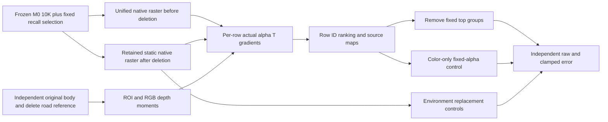

# Source control r1: frozen native causal diagnostics

All static/dynamic/environment parameters remain frozen. The original `recall_verified` static selection is reused exactly, and all existing dynamic rows are deleted. Three keyframes 0/8/15 are audited. No persistent Gaussian identity or unique owner GT is inferred.

The ROI is **original first-hit vehicle body AND independent delete first-hit road**. It differs from all original-body pixels, hence its alpha sum should not be compared directly to earlier all-body sums. A separate independent delete-road region outside the original body records background damage. Feature gradients use the complete unified native static+dynamic ordering before deletion and the complete retained-static ordering after deletion. Their per-row sums must reproduce actual raster alpha in the ROI to relative error <=2e-5.

`per_row_sources.npz` contains every static row ID, fixed selection, pre/post body and outside-road alpha T, post error-weighted contribution, depth/RGB first/second moments, view-direction native SH color, depth, scales and opacity. Before dynamic contributions are stored separately. `top_rows.csv` reports the top2000 rows ranked by actual post alpha T times raw RGB error versus independent delete reference. This ranking is an evaluation diagnostic; it is not an ownership classifier. Thresholds and selected row IDs are in `source_receipt.json`.

Fixed causal controls remove top32/128/512 error contributors, the top512 with reveal gain>5, the top512 with body and outside-road alpha T >1e-4, and the top512 with contribution-weighted RGB RMS>.15. Groups can overlap. Top8 contribution maps use an indicator feature in the full retained-static raster; isolated-row rendering is not used to estimate actual transmittance. Color-only control replaces top128 view-direction colors with each row alpha T weighted independent delete RGB moment. This is privileged sensitivity analysis, not an editing method. Geometry, opacity, alpha and depth ordering remain fixed; original precomputed-color parity and alpha invariance are checked. Environment white, zero and independent-reference replacements are separate controls.

Middle-frame retained-row contribution changes from .2421 before deletion to3406.5144 after it. Most of that belongs to rows with reveal gain>5. Thus original contribution recall does not predict post-deletion visibility. Removing top32 reduces ROI clamped MAE .213075→.202669 with near-constant outside-road error. Removing512 does not improve monotonically. Color-only top128 control reduces ROI .213075→.144121 while outside-road remains .021541. This establishes a local color/representation error contribution, not semantic identity or complete ghost removal. Environment replacements alone do not remove the error.

R1 contains the first complete diagnostic; R2 adds source maps and color-only controls. Both successful runs are preserved, and their execution time is separately recorded. No training, shutdown or Git operation was performed.

Delivery contains all JSON/PNG/CSV/code, all-frame top2000 row NPZ, and the complete middle-frame per-row NPZ. Complete per-row and FP32 arrays for all3 frames remain on the remote under `ROOT/source_control_r1/run_r2_color_maps/`. SHA256 is supplied in `delivery_manifest.json` and verified after retrieval.

The additional observed16 source trace fixes the middle-frame postdelete top128 IDs and replays all16 original observed camera/time pairs with correctly moving dynamic Gaussians. It records actual vehicle/road/other alpha T, RGB direction/SH changes, input-color moment fit RMS and center z versus independent firsthit z. `observed16_source_trace.json` and `observed16_top128.csv` summarize all rows. Top8 center projection and firsthit-category maps are supplied at frames0/4/8/12/15. This is final-checkpoint replay, not per-optimizer-step history; low final contribution establishes weak direct visibility at this snapshot, not absence of all historical or regularization constraints. The history delivery has50 files with verified SHA256.

All-row extension: `allrow_observed16_r1/weighted_visibility_bins.json` now uses every retained static row, not the mid top128 subset, and weights visibility bins by actual mid postdelete ROI alpha T and shared pixel-error weighted alpha T. The all-row aggregate is in `allrow_visibility_aggregate.npz`. Category mixtures describe original firsthit pixel exposure, not owner identity. The prior top128 summaries are conditional case studies covering25.4% of postdelete alpha T and31.6% of the error-weighted statistic. Generic all-row replay/summarizer scripts take explicit new-checkpoint paths and refuse mismatched source/history checkpoint events.
