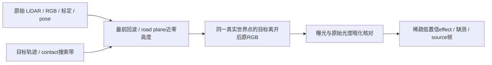

# 稀疏 contact effect 独立证据

`build_contact_effect_evidence.py` 只搜索已有 body bbox 左右各 4 像素、底部上下 `[-8,+5]` 行；搜索域本身不是正证据。必须有该相机像素最前的实际 LiDAR 回波，世界高度距已独立核验的局部 road plane 不超过 0.05 米，并对这个实际回波世界点重新做独立原始源 RGB/LiDAR 投影比较。参考至少三帧、目标已移开、真实源道路回波可见、曝光匹配与颜色稳定；暗化条件保持 r2 原合同。全程不读删除、补景或模型 RGB。

不按黑色或靠车生成结果；不统一排除 body，不放宽光度阈值，不膨胀、不填孔、不补成完整阴影。允许把 body 内具备实际近地回波及原始光度支持的少量点单列。近零高度回波仍可能来自轮胎接地点，不能据此给出 road/tire 真值或物理阴影因果结论。源阴影状态未知，分数上限 0.49。

逐 raw 输出 `contact_ground_photo_effect`、`contact_ground_photo_effect_score`、`contact_ground_photo_effect_valid`、`body_overlap_contact_effect`，以及 `actual_lidar_row_index`、`actual_return_world`、`actual_return_height_m`、`actual_return_uv`、`source_raw`、`source_count`、原始/参考颜色、亮度比/差及缺测码。只可作为独立 effect 候选字段；不得把零候选理解为无阴影，不得覆盖完整 body 或原 strict 阴影。

原始源可用完整 199 帧的 stride4 观测；模块不使用 native 模型，因而没有向额外时刻外推模型或添加模型采样。原始真实观测与 frozen native row 导出的 49 时刻合同分开记录。
