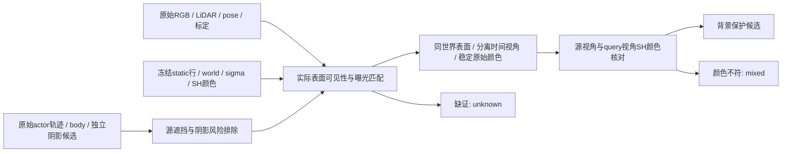

# 原始多视角行级背景保护候选

模块为 `build_row_background_counterevidence.py`，仅第一场景、CPU 两线程、不训练、不启动 GPU，不改分类或渲染主脚本。输入是冻结原 static 的稳定行号，以及 raw77..125 每个真实源时刻的 float64 world、最大 sigma、未乘 alpha/T 的 native SH 颜色、有效 opacity；不向 199 帧外推模型时刻。原始 RGB、LiDAR、标定、pose、annotations 来自已取回的完整原始 clip，阴影排除使用独立 r3 原始观测结果。

不以“比车深”排除 U，也不以重复 body 投影判定 ownership。模块只给正背景见证；缺失见证不构成 car/U 正例。错误深度上的 ghost 若没有同世界真实表面，保留 unknown；若有真实背景表面但 query SH 颜色受到车辆污染，保留 mixed，不自动当 car 或完整可删除行。

源见证须满足：同一行在源/查询世界位置相差不超过 0.15 米；查询世界点邻近源图最前可见的实际 LiDAR 回波，三维距离不超过 `max(0.08,min(0.20,2*sigma))` 米且重投影差不超过 2 像素；没有实际前景深度遮挡；远离目标足印至少 6 米、其他 actor 至少 5 米；不在 body、动态语义或已有阴影候选/光度 unknown 的扩张区；语义与原图局部纹理置信足够。大 sigma 行及有效 opacity 不足的时刻弃权，不能把中心近似当高斯表面交点。

所有几何合格源的原始 RGB 经真实共享道路回波估计全局逐通道曝光增益。源颜色须稳健一致，不能挑两张有利图片而忽略其他合格源的冲突。至少两个见证须相隔约 0.5 秒、相机基线至少 1 米、视角差至少 1 度。源 SH 对原始颜色匹配比例至少 80%，且最早/最晚匹配见证独立；query 时刻 SH 也必须与曝光匹配的原始背景参考一致，才输出背景保护候选。

源阴影完整负标签缺失；可以排除已知阴影及近车风险，但不能证明剩余源绝对 shadow-free。`source_shadow_state_unknown=true`，`background_certified` 必须全部 false。保护候选不是人类真值；如果下游需要认证无阴影背景，当前数据不足。

逐 raw NPZ 与 `source_rows_r1/ids.npy` 完全同序：

| 字段 | 含义 |
|---|---|
| `ids` | 原 static 行号，不复用 actor 行号 |
| `background_protection_candidate` | 多视角真实几何、稳定原始颜色及源/query SH 一致的候选 |
| `background_geometry_witness` | 稳定可见真实表面，尚未要求 SH 颜色一致 |
| `mixed_color_mismatch` | 有背景几何见证但颜色不符；不自动判 car |
| `unknown` | 缺证或未定，不能视作删除依据 |
| `row_evidence_state` | 0 unknown、1 背景保护候选、2 mixed |
| `background_certified` | 全部 false |
| `source_geometry_valid` / `source_sh_match` | N×S，逐行逐源的几何有效/SH 匹配 |
| `source_reason_bits` | N×S，源缺测或拒绝原因，码表见 contract.json |
| `source_original_rgb_exposure_matched` | N×S×3，实际原始颜色；缺测 NaN |
| `stable_original_rgb_reference` | N×3，合格原始颜色的稳健参考 |
| `independent_*_source_pair` | 两个实际源 raw；不是邻帧插值 |
| `independent_time_span_s` / `independent_camera_baseline_m` / `independent_view_angle_deg` | 独立性证据 |
| `query_sh_rgb_mean_abs_error` | query SH 与真实稳定背景参考的误差 |

阈值、源曝光锚点/误差、源缺测统计和具体 row 示例保存在 JSON。所有 source 和 query 色值均使用 native 训练相同的归一化相机 RGB 数值空间；native SH 只 lower-clamp，不把大于 1 的色值裁剪以伪造匹配。

该模块只补充独立反证，不决定主脚本的删除策略。原 `mixed` 行若仍被 `role>=2` 整批删除，则新增背景证据仍无法保护背景几何；下游须明确让正保护候选和 mixed/unknown 的处置各自可审阅。
