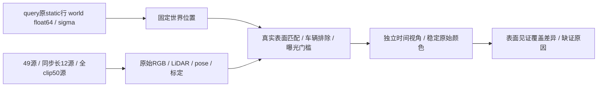

# 固定 query 世界点的原始表面覆盖对照

`compare_row_surface_coverage.py` 不改 `row_background_evidence_r1`。只读取 raw98/113/114 导出的原 static query 行世界位置和 sigma，固定这个世界点，逐真实源相机投影和匹配实际 LiDAR。没有源 Gaussian 运动外推，没有源 SH 匹配，没有优化或 GPU；query opacity 仅记录，不能冒充额外源时刻的模型状态。

实际表面距离、像素对应、目标足印 6 米/其他 actor 5 米排除、动态/body/已知阴影排除、纹理/语义、曝光、稳定原始颜色和两视角独立性门槛均沿用原严格模块。固定点的两组对照同时不使用源 Gaussian motion/opacity；与原49源严格模块的差异明确单列，不能把这部分差异归因源片段长度。

一次评估固定的 87 个真实原始时刻，汇总四种预先指定源集合：

| 集合 | 源数 | 用途 |
|---|---:|---|
| `local49_all` | 49 | 原片段全部真实源的固定点控制 |
| `local49_stride4` | 12 | 与完整clip相同stride4的公共时刻 |
| `full199_stride4` | 50 | 全199原始观测每4帧 |
| `union87` | 87 | 保留原49密度并仅增加38个片段外时刻，避免稀疏采样丢掉原见证 |

`full199_stride4` 不包含全部 `local49_all`，因此同时报告公共12帧控制和87帧联合；这些只从同一批CPU原始观测统计汇总，不追加模型运行。

源片段外没有独立完整阴影图，记 missing/unknown；继续应用相同车辆排除和已有阴影图，但不能认证 shadow-free。输出只叫原始表面见证扩展，不输出可直接代替严格背景保护的 bool。没有实际表面近邻也不能单独证明几何错误：可能是原模型中心错位、LiDAR稀疏、遮挡或视角不足，均须保留未知。

每个阶段提供 `*_raw_surface_witness`、`*_source_count`、`*_raw_geometric_proximity_count`、稳定颜色/离散程度、两个真实源raw及时间/基线/视角差；另存逐源可见性、实际表面距离/UV/原始RGB、缺测码和是否缺阴影图。保存原严格49方案标记作只读参考，并报告新增表面见证与原native U的交集。`source_sh_matching_performed=false`、`native_motion_extrapolated=false`、`background_certified=false`。
