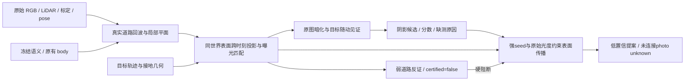

# 第一场景独立原始阴影候选合同

唯一场景为 `14705303724557273004_3105_000_3125_000`，唯一目标为 `gTriXsyDrbzzU6apS1WErQ`。脚本仅读取 `target_unknown_v2/fullclip_inputs` 的原始 RGB、LiDAR、pose、calib、annotations，冻结语义，以及 `datasets/CTX` 已有 body。禁止读取删除/补景/模型渲染 RGB；没有训练、GPU 推理、第三场景或 human GT。



## r3 受约束传播提案与 unknown

以冻结 r2 strict 候选作 strong seed，保留 r2 的 mask/score，不统一放宽任何原始光度阈值。每个可传播点自身须有至少三帧目标远离的原始同世界道路 RGB、稳定参考和原有乘性暗化证据；query 仍须是高置信道路、body 外、其他 actor 外，并没有真实前景深度反证。在同一已核验道路 plane 上，沿八邻域传播；query RGB、参考 RGB、亮度比均须局部连续，世界表面路径距 seed 至多 1.5 米。弱背景一致观测、body、其他 actor、深度前景、缺失独立 photo 证据立即阻断，不能从斜向阻断角之间通过。

只有 query LiDAR 稀疏/随动见证不足等缺采样区域可因此新增候选。新增 `shadow_propagated` 明确是低置信提案，score 上限 0.49，未由此获得 human GT 或完整 query LiDAR 可见性证明。新增像素仍各自有源帧真实 LiDAR 支持的同世界表面原始光度暗化。原 strict 的额外传播防护不通过时仍原样保存，但该点不能作为传播 seed。没有 strict seed 的帧不传播。

`photo_supported_unknown` 保存具有独立原始光度暗化、但没有通过 strict 全部证据的点；可以与低置信传播提案重叠。未连接到 seed 的点保存 `photo_supported_unknown_unattached`，不硬填进 mask。随动缺测（`motion_witness_valid_count<2`）与有观测但暗化未重复分别记录；两者均不能作 nonshadow 标签。

新增 `strict_shadow_evidence_state` / `proposal_shadow_evidence_state` 为 int8 证据态：`1` 是正候选证据；`0` 是弱道路 RGB 一致反证，仍不是认证 nonshadow；`-1` 是缺证或未定。`road_counterevidence_certified` 继续全部 false。

比较使用 r2 strict 与 r3 proposal 两条独立行。r3 的标准 `shadow_candidate`/`shadow_score` 是 proposal，另有 `shadow_candidate_strict`/`shadow_score_strict` 和 `shadow_candidate_proposal`/`shadow_score_proposal`。`shadow_evidence_valid_strict` 保留 r2；proposal 的 `shadow_evidence_valid` 允许新传播点，实际 query 回波支持单列 `query_surface_lidar_supported`。`propagation_seed_geodesic_m` / `propagation_seed_pixel_index` 提供路径距离和 seed 来源。JSON 逐帧记录新增量及 body、弱背景、实际前景深度的交叠量，零 strict 帧另有完整 abstention 审计。

`prediction` 经实际文件核验是 Cityscapes 类别加 1：road=1、sky=11、car=14，范围 1..19；脚本用 `prediction-1` 转成 0..18。`labels=0` 还包含低置信未知。该映射仅在脚本内部使用，不修改共享十九类数据。

局部平面来自 query 的实际道路 LiDAR 回波。每个 query 像素须匹配实际回波深度和像素支持，并排除 body 和其他车辆附近。源原图须能看见同一世界点、有真实道路回波，且该点远离目标及其他 actor；目标离开后的至少三帧、跨度至少 0.5 秒才构成参考。参考显式排除当前待判断观测自身。源 RGB 按目标邻域外真实共享道路回波进行全局逐通道增益校正；参考颜色离散过大则弃权。只靠黑色、靠车或 road 标签均不能产生阴影候选。

候选还要求 query 对参考出现可解释的乘性暗化，以及至少两个邻近时刻在目标局部坐标携带的道路点也有独立同世界参考支持暗化。只保留至少六个有效像素的连通组件，不膨胀或补齐。目标接地点与随动关联仍不能证明物理因果；曝光、标定、路面非平面、阴影颜色变化及遮挡都会导致缺测或误差。本方法是保守诊断候选，分数不是校准概率，零候选不代表无阴影。

`road_counterevidence` 仅表示 query 与多帧同世界原始道路 RGB 一致的弱证据。源阴影状态未知，`road_counterevidence_certified` 必须全部为 false，不能写成 clean/shadow-free 背景。任何下游清除或所有权判定不得把该字段升级为真值。

逐 raw NPZ 核心接口：

| 字段 | 形状 / 含义 |
|---|---|
| `body` | H×W bool，上游 body 原样保留 |
| `candidate_domain` | H×W bool，目标足印五米范围的潜在道路投影域 |
| `shadow_candidate` | H×W bool，通过几何、原始暗化、随动见证的候选 |
| `shadow_score` | H×W float32，未校准证据强度；有效域外 0 |
| `shadow_evidence_valid` | H×W bool，query 与同世界参考具有有效观测；不等于候选 |
| `road_counterevidence` / `road_counterevidence_valid` | H×W，弱道路一致性分数和有效域 |
| `road_counterevidence_certified` | H×W bool，全部 false |
| `world_point` | H×W×3 float64，仅候选域记录局部平面世界点，域外 NaN |
| `source_raw` | H×W×3 int16，最接近稳健中位数的三个真实源帧；缺测 -1 |
| `source_count` / `source_span_raw` | 同点源帧数量 / 时刻跨度 |
| `reference_rgb_exposure_matched` | H×W×3，真实观测稳健中位数，仅诊断参考 |
| `reference_rgb_deviation` | H×W，源观测偏差，缺测 NaN |
| `luminance_ratio` / `luminance_drop` | query 相对参考亮度比 / 差 |
| `attenuation_rgb_residual` | 乘性暗化模型 RGB 残差 |
| `motion_witness_raw` | 四个邻近随动时刻，具体维度按边界可少于 4 |
| `motion_witness_valid` / `motion_witness_support` | H×W×K，随动点独立参考有效 / 支持暗化 |
| `motion_witness_valid_count` / `motion_witness_support_count` | H×W，见证数量 |
| `reason_bits` | H×W uint16，码表在 contract.json；包含缺测、拒绝和未知源阴影 |

JSON 保存平面拟合、源曝光参数/锚点数/误差、组件范围、源帧、随动位移、失败原因和运行时间。`*_overlay.png` 三联图展示原 RGB、紫色阴影候选与青色 body、绿色弱反证。`*_same_world_point_sources.png` 展示证据分数最高点及真实源图裁剪；即使未通过最终候选门限也保留，不能把展示选择当成成功。

真实 smoke 命令（CPU 两线程，保留已有输出目录）：

```bash
CUDA_VISIBLE_DEVICES= OMP_NUM_THREADS=2 MKL_NUM_THREADS=2 OPENBLAS_NUM_THREADS=2 \
  /root/autodl-tmp/envs/motionproj/bin/python build_shadow_evidence.py \
  --raw 98 113 114 --output /path/to/new/shadow_evidence_r1
```
