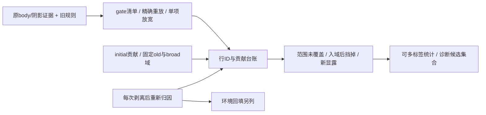

# 候选规则漏检台账

本轮按用户完整指令先查召回上界，背景误召只记录，不能否决扩候选。不加补景、不调颜色、不训练，不改旧分类、旧报告、旧模板。剥离后贡献来自固定模型干预，只作机械来源诊断，不倒灌训练或语义真值。



`rule_miss_ledger.py` 为纯 CPU，默认两线程。主线程负责所有 GPU。输入行号只属 `original_static_rows`，原 actor 单独剥离，不复用原 dynamic 行号；环境没有高斯行号，单独记回填贡献与负色值诊断。

支持 `--campaign <recall_ceiling_r1>` 直接读取 `{raw:03d}/initial_weights.npz` 和各 stage 的 `contributors.npz`，或 `--manifest` 指定任意显式文件路径。六列固定为 `old_domain,broad_domain,body,effect,outside,total`。initial 全 918850 static 行；stage 可稀疏保存所有 `total>0` 行，因此未存行确为零。`removed_ids` 必须是完整被删原static全局行号，不能仅从 post 非零行内的 bool 推断被删集合。

优先 `--exact-gates <recall_gate_env_r1>` 读取 `{raw:03d}_gate_inputs.npz` 的原13列 `weights`、`center_z`、`body_counts`，按 `summary.channels` 精确重放旧规则。缺 exact 时按 `body_probe` 和旧 profile 对齐补充；缺字段保留三值 unknown，不能把未导出写成0。原 probe 的 `active>1e-4` 保存门槛单列为输入覆盖，不冒充真实空间不可达。

逐项放宽每个 row gate，其他 gate 固定；还给出 any-positive body、body/ring、all initial old-domain、all initial broad-domain 的候选上界。所有放宽均并入原 selected，不丢失原集合；记录明确新增与因缺字段尚不能判定的可能新增。`gate_catalog.json` 列出 row gate、掩码/导出门槛、独立阴影上游 gate，以及哪些计算只标 mixed 而非 selection veto。

每 stage 的剩余 cohort 是 `broad_domain>epsilon` 的真实贡献行，不是人工车影GT。三类可以重叠：

| 类别 | 定义 |
|---|---|
| `scope_missed` | 此 stage 的 old-domain 质量 ≤epsilon，但 broad-domain 有贡献。它是加权支持定义，不证明几何 footprint 从未覆盖原范围 |
| `inside_but_gated` | initial old-domain 有贡献，却没进入旧 selected；列每个失败/缺测gate及单项放宽能覆盖多少剩余行 |
| `newly_visible` | 剥离后 broad-domain >epsilon，initial ≤epsilon；另记相对前一 stage 的新显露 |

每行可同时带多个 bit。另记“原probe未导出”和“仅剥离后才进入old-domain”，不强行合并成单一原因。所有 cohort 同时保存 initial/after 实际六列权重、原 selected、removed、每gate三值结果和完整源文件路径。

旧 bg 冲突只计交集。不会调用已有背景保护候选模块作为 veto；也不会用中心深度不匹配直接排除 U。旧 target-depth 三列虽被计算，目前不参与 classify，台账不会凭空添加新深度规则。

示例：

```bash
python rule_miss_ledger.py --campaign ../recall_ceiling_r1 \
  --body-probe ../body_probe_r1 --old-profile ../native_target_contact_smoke_r1/evidence \
  --old-strict ../native_strict_smoke_r1/evidence --shadow ../shadow_evidence_r3 \
  --exact-gates ../recall_gate_env_r1 --classify-source ./classify_detection.py \
  --raw 98 113 114 --output ../recall_rule_ledger_r1
```

`rule_relaxations.npz` 可直接供后续固定模型诊断选择集合，但其角色是规则上界，不是新训练标签。输出中的“覆盖”只指机械贡献集合交集，不冒充独立车身/阴影 precision 或 recall。
