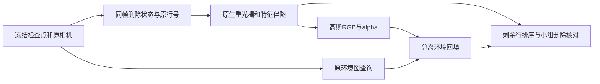

# 剥离后贡献重算审计

本轮验收采用用户最新的召回优先口径：允许扩大目标相关 unknown，路面误选与损伤记录为代价，不再把它们当作阻止召回诊断的硬门槛。当前任务是查清去 car／U 后仍存在的暗残影由哪些**保留高斯与环境项**造成。这里没有运行 GPU，没有修改检测、渲染、UI 或旧产物，也没有重填人工 verdict。

结论：旧三帧 RGB／alpha 是真实重光栅结果，但现存 `role_contribution` 是**删除前**的贡献。它不能解释删除后的残影，也不能作为 after 状态继续扩展 U 的完整候选池。下一轮应在每个实际删除状态上重新进行原生光栅与辅助特征伴随归因，并同时导出 Gaussian、常量背景和 EnvMap 三项。



## 已核对的实现事实

| 位置 | 当前行为 | 对本轮的含义 |
|---|---|---|
| [probe_detection.py](../probe_detection.py)，37–52、72–84 行 | `full` 与 `without_actor` 分别原生光栅；辅助特征梯度积分得到各行的 alpha×T；最后一个全图 ones 通道做总 alpha 闭合 | 这是可复用的机械归因入口，但权重只属于传入的那个状态 |
| [render_detection.py](../render_detection.py)，49–55 行 | 静态检测标签取 actor-omitted 状态；Actor 取历史 full probe 的质量并显式指定既有身份 | 这些是固定标签的来源，不是各删除组 after 权重 |
| 同上，61–68 行 | 每组复制 `opacities`，将删除行置零，重新调用 `helpers.raster`，再加 `(1-alpha)×env` | 四组 RGB／alpha 是真实重算；没有用旧 RGB 裁贴代替 |
| 同上，70–74 行 | `allkw` 的五个角色 one-hot 再渲染一次，**没有沿用当前 mode 的零 opacity** | `evidence/*_contributions.npz` 明确是未删除 full 状态，不能叫 after contribution |
| [audit_native_controls.py](../audit_native_controls.py)，11–28 行 | 在 PNG8 上计算绝对变化，结合各 mode 的 alpha；所有 run 使用 contact 最终 effect 域作为公共诊断域 | 可比较保存图的变化，不能识别暗化来源，也不包含新的每行 after 归因；公共域需标明来源 |
| [render_motion_suite.py](../../persistent_world_20261027/render_motion_suite.py)，33–66 行 | 实例读取冻结 static、原 dynamic 和 env；断言使用 CUDA SH；`n.unchanged()`只检查这些 NativeMotion 模型及文件 | 单独加载的 V43 Actor 不在 `n.unchanged()`覆盖内；新诊断需另做 Actor 不变核对，不能据此推断旧 Actor 曾被修改 |
| [v4_road_render.py](../../v41/baseline/engine_overlay/utils/v4_road_render.py)，39–60 行 | `merge_rows`沿第一维拼接字段；raster 的前两个特征为 depth／alpha，后面才是 extra | 保持字段与原行号同序；辅助特征必须保留前两通道的含义 |

本地 V1 `prepare_rasterization` 的非 split 路径保留原行数，通过 `mask`与时变 opacity 控制可见性；split 路径会裁行。当前探针没有请求 split。这里读到的是本地源文件与运行入口，未检查远端正在使用的 CUDA 文件；执行时以同状态 RGB／alpha 的零扰动闭合确认接口一致。

## 三帧现有文件已经证明不能复用 before 权重

只读读取 `native_target_contact_smoke_r1` 的保存数组。公共区域为 `shadow_evidence_r3` 的原车身 body。对联合删除，保留角色只剩原 static 的 role0：将**删除前**五类贡献图中的 role0 留下，再与真实联合删除 alpha 比较。

| raw | 真实 after 的 body 平均 alpha | before 仅保留 role0 的平均 alpha | 差值 | after 浮点 RGB 最小值 | body 内含负 RGB 的像素 |
|---:|---:|---:|---:|---:|---:|
| 98 | 0.404626 | 0.003634 | 0.400992 | −3.658 | 58 / 2009 |
| 113 | 0.405481 | 0.005459 | 0.400022 | −5.258 | 35 / 2202 |
| 114 | 0.375444 | 0.009638 | 0.365807 | −4.441 | 45 / 2223 |

删除前五类贡献和 baseline alpha 的逐像素最大误差只有约 `5.5e-4–5.7e-4`，符合保存 float16 后的量化尺度；上表约 `0.37–0.40` 的变化不能用该量化误差解释。仅删 Actor 的 raw113，真实 body alpha 也是 `0.995472`，而 before 保留非 Actor 的角色质量只有 `0.141976`。

这说明删去前方贡献后，新的保留静态贡献大量显露。当前三帧稀疏 evidence 只导出了原先候选或背景积分达到门槛的 `13469 / 10119 / 10131` 行；不能把它们当作剩余 `918850` 行 static 的完整 after 搜索空间。上表的 alpha 是**静态剩余覆盖**，并不说明这些行一定是车辆或阴影。

负 RGB 也必须单列。PNG 保存会把负值截成黑色，因此某些黑点可能来自环境回填的负通道或其他数值项。当前 dump 只保存 composite RGB 与 alpha，无法单凭这两项确定每个负像素的来源。保存为 float16 的 `>1` 数量还会与原 float32 summary 不同，例如 raw113 联合删除为 `3480` 对原 summary 的 `3575`；不要把临界量化误差当作新实验变化。

## 重算必须绑定实际删除状态

1. 用原 `frames` 的 `(i, f)`配对确定 raw、相机与 model time，然后构造冻结的 `st`与 `dy`。不能先抽出三帧再重新枚举成 `i=0,1,2`；那会错配相机索引。
2. 在本轮状态的浅字典副本中**复制并修改 opacity**；保留原几何、SH、时钟和所有 mask。把该状态对象同时传给 RGB 渲染与 `attribution`。每扩展一次 U，都生成一个新的状态编号并重新光栅，不能把上一状态的权重继续当成当前权重。
3. 当前 mode 循环在 `torch.no_grad()`内。伴随归因需要局部 `torch.enable_grad()`，否则即使 `aux.requires_grad=True`也没有可回传的光栅图。只让辅助特征求导，模型参数保持冻结，完成后立即释放图。
4. 探索区域可包括原 body、外扩轮廓／车底、原始 photo＋contact 域，以及删除后人工指定或明确登记的暗残留诊断域。后者是 after 查询，不回写旧“仅原观测检测”的标签来源，也不冒称独立真值召回率。比较控制组时固定同一套区域，避免各组各自选暗点导致分母漂移。
5. 对**全部当前输入行**分配辅助特征。先得到 ROI 内新可见行的积分，再导出稀疏结果；不要预先限定在 before 的 ids、旧 U、旧 owner1 或三维中心落框的行中。扩大 U 可以包括新暴露的 role0，道路代价另记。

最小调用关系应是：

```python
kw_after = {**allkw, 'opacities': allkw['opacities'].clone()}
kw_after['opacities'][removed_original_indices] = 0
with torch.enable_grad():
    out_after, row_mass_after, closure_after = attribution(n, cam, kw_after, maps_diag)
```

`maps_diag[-1]`仍为全图 ones。这里的 `row_mass_after`是各 ROI 的原生 alpha×T 积分，不是任意像素的 Top-K，也不是颜色强弱或归属概率。

## 环境回填与 SH／opacity 要分开解释

令 `a`为当前状态 alpha，`T=1-a`，`b`为传入 raster 的常量背景，`E`为原 EnvMap 查询。当前代码的合成为：

`raster_rgb = G + T*b`，`native_rgb = G + T*b + T*E`。

因此每个状态至少保存 float32 的 `alpha`、`raster_rgb`、`raster_background=b`、`env_rgb=E`、`env_fallback=T*E`、`gaussian_premult_rgb=G`和 `native_rgb`。确认 `n.bg`实际是否为零；若是白背景，直接把 `raster_rgb`叫“纯高斯”会误把常量背景也算进去。每像素检查这些项之和重建原 native RGB，先验证再画 PNG。负值、超 1、signed luminance 和 alpha 的有符号变化另存，不能只看 clamp 后的变化面积。

先查看暗残留区域的 `G`与 `T*E`，再分别做明确标注的无环境／固定中性背景诊断。无环境的预乘 `G`在低 alpha 区本来就暗，不能据此证明还有暗车影。可在 alpha 足够时同时看 `G/alpha`这个可见混合颜色均值，区分“覆盖很少”与“覆盖很强但颜色很暗”。这些分解与中性背景图都是因果诊断，不是修复图或反事实道路真值。

每行的伴随质量 `M_i=sum_ROI(w_i)`只说明它目前有多少可见支撑。它不等于像素变黑的责任：深色、高 opacity 的行可能具有很小的正 RGB 和很大的遮挡作用。静态颜色必须用当前相机、当前时刻位置与 active SH degree 进行原生 SH 求值，遵循其 lower clamp；不能用 UI 的 DC 颜色代替。Actor 的高阶 SH 是零，与原 static 的外观模型也不同。

建议同时导出当前视角实际 `c_i`、ROI 的 `M_i`和 `M_i*c_i`；通过额外的颜色特征渲染核对后者与 `G`闭合。颜色均值用于候选排序，最终用少量候选的真实 leave-one-out／分组置零重渲染验证是否确实提亮残留。`dL/dopacity`包括透射变化及后方高斯／环境暴露，不能单独当成该行的“黑色贡献”。多行删除存在非加性，批量差值也不能拆成各行独立责任。

本地旧 `target_unknown_v2/mixed_support_audit`曾记录环境值约 `−12～+12`且回填主导许多饱和点；那是**不同删除集合的历史证据**，不能把其比例套到当前三帧。当前新分解会直接决定本轮暗残留是否仍主要由高斯承担。

## 原行号映射与最小验收

当前输入是 `918850`行原 static 加 `6241`行冻结 V43 Actor，总计 `925091`。它没有使用原 dynamic30K 的行空间。建议继续使用“opacity 置零而不压缩”：每个输出保留 `source_namespace`、`source_row`、原始合并索引、`removed`与状态编号，Actor 的合并偏移固定为原 `ns=918850`。

如果为节省计算而物理裁行，必须在裁前建立 `compact_to_original`，对**所有**首维字段使用同一 keep（含 SH／预计算颜色、covariance、features、mask），归因返回后按映射散射回原空间。不能用 compact 的位置直接查旧 ids，也不能用“剩余 static 数量”作为原 Actor 的新身份偏移。GPU tile/depth 排序后的内部索引同样不能直接暴露为 checkpoint 行号。把整数行号塞进可混合 feature 后取值，也不能恢复 Top-K 身份。

正式查看新产物前，最少核对：

- 同 raw、同状态的伴随 pass 与直接 native pass 的 float32 RGB／alpha一致；零 aux 不改变渲染，删除行在 after 伴随质量中为零。
- 全行 total 积分与 after alpha 闭合，并补充逐像素角色/分组和对 alpha 的闭合；当前只有一个全图标量闭合不足以证明 ROI 与行映射都正确。对负梯度先记录最小值和数量，再允许数值容差处理，不用无记录 clamp 掩盖异常。
- `G + T*b + T*E`与 native RGB 闭合；行级颜色特征和 `G`闭合。精度检查用 float32，PNG/float16只作浏览或轻量旁证。
- 每一状态存实际删除的**原行号集合**和重算来源，所有新暴露行仍可被检索。用一个已知原 static 行和一个 Actor 行做删除/映射探针，确认两个 namespace没有混用。
- 原 NativeMotion 与单独 Actor 的参数/源文件均保持冻结；诊断区域、状态增量和额外计算单列。道路误选只报告面积、RGB/alpha变化等代价，召回优先阶段不据此回退到旧的 precision veto。

建议的新产物每帧、每状态包含：`state.json`（原行号删除集合、相机与时刻）、`components.npz`（上述 float32 分量）、`row_attribution.npz`（原行号、namespace、各 ROI 的新质量、当前 SH 颜色与原因）、`closure.json`，以及明确标为诊断的 residual ROI。先跑同一三帧确认接线与残留来源，再决定扩展，不需要先重跑 49 帧才能发现 before/after 或索引错误。
