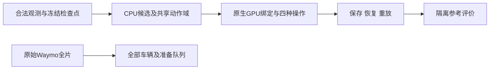

# V43 R4 候选与共享绑定入口

当前研究结果见 [研究状态](../../../../docs/RESEARCH_STATUS.md)，逐项数值及边界见 [独立报告](../../../../docs/autoresearch/v43_ownership_20261028/decision_r4_gpu_20261031/report.html)。此目录的工具只在显式指定的新输出目录运行，不覆盖旧现场。



- `prepare_cpu.py`：只读完整检查点、合法 mask／LiDAR／轨迹，冻结原行候选与任务。`legal_mask.py` 忽略 alpha，仿真逐帧核对训练准备记录；未校准资格保留未知。
- `native_shared_route.py`：继承 V42 原生光栅。一份共享绑定跨时间与全部操作，先运行 `smoke` 保存推理状态，再用新进程 `enumerate --resume` 重放和完整枚举。Scene 在完整私有输入副本中加载，防止写回原 gauge。
- `isolated_reference_scorer.py`：参考只在此进程读取；先校验真实掩码语义及冻结上下文，再算联合操作目标、逐操作硬约束及分母。真实场景无完整反事实时不填 D/C。
- `audit_development_scores.py`：独立核对有限域、目标归一化及约束算术。
- `freeze_legal_responsibility.py`：合法 none 贡献探针。旧候选上的历史探针不是有效主比较；新动作域必须先重新冻结，并按实际非空组数评价。
- `actor_screen/`：全片注释辅助车辆登记、49 帧准备窗口与可视候选导入；准备顺序不等于正式资格、掩码或编辑成功。

```bash
# CPU：使用 motionproj 环境；每次指定未存在目录。
/root/autodl-tmp/envs/motionproj/bin/python scripts/worldsim_v82/v43_ownership_20261028/v43_decision_r4/prepare_cpu.py --output NEW_CPU_RUN

# 原生推理：使用已验证的 drivingeditor 环境。
/root/autodl-tmp/envs/drivingeditor/bin/python scripts/worldsim_v82/v43_ownership_20261028/v43_decision_r4/native_shared_route.py --cpu-scene-dir NEW_CPU_RUN/SCENE --output NEW_SMOKE_RUN --phase smoke
/root/autodl-tmp/envs/drivingeditor/bin/python scripts/worldsim_v82/v43_ownership_20261028/v43_decision_r4/native_shared_route.py --cpu-scene-dir NEW_CPU_RUN/SCENE --output NEW_ENUM_RUN --phase enumerate --resume NEW_SMOKE_RUN/inference_state.pt
```

仿真沿用显式 sensor-oracle 掩码／轨迹与无噪稀疏 LiDAR 角色；真实输入为已有 DEVA 关联及标注辅助轨迹。它们不代表无注释部署或高斯身份真值。查询恢复保留原检查点及优化器状态引用，没有启动训练；小时级训练仍须另做真实训练约十分钟的保存、评价、参数与优化器完整恢复 smoke。
