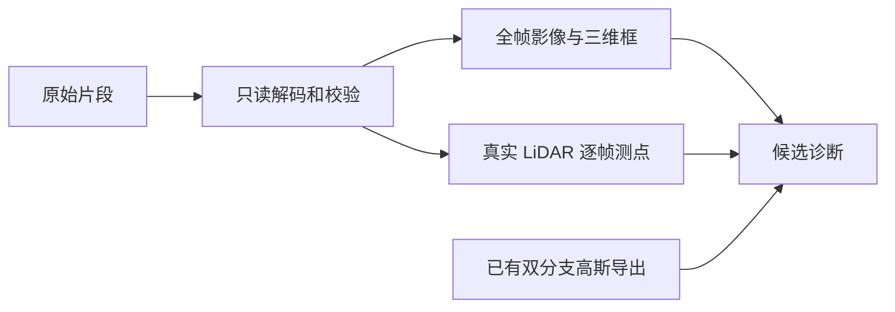

# 逐车时序与编辑前几何诊断

读取原始 Waymo 全片，输出 RGB/三维框视频、完整轨迹、真实框内 LiDAR 与逐帧独立采样。此入口不加载/训练高斯模型，不读取独立编辑参考或学生结果。原始框内测点不是实例分割或完整表面，当前正式资格未知。

主要入口为 `build_media.py --scene waymo-val-035`，再运行 `add_frame_point_views.py waymo-val-035`。在独立运行目录复制代码、固定 `scenes.json` / `raw_inventory.json` 和官方 `pb/`，将对应完整原始 TFRecord 放入 `raw/`。Python 3.11，依赖 NumPy、SciPy、Pillow、protobuf 3.20.3、google-crc32c；FFmpeg / FFprobe 需在 PATH。依赖可装入本目录 `vendor/`，不要改模型训练环境。输出新建 `generated/scenes/<context>/`，已完成现场拒绝覆写。每进程线程数固定 1；并发数按 CPU 配额配置。

`scenes.json` 是本轮 15 场固定身份/准备队列；场景号和 aN 为已登记沟通映射，不能重编号。`raw_inventory.json` 记录原源路径和大小，不是分割真值。完整原片模式逐条验证 CRC / context；212 使用精确字段子集与远端全序列量测缓存，原 CRC / payload / source-point 审计单列。

`ui/` 是实际页面源码快照，需要配套生成的 scenes/ 媒体和 geometry/ 诊断；不把网页代码中的参考数据路径当作仓库已附带大型媒体。`ui_tools_snapshot/` 为本地一次性部署与核验工具，`local_run_snapshot/`、`audit_source_snapshot/` 保留本轮原路径的实际运行脚本。它们是记录，复制到其他位置前需显式修改其输入/输出路径，不自动从旧现场恢复任务。

点云全片显示使用独立 6cm 体素、最多12,000点；逐帧从各自完整 NPZ 独立采样、最多512点。缺标注、真实零量测和缺文件分开。三维投影用提供的图像位姿近似，不补逐行滚动快门或车辆扫描期运动。212 的严格20微米跨运行时控制未过，最大差约0.976毫米；源点身份与计数一致，不改阈值宣称通过。完整 G 的 f_geom / 表面视向 / 历史背景射线仍需另测。

[独立说明](../../../../../docs/autoresearch/v43_ownership_20261028/actor_diagnostics_20261101/report.html)包含分母、缺失与数值边界。原 GPU 小域结果和无效掩码归档未改变。此流程没有训练更新，不能替代小时级训练前实际约10分钟的完整训练状态保存/评价/恢复 smoke。
